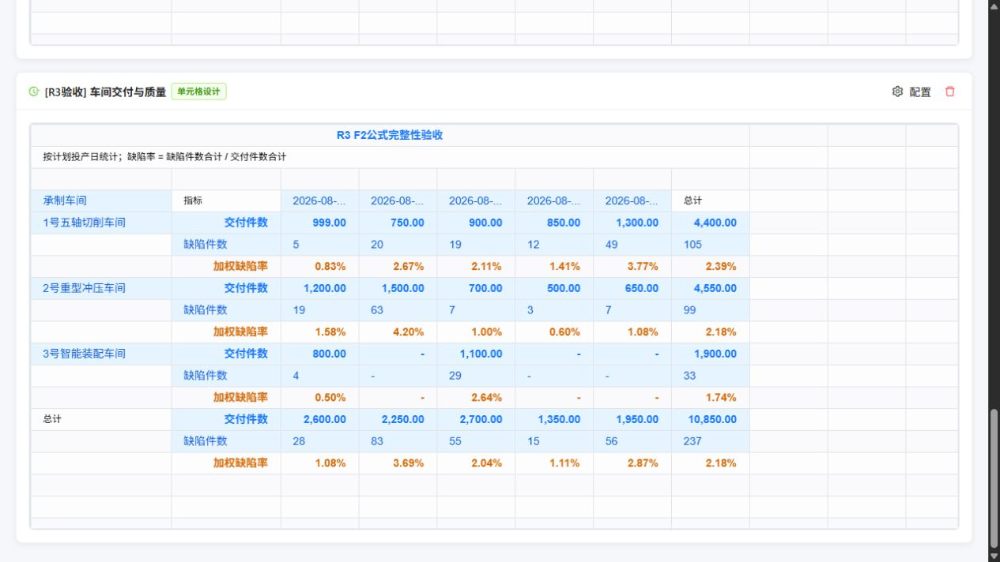
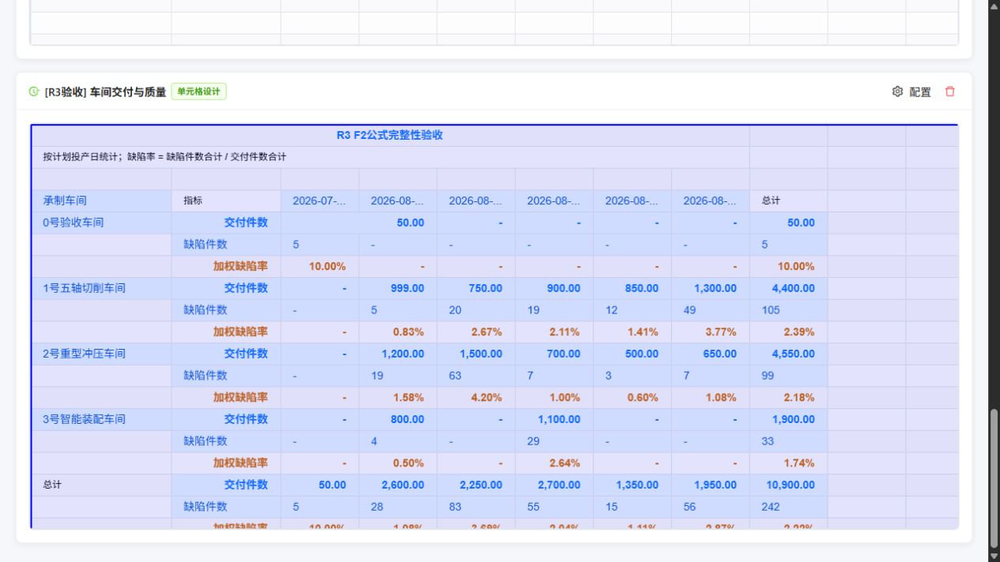

# 主流程专项验收 R3：F2、冷加载、动态覆盖与合并

**历史记录：本篇原FR12项在R4复验中已全部通过。最新设计态刷新与存量键兼容结果见[R4复验](cell-designer-identity-merge-acceptance-r4-2026-10-19.md)及整改清单第23节，不再把本篇7项失败当作当前结果。**

日期：2026-10-19。范围：R3时点的 `micro-bi` 与 `dynamic-data-test` 工作区。汇总见[整改清单第21节](univer-implementation-issues-and-remediation.md)。

## 1. 结论

**F2公式指标完整性和首次打开设计器样式通过；实例覆盖与动态合并尚未全部通过，保持 DCR-01、DCR-02 打开。**

本轮确认上一轮的25个反例已全部修复。新增专项检查覆盖连续编辑、身份作用域和布局迁移，不能用前25项通过替代这些流程。

| 验证 | 结果 |
| --- | --- |
| 库构建与 `npm test` | 155/155通过 |
| 上轮25项RC边界复验 | 25/25通过 |
| 原AC/CX基线 | 15/15通过 |
| 原流程动态专项 | DT 20/20、RX 19/19通过 |
| 主应用构建及manifest | 通过，编辑器JS与CSS按需加载 |
| 新增动态保存专项FR | **12项，5通过、7失败** |
| 主应用真实操作 | **12项，10通过、2失败** |

失败断言归并为第4节的5个具体整改发现，继续挂到 DCR-01/02；不重复登记为7个新问题。DCR-09中程序写入破坏业务公式、DCR-11冷打开缺样式的既有反例，本轮验证通过。

## 2. 验收基准与通过的主流程

从主应用“新建分析看板”附加菜单直接创建全新示例，标题设为 `[R3验收] 车间交付与质量`。采用源JSON重新创建，避免上轮已丢失公式的旧本地模板影响判断。新卡片与历史卡片分别保留。

1. 刷新页面后直接进入单元格设计器，未先进入原面板；Univer工具栏、工作表、字段库样式正常。
2. F2将画布标题改为 `R3 F2公式完整性验收`，保存至原主应用VTable卡片。
3. 三个车间及总计共**4行加权缺陷率**全部保留；总交付10,850.00、缺陷237、总缺陷率2.18%。
4. 重开进入动态预览，将“车间一 × 2026-08-01 × 交付件数”的600改为999；保存后VTable对应格显示999.00，其他指标保留。
5. 在预览中选择C5:D5，通过Univer“全部合并”保存。随后进行事实数据变化验证。
6. 最后取消该合并并直接保存、重开，C5保持独立格，999.00和750.00分别展示；公式指标完整。

覆盖只改变该展示实例，合计与业务公式仍从事实记录计算。单格600显示为999之后，总交付仍为10,850.00，是此设计的口径。



## 3. 真实数据变化验证

保持主页面打开，通过受哈希保护的临时mock变更触发注册表热更新，在同一VTable卡片复制全部内容核对。没有重开编辑器或手工再次保存来触发数据更新。

| 数据变化 | 实例覆盖与数值实际结果 | 合并结果 |
| --- | --- | --- |
| 前插 `0号验收车间`、`2026-07-01`，交付50、缺陷5 | 999仍跟随原车间/原日期，未进入新成员；总交付10,900.00，公式指标为4车间加总计共5行 | **失败：原C5:D5范围没有迁移，合并到新车间/新日期上** |
| 移除新增记录，将原13条源记录逆序 | 新行、新列清理，999仍保留，总交付恢复10,850.00 | 源记录逆序由投影器排序，不代表业务排序DSL的所有组合已验收 |
| 删除被覆盖的车间一全部记录 | 旧车间与999消失，不污染其他成员；总交付6,450.00 | 业务合并的身份迁移仍受上述问题影响 |
| 事实清空 | 旧数值、车间和999清除，标题保留 | 不产生新的默认数据合并 |
| 恢复原13条记录 | 原车间与999恢复，4行公式指标恢复 | 之后执行解除并直接保存，重开保持解除 |
| 原始600改为700 | 人工999保留，事实总交付更新为10,950.00，4行公式指标保留 | 已解除的数据合并未重新产生 |

实际源值变化的持续冲突诊断由FR-08以及原RC-06验证；本轮主界面数据测试证明显示值与事实合计的更新，不扩展为完整冲突处理界面已通过。

事实文件已按字节恢复：SHA-256为 `7ae500177b538d96817ecb646f80804965e0ed2c85f21a7a11d7aa13f59ba125`。测试新增记录、逆序、清空及700修改均未留在mock源中。

## 4. 发现的问题与具体整改方案

### R3-01：连续人工编辑会错误改写事实基线（P1，DCR-02）

复现：事实原值600，第一次预览改为999并保存；重开再改为1000并保存。第二次覆盖的 `originalBaseValue` 被设为999，而不是事实600。随后编译在事实未变的情况下报告“基线999与600冲突”。FR-02/03失败。

代码：`src/cell-designer/syncWorkbookToTemplate.ts:179` 以已经包含人工覆盖的 `gridCell.value` 作为 `baseVal`，第211行重新赋给 `originalBaseValue`。

整改：

1. 展开实例提供独立的事实基线值与当前展示值；事实基线在应用覆盖之前采集。
2. 判断是否产生新编辑时比较当前展示值，保存覆盖时使用事实基线或既有覆盖的原始基线，两者分开维护。
3. 普通连续编辑不能把上次人工值当作事实；只有明确解决源数据冲突的事务才能更新基线。
4. 回归600→999→1000→再次刷新：基线始终为600，覆盖数量为1，事实未变不产生冲突；源变700才产生对应冲突。

### R3-02：消费覆盖没有完整校验role与region（P1，DCR-02）

复现：

- 把全局交付总计改为12345，度量和路径相同的“总计行指标表头”也被改成12345；不再只有目标数值格变化，FR-04失败。
- 保持行列和度量相同，只将实例键里的region改为另一区域，仍能将当前格改为999，FR-05失败。

代码：`src/report-template/expandTemplate.ts:552` 至第561行匹配metric、路径和部分模板信息，没有核对 `parsed.role`、`parsed.regionId`。实例键已携带这些信息，但消费阶段丢失了它们。

整改：生成和消费使用同一完整身份比较器，必须包含当前文档/区域、模板格、role、metric及完整类型化行列路径；键中的模板ID与覆盖对象的模板ID必须一致。表头编辑、业务实例覆盖分别定义操作语义。无法匹配的键进入失效诊断，不能跨区域或跨角色消费。

回归不仅断言目标格为12345，还须断言其他数值格、表头和总计标签未变。

### R3-03：更换分组字段后会按同名成员错误继承覆盖（P1，DCR-02）

复现：先编辑workshop维度中的目标实例，再把行维度换成另一个字段 `dispatch_group`。测试中该字段恰好包含相同成员文字，旧999仍被静默继承，没有迁移或失效诊断，FR-06失败。

代码：`syncWorkbookToTemplate.ts` 将行列路径编码为 `memberKey` 数组；`expandTemplate.ts:557` 同样只比较成员元组。字段/轴定义的业务身份没有进入这一路匹配。

整改：路径携带稳定字段/轴定义ID、类型化成员值及必要的时间分桶定义版本。显示名变化保持身份；换字段、时间分桶含义改变等操作需要明确迁移或诊断。仅有相同成员文字不能视为同一业务实例。

### R3-04：数据增删及指标方向切换后，业务合并仍固定旧坐标（P1，DCR-01）

真实主流程复现：先保存车间一、8月1日至2日交付格的合并C5:D5。前插新车间和7月1日后，原业务格移到D8:E8，但合并仍是C5:D5，落在新车间上；999覆盖本身已正确移动。见主界面截图、FR-09。横纵指标切换也会让旧合并落到不同语义的格，FR-10失败。

代码：`src/report-template/types.ts:144` 的LayoutRule只保存range；`syncWorkbookToTemplate.ts:87` 把mergeData转为绝对坐标；`expandTemplate.ts:667` 原样输出这些坐标。没有将数据区域合并映射到业务实例再重定位。

整改：

1. 采集合并/解除事务时，用当前grid绑定反查选择范围内的模板格、成员路径、度量、role和主格。
2. 数据区域保存语义选择器、主格身份和编辑序号；自由标题/备注块使用其固定或相对锚点规则。
3. 每次数据或布局变化后重新解析语义选择器，校验结果是否仍连续、同父组且可以表示为合法矩形。
4. 无法保持意图时返回明确诊断并保留上次成功发布结果；禁止直接把旧坐标合并到新成员。
5. 分别验证新增更早日期、插入新车间、删除成员、顺序改变及指标横纵切换，比较合并覆盖的业务身份和主格文字，而不只是比较range数量。



### R3-05：取消合并后切换模式会恢复旧合并（P1，DCR-01，关联编辑事务）

真实复现：预览中取消C5:D5合并，名称框显示C5，999与750分格展示；切到模板设计态，再回动态预览，名称框又显示C5:D5，旧合并恢复。本轮主界面R3-UI-11失败。

直接取消后立刻保存、再重开是通过的。失败触发条件是**保存前切换模式**。

代码：`CellReportDesigner.tsx:365` 直接派发SET_MODE；`designerReducer.ts:237` 只提交侧栏草稿。Univer中尚未保存的合并事务没有先落入源模型，之后`currentGrid`重建又使用旧layoutRules。

整改：模式切换前按当前mode、当前grid版本提交工作簿事务；合并/解除等原生命令及时形成语义布局补丁。提交成功后再切换模式和重建网格。模式切换、数据刷新、属性应用和保存统一使用事务提交入口，防止只在底部“保存报表”时读取一次快照。

验收取消→设计→预览→保存→重开，以及取消后立即数据刷新。都应保留解除意图；再次明确合并仍可覆盖先前解除操作。

对照截图：[解除后C5](verification/cell-recheck-2026-10-19-r3/unmerged-before-switch.jpg)、[切换后C5:D5](verification/cell-recheck-2026-10-19-r3/unmerge-lost-after-switch.jpg)、[直接保存重开保持C5](verification/cell-recheck-2026-10-19-r3/unmerge-reopened.jpg)。

## 5. 原整改项的关闭范围

| 原项 | 本轮状态 |
| --- | --- |
| DCR-09中F2改题导致业务公式退化的反例 | 真实主应用与RC-22/25均通过；不再沿用上一轮该失败结论 |
| DCR-11冷打开样式 | 主界面及生产CSS依赖验证通过 |
| DCR-02一次实例覆盖、普通成员增删/源值变化 | 本轮相应正向用例通过；连续编辑及完整身份校验仍未完成 |
| DCR-01空合并不回补、解除后直接保存重开 | 通过；动态语义迁移和模式切换仍未完成 |
| 原25项中的其他已修复反例 | 本轮全部通过；不扩展为所有Excel功能、所有字段迁移与多表组合全覆盖 |

本轮未执行大数据预算、所有异步乱序、全部Excel公式及完整多表编辑组合。当前重点问题集中在DCR-01和DCR-02。

## 6. 重跑命令与证据

库构建结束后再构建宿主，避免并发清理dist。

```powershell
# micro-bi
npm test

# dynamic-data-test
npm run build -- --manifest

# micro-bi：保留历史证据，显式指定本轮输出路径
node scripts/verify-cell-remediation-recheck.mjs doc/verification/cell-recheck-2026-10-19-r3
node scripts/verify-cell-designer-acceptance.mjs doc/verification/cell-recheck-2026-10-19-r3/baseline.json
node scripts/verify-cell-dynamic-roundtrip.mjs
node scripts/verify-dynamic-report-template.mjs doc/verification/cell-recheck-2026-10-19-r3/legacy-template.json
node scripts/verify-dynamic-report-regression.mjs doc/verification/cell-recheck-2026-10-19-r3/legacy-regression.json
```

新增专项当前应返回1，并输出7个失败断言；原脚本的断言保持不变，仅增加可选输出路径。程序专项调用真实快照适配器、编译器和VTable适配器；浏览器专项来自主应用实际操作与VTable复制，二者分别记账。

- [构建、测试与源码指纹](verification/cell-recheck-2026-10-19-r3/checks.json)
- [原25项](verification/cell-recheck-2026-10-19-r3/extended.json)、[原15项](verification/cell-recheck-2026-10-19-r3/baseline.json)
- [新增12项动态保存检查](verification/cell-recheck-2026-10-19-r3/focused.json)
- [主应用12项操作记录](verification/cell-recheck-2026-10-19-r3/browser.json)
- [生产manifest](verification/cell-recheck-2026-10-19-r3/build-manifest.json)
- [F2完整指标复制结果](verification/cell-recheck-2026-10-19-r3/f2-complete.tsv)
- [新增行列](verification/cell-recheck-2026-10-19-r3/added.tsv)、[逆序](verification/cell-recheck-2026-10-19-r3/reverse.tsv)、[成员删除](verification/cell-recheck-2026-10-19-r3/deleted.tsv)、[空数据](verification/cell-recheck-2026-10-19-r3/empty.tsv)、[成员回归](verification/cell-recheck-2026-10-19-r3/restored.tsv)、[源值改变](verification/cell-recheck-2026-10-19-r3/source-changed.tsv)

当前主应用保留本轮新建的R3验收卡片，事实数据已恢复；该卡片保留999展示覆盖，业务合并已解除，三组指标完整。没有用历史已损坏卡片替代新版本验证。
