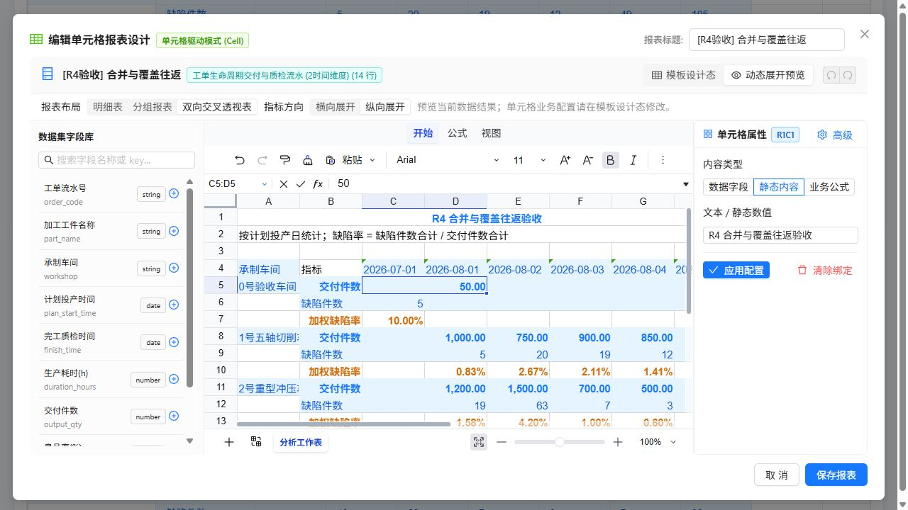

# 第21节整改复验 R4：合并迁移、连续覆盖与身份兼容

日期：2026-10-19。对象：当前 `micro-bi` 与主应用 `dynamic-data-test` 工作区。汇总见[整改清单第23节](univer-implementation-issues-and-remediation.md)。

## 1. 验收结论

**第21节原有反例已通过；扩大到设计态数据刷新及存量键升级后，完整验收仍未通过。** 新发现归并为4项，继续挂到 DCR-01、DCR-02，不按失败断言数量重复登记。

| 本轮重点 | 实际结果 | 通过范围及限制 |
| --- | --- | --- |
| 已保存业务合并随数据变化迁移 | 通过 | 展示态增加更早日期与新车间，原 C5:D5 正确迁移至 D8:E8，人工1000仍跟随原业务格 |
| 取消合并后切换模式 | 通过 | 预览中取消 C5:D5，切设计再切预览，C5保持独立；保存后VTable为独立1000与750 |
| 连续修改覆盖值 | 新键通过，存量键失败 | 新建600→999→1000只有1条覆盖，事实基线仍600；R3旧键再次编辑生成新旧2条覆盖并误报冲突 |
| 总计与度量表头身份区分 | 通过 | FR-04验证总计覆盖不再误改同路径度量表头 |
| 区域身份校验 | 通过 | FR-05验证其他区域的实例键不消费到当前区域 |
| 分组字段身份校验 | 新键通过，存量键失败 | FR-06新字段键更换字段后不继承；旧成员键仍可跨字段同名继承 |
| 设计窗口打开时数据更新 | **失败** | 设计快照丢失原合并选择器，返回预览后把旧范围重新绑定到新成员 |
| 成员文字含等号 | 新键通过，存量键失败 | 旧成员 `A=B` 的编码被误判为带字段的新协议，合法覆盖失效 |
| 冷打开样式、F2与公式完整性 | 通过 | 直接进入设计器样式正常；F2改题保存及两次覆盖后，3个车间及总计共4行加权缺陷率完整 |

## 2. 实际执行与证据

| 套件 / 操作 | 结果 | 证据 |
| --- | --- | --- |
| 库 `npm test`，含构建 | 155/155通过 | [日志](verification/cell-recheck-2026-10-19-r4/unit-tests.log) |
| 主应用 `npm run build -- --manifest` | 通过 | [构建日志](verification/cell-recheck-2026-10-19-r4/host-build.log)、[manifest](verification/cell-recheck-2026-10-19-r4/build-manifest.json) |
| 第21节动态保存 FR | 12/12通过 | [focused.json](verification/cell-recheck-2026-10-19-r4/focused.json) |
| 原RC边界复验 | 25/25通过 | [extended.json](verification/cell-recheck-2026-10-19-r4/extended.json) |
| 原AC/CX基线 | 15/15通过 | [baseline.json](verification/cell-recheck-2026-10-19-r4/baseline.json) |
| 原面板模板动态专项 | 20/20通过 | [legacy-template.json](verification/cell-recheck-2026-10-19-r4/legacy-template.json) |
| 原面板动态回归 | 19/19通过 | [legacy-regression.json](verification/cell-recheck-2026-10-19-r4/legacy-regression.json) |
| 新增快照与历史键专项 | **8项，2通过、6失败** | [persistence.json](verification/cell-recheck-2026-10-19-r4/persistence.json) |
| 主应用真实交互 | **7项，6通过、1失败** | [browser.json](verification/cell-recheck-2026-10-19-r4/browser.json) |

本轮没有另跑第22节列出的10项全周期脚本和8项合并文本脚本，不能将第22节的264/264直接写成本轮结果。各套件存在覆盖重叠，按套件分别报告。新增脚本 [verify-cell-r4-persistence.mjs](../scripts/verify-cell-r4-persistence.mjs) 调用实际展开器、快照同步器与编译器，并经过JSON持久化边界；失败时按实际结果返回1。

历史实例键按R3实际使用的 `encodeMemberTuple(memberKey[])` 协议构造，包含真实区域、模板格、角色及原基线，未故意移除必需字段。该部分是兼容性函数验收，没有冒充浏览器旧卡片操作；当前文档仍使用1.0版本，新消费代码也显式保留旧键分支。浏览器证据来自本轮新建卡片。

源码指纹、执行摘要、事实恢复校验见 [checks.json](verification/cell-recheck-2026-10-19-r4/checks.json)。Git HEAD为 `e8eb3b453f03ea3d9473ac846e2c858eb7e2909d`，验收对象包含工作区尚未提交的整改实现，不能只用HEAD代表实际受测源码。

## 3. 主应用操作结果

新建 `[R4验收] 合并与覆盖往返` 卡片，采用“车间交付与质量”示例，直接进入单元格设计器，F2改画布标题为 `R4 合并与覆盖往返验收`。全程保存到原看板卡片并由VTable展示。

1. 预览中将原车间、2026-08-01、交付件数600改999并保存；重新打开再改1000并保存。VTable只在对应业务格变化，4行加权缺陷率及总交付10,850.00保持完整。
2. 通过Univer工具栏合并 C5:D5并保存。保持展示态打开，追加 `0号验收车间 / 2026-07-01 / 50件 / 5缺陷`，触发数据注册热更新。原业务合并正确迁移至 D8:E8，1000仍属于原车间/原日期，总交付变10,900.00。
3. 恢复事实后重新打开配置，停留在模板设计态。保持窗口打开，再追加同一条记录，然后切动态预览。此时原合并错误落在新车间 C5:D5，主格为50；原业务1000已经在后面的行列中。名称框与选区确认错误合并范围，见下图。
4. 取消该错误草稿，恢复事实。重新打开原卡片，在预览取消合并，切设计再切预览，C5保持独立，1000与750分别展示。保存取消结果后再次核对VTable，4行公式完整。

错误预览没有保存到看板。最终保留的是1000人工覆盖、已取消业务 C5:D5 合并、公式完整的卡片。历史验收卡片保持原状。

覆盖值按现有“展示实例覆盖”口径生效，合计与缺陷率继续基于事实记录计算；因此单格1000与总交付10,850.00并存不计为本轮缺陷。[最终VTable复制结果](verification/cell-recheck-2026-10-19-r4/final.tsv)、[正确迁移截图](verification/cell-recheck-2026-10-19-r4/merge-relocated.jpg)、[取消后模式往返截图](verification/cell-recheck-2026-10-19-r4/unmerge-switch.jpg)。

## 4. 发现与具体整改方案

### R4-M1：设计快照丢失业务合并身份，刷新后重新认领新成员

**P1，DCR-01保持打开；对应 R4-01、R4-02、R4-UI-05。**

实际链路：

1. [CellReportDesigner.tsx](../src/cell-designer/CellReportDesigner.tsx) 第250行生成设计网格，`bindings: []`。
2. [syncWorkbookToTemplate.ts](../src/cell-designer/syncWorkbookToTemplate.ts) 第80～123行从 `mergeData` 重建本表全部合并规则。第87行先置空 `semanticSelector`，设计网格没有运行时绑定，旧规则中的选择器随重建丢失。
3. 模式切换前的 `flushDraft()` 解决了普通取消合并意图丢失，但同时把这个缺少选择器的规则写回文档。
4. [expandTemplate.ts](../src/report-template/expandTemplate.ts) 第706～725行发现缺少选择器，就按当前数据和旧 `range` 捕获并写回。新增成员后，旧C5已属于0号车间，于是规则被静默改为该新业务身份。

整改步骤：

1. 为布局规则明确区分模板/自由区合并与业务实例合并，保留稳定规则ID、sheetId、regionId、主格身份、覆盖身份集合和创建时的数据/布局版本。不要通过“当前在表头上方”来替代完整作用域。
2. 设计态没有运行时绑定时，未发生合并修改的业务实例规则必须原样保留。设计快照只更新它有权解释的模板规则；业务实例增删由明确命令事务或带原始绑定的预览快照提交。不能按坐标重建后覆盖全部规则。
3. 切模式、刷新和保存共用有版本校验的提交入口。提交使用操作产生时的grid与数据版本，刷新后的grid不能解释刷新前的未提交操作。取消合并显式删除对应稳定规则ID，不靠后一次全量快照推断业务归属。
4. 展开/编译阶段保持只读。缺少业务选择器的存量规则应进入一次性迁移：只有原数据/布局版本可验证时才捕获身份；否则给出迁移诊断并暂不应用，禁止按变化后的当前坐标静默补身份。自由区静态规则仍可合法按坐标使用。
5. 保留当前已通过的矩形、覆盖成员和指标方向校验，新增设计往返与刷新组合回归后再关闭DCR-01。

### R4-I1：存量覆盖再次编辑产生双记录和伪冲突

**P1，DCR-02保持打开；对应 R4-05、R4-06。**

旧键行路径只编码成员，新键编码 `field=memberKey`。同一业务格的旧999可正常显示，但再改1000时，[syncWorkbookToTemplate.ts](../src/cell-designer/syncWorkbookToTemplate.ts) 第234行仅按原始 `instanceKey` 字符串查找旧覆盖，无法识别等价身份，直接追加第2条。消费时先写999，再在 [expandTemplate.ts](../src/report-template/expandTemplate.ts) 第588行把已覆盖值999与原事实基线600比较，事实没有变化也报告 `ERR_INSTANCE_OVERRIDE_CONFLICT`。

整改步骤：

1. 加载文档时先迁移旧键，再进入设计器与编译器；使用统一规范化身份对象/键进行查找和去重，不能仅让消费器兼容旧字符串、编辑器另写新字符串。
2. 身份完整包含工作表/区域、模板格、角色、指标、字段/轴定义、类型化成员及时间分桶定义。为键协议增加明确版本，记录迁移状态。迁移应幂等，保存并重开后仍只有1条覆盖。
3. active、冲突状态与 `orphanedEdits` 使用相同迁移入口。保留原始事实基线和显式编辑顺序；无可靠编辑序号的重复历史记录要提供冲突诊断，不依赖数组顺序决定胜者。
4. 冲突判断始终读取本次事实展开的不可变基线，再应用最终一条覆盖。即使存在脏重复记录，也不能与前一条人工值比较并伪造源数据冲突。
5. 以R3原格式文档做600→999→1000→1001、JSON保存/重开与源600→700验证；源未变无冲突，源变化才报告真实冲突。

### R4-I2：用等号猜测键版本，合法旧成员被错误归档

**P2，DCR-02兼容问题；对应 R4-07，新键对照 R4-04通过。**

[expandTemplate.ts](../src/report-template/expandTemplate.ts) 第567～568行用路径是否含 `%3D` 或 `=` 判断字段格式。旧成员本来就可以是 `A=B`，其URI编码包含 `%3D`，因此被误当新格式，999失配并报告孤儿。

整改步骤：使用显式 `identityVersion` 和结构化字段/类型化值元组编码，codec按版本解析并校验，禁止从成员内容猜测协议。旧格式由版本迁移器处理，未知/歧义版本给出诊断；不要尝试依次匹配全部格式扩大命中面。测试成员含 `=`、`%3D`、分隔符、空串、中文以及数字/字符串同字面量，分别验证行轴和透视列轴，保存往返后只命中原实例。

### R4-I3：旧键在更换分组字段后仍同名继承

**P1，DCR-02身份完整性；对应 R4-08，新键对照 FR-06通过。**

旧成员键不含字段身份。将 `workshop` 改成 `dispatch_group`，新字段恰好有相同成员文本时，[expandTemplate.ts](../src/report-template/expandTemplate.ts) 第569～574行的旧元组兜底仍命中999且没有迁移诊断。新键字段比较已修复，不能据此关闭存量配置风险。

整改步骤：

1. 在文档加载及轴定义编辑前，使用保存时的原轴schema将旧键升级，记录原字段/时间粒度等身份；分组字段变更后必须比较完整轴身份。
2. 对已经变更轴schema、无法证明原字段的旧文档，保留编辑但标记待迁移/失效并展示诊断；禁止把当前字段补给旧键后直接继承。
3. 字段展示名变化可以保持稳定字段ID，替换字段、分桶粒度或透视轴定义则触发明确迁移策略。总计/表头、区域及角色检查继续作为共同前置条件。
4. 同步验证行分组和透视列字段的同名替换、成员消失/回归以及多级相同文字，检查目标格、所有非目标格和诊断。

## 5. 下轮回归与关闭标准

| 用例 | 输入与操作 | 必须满足的断言 |
| --- | --- | --- |
| R4-01/02 / UI-05 | 保存业务合并，设计态打开，新增更早日期/车间，返回预览 | 原selector不变；合并移至原业务成员D8:E8；新成员C5保持独立；保存重开与VTable一致 |
| 合并删除与重排 | 同一设计会话内逆序、删除覆盖成员、清空再恢复 | 不重新认领新成员；缺失明确诊断；成员回归按既定策略恢复；取消后往返与刷新不复活 |
| 分组与双向透视 | 在分组/交叉布局重复上两项；方向变化使范围不连续 | 仅正确矩形重放；不连续明确阻断；不覆盖其他组、总计或新透视列 |
| R4-05/06 | 载入R3旧999，连续改1000/1001，JSON保存/重开 | 同一身份仅1条覆盖；原基线600；事实不变无冲突；源变700才报真实冲突 |
| R4-07 | 旧行成员及透视列成员包含等号/转义字符 | 合法编辑能迁移；无误报孤儿；不误命中其他文字相似成员 |
| R4-08 | 旧文档更换行/列轴字段但保留相同成员文本 | 旧编辑不静默继承；有明确迁移/失效诊断；新旧键路径采取同一校验规则 |
| 身份保护回归 | 总计改12345，伪造另一region，同名成员换字段 | 仅目标总计变化；表头不变；跨区域不命中；字段不同不继承 |
| 编译纯度 | 同一JSON文档对不同数据按不同顺序编译 | 编译前后源文档深相等；结果不受前次编译捕获selector影响 |

本轮新增8项脚本全通过、主应用失败场景按上述步骤通过，并保持原FR12/RC25及公式完整性回归通过后，才可关闭本轮4项发现。扩展表中的新增用例是下一轮要求，未标记为本轮已执行。

## 6. 留存与恢复

临时数据只用于验收，`dynamic-data-test/src/mockData.ts` 已恢复为原始字节，SHA-256为 `7ae500177b538d96817ecb646f80804965e0ed2c85f21a7a11d7aa13f59ba125`。临时变更辅助文件在校验后移除。错误设计预览未保存；最终卡片的业务合并已取消，1000覆盖与4行公式完整。

本轮新增验收脚本、证据与文档；原FR脚本仅增加输出目录参数以保留历史证据，未修改业务源码。既有R2/R3报告、截图和用户第22节整改记录继续作为历史资料保留。
