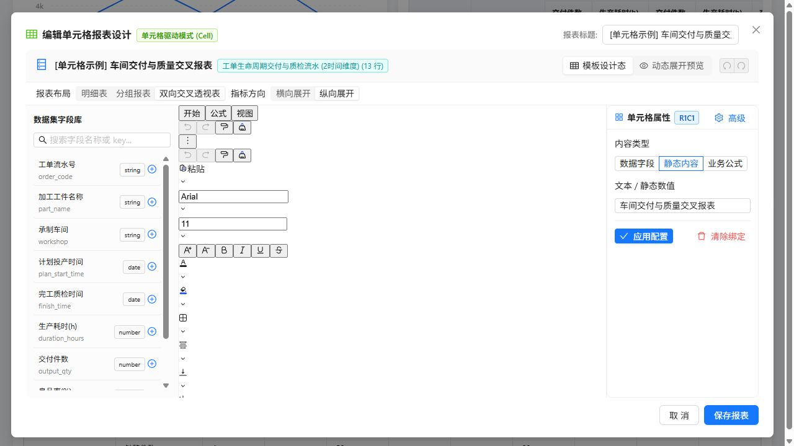
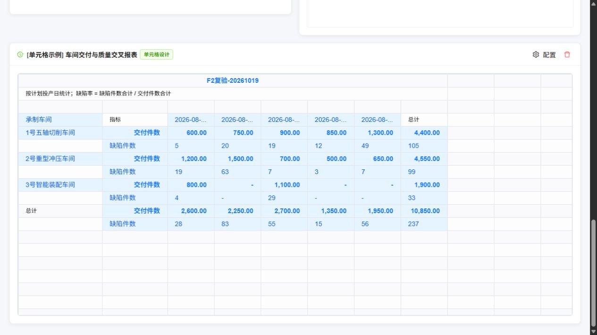

# 单元格报表整改复验（2026-10-19）

本篇是上一轮历史复验记录，其中25项检查在最新R3中已全部通过。当前结论见[R3主流程专项验收](cell-designer-dynamic-acceptance-r3-2026-10-19.md)与整改清单第21节：F2完整性、冷加载样式已通过，动态合并与连续覆盖仍有未完成条件。

## 1. 结论

**复验不通过，不能将 DCR-01～10 整体关闭。** 本轮确认若干基础修复有效，同时复现了保存后业务指标丢失和单元格入口缺样式的新回归。

- `npm test`：155/155 通过。
- 当前 AC/CX 脚本：15/15 通过，保留原断言，仅另存本轮结果。
- 原流程专项：DT 20/20、RX 19/19 通过。
- 主应用 TypeScript + Vite 生产构建通过，生成 manifest。
- 独立边界复验：**25 项中 3 项通过、22 项失败**。这些是失败用例数，合并到原整改项后不按22个新问题计数。
- 原10项中，DCR-06的单格碰撞阻断、DCR-10的生产入口静态依赖隔离通过本轮检查；其余8项仍有未满足的关闭条件。新增 DCR-11：单元格编辑入口没有独立加载 Univer CSS。

代码范围：当前 `micro-bi`、`dynamic-data-test` 工作区，包含尚未提交的新实现。本轮新增复验脚本、证据和文档。原事实数据文件 SHA-256 仍为 `7ae500177b538d96817ecb646f80804965e0ed2c85f21a7a11d7aa13f59ba125`。

最新状态已补入[整改清单第19节](univer-implementation-issues-and-remediation.md#19-单元格报表整改复验2026-10-19)。第18节的“全部闭环”属于整改阶段自测声明，本次独立复验不支持该结论。

## 2. 浏览器中的两个主要失败

### 2.1 直接打开单元格设计器缺少样式（新增 DCR-11，P1）

复现：

1. 刷新主应用 `http://localhost:5174/`。
2. 直接点击原示例卡片“配置”，进入单元格设计器。
3. 工具栏控件沿纵向堆叠，画布区域无法正常使用。
4. 关闭后先打开原面板配置，随后再打开单元格设计器，样式恢复。

根因：`dynamic-data-test/src/components/DashboardEditModal.tsx:10` 导入 Univer CSS，`CellReportEditModal.tsx` 没有同样的导入。两个入口改为独立懒加载后，单元格入口依赖的 CSS 不再由首页提前带入。

生产 manifest 也确认：`CellReportEditModal` 及其静态依赖没有 CSS，原面板模块带有 `assets/DashboardEditModal-CjrtGQ9u.css`。单看 `index.html` 没有 CSS 不能证明编辑入口完整。

整改：在每个独立编辑入口或共用的异步编辑入口导入所需 CSS；保证它与编辑器一起加载。分别从刷新后的页面直接进入 panel、cell、报表工作区验收，不允许依赖先打开另一个入口。



### 2.2 F2标题保存成功，原业务公式指标却消失（DCR-09，P1）

本次为继续独立验证其他功能，先打开原面板加载样式，再进入已有示例：

1. 示例原本有交付件数、缺陷件数、加权缺陷率三个指标。
2. 只用 F2 将 A1 标题改为 `F2复验-20261019`，回车，再保存。
3. VTable标题更新成功，但“加权缺陷率”整组指标消失；原来的2.18%也不再显示。10,850.00和237仍存在。
4. 从 VTable Ctrl+A、Ctrl+C 得到的实际文本也没有“加权缺陷率”，排除了单纯滚动或裁切造成的误判。

因此，“F2文本现在能回写”这一局部修复通过；“保存不损坏其他模板语义”没有通过。

因果链已用安装的真实 Univer SDK 复现：

```text
F2改题 → document更新 → currentGrid重建 → UniverPreview写入模板占位符
→ CommandExecuted也被当成人工编辑
→ APPLY_NATIVE_CELL_EDIT把business-formula分支改成literal
→ 下一轮编译缺少该度量 → VTable整组指标消失
```

关键代码：

- `src/cell-designer/univerEvents.ts:86`：处理 set-range-values 时没有排除现有 `__isProgrammaticWrite` 等程序写入标记。
- `src/cell-designer/CellReportDesigner.tsx:172`：事件直接派发 `APPLY_NATIVE_CELL_EDIT`。
- `src/cell-designer/designerReducer.ts:325`：业务公式未单独处理，进入兜底分支后变成 literal。

RC-22 用真实SDK设置程序写入标记后写一个格，仍收到1条用户编辑；RC-25将真实事件接入当前reducer，确认 `defect-rate.content.kind` 从 `business-formula` 变成 `literal`。这两个反例没有依赖模拟 CommandExecuted 参数。

整改步骤：

1. 所有程序写入、工作簿恢复和网格刷新在同一事务中带来源标记，事件桥接首先识别并排除。
2. 仅对真实用户操作形成源模型补丁；业务绑定、业务公式、工作表公式、静态文字分别处理，不能通过占位符字符串推断新业务类型。
3. 保存前结束输入并提交草稿，读取已提交事务对应的快照；模板、grid、publication和stamp使用同一版本，处理等待期间的新编辑。
4. 将取消加粗、清空值、粘贴、撤销重做作为带显式删除语义的事务；不能只同步快照中非空、为true的属性。
5. 增加主界面回归：只改标题→保存→重开→核对所有度量ID、公式、值和样式；数量应始终为3，不能仅断言新标题存在。



本轮原演示条目保留了这个失败现场，标题为 `F2复验-20261019`；源JSON示例和事实数据仍可用于重新创建基准。浏览器证据见 [browser.json](verification/cell-recheck-2026-10-19/browser.json) 和 [实际复制文本](verification/cell-recheck-2026-10-19/f2-saved.tsv)。

## 3. DCR逐项复验与具体整改要求

| 原编号 | 当前结论 | 已生效的修复 | 尚未满足的要求及本轮证据 |
| --- | --- | --- | --- |
| DCR-01 | 部分修复，保持打开 | pivot空合并的原CX-01通过 | grouped仍无条件使用baseGrid.merges；多层分组清空layoutRules后仍自动合并，RC-01失败。合并/解除要按语义作用域和最终意图统一重放，不能按布局类型走两套规则 |
| DCR-02 | 保持打开 | 手工构造的正确实例键可以消费999，RC-05通过 | UI快照生成的模板ID、区域ID与消费协议不一致，RC-03失败；未改预览就生成85条覆盖，RC-02失败；非法键被当通配符，RC-04失败；基线冲突、归档仍无执行闭环，RC-06/07失败 |
| DCR-03 | 部分修复，保持打开 | 单一条件背景色能重算 | styleRules仍未执行；条件规则中的undefined覆盖原加粗/字体色，空交叉格Number(null)被当0；RC-08～10失败。按显式已定义属性合并规则，区分null与0，补齐优先级及模板格/区域/表作用域 |
| DCR-04 | 部分修复，保持打开 | =1+1能计算 | =SUM(K1:K2)未计算、未诊断，valid=true直接发布公式字符串；=1/0成功发布Infinity；RC-11/12失败。实现支持的引用/函数并检查非有限结果，未支持的表达必须诊断阻断 |
| DCR-05 | 部分修复，保持打开 | 单独列父格循环已检测 | 行、列两套while遗漏混合有向环；RC-13失败。用同一依赖图检查所有边，并验证同表/同区域/业务角色、父格上下文及expand语义 |
| DCR-06 | 本轮单格碰撞阻断通过 | 碰撞产生ERR_REGION_CELL_COLLISION并返回valid=false，RC-14通过；宿主保持上次成功发布结果 | 复杂自由块迁移、合并足迹及多种扩展边界没有在本轮穷尽；通过范围是当前明确的单格碰撞阻断 |
| DCR-07 | 部分修复，保持打开 | 第二张静态说明表已能返回 | hidden属性丢失，无活动区域时静态内容仍丢失；RC-15/16失败。按所有工作表统一编译，保留顺序、隐藏、尺寸、冻结和静态/公式内容，预览与编辑也须使用真实sheetId |
| DCR-08 | 部分修复，保持打开 | 同类型重复主键有错误诊断 | 数字1和字符串1被String化判成重复；缺主键无诊断；校验接受_id而实例展开仍用行号，重排后身份改变；RC-17～19失败。显式主键/组合键、类型化编码、校验和展开必须共用解析器 |
| DCR-09 | 回归失败，保持打开 | 静态标题F2回写成功 | 程序写入误入用户事务并破坏业务公式；原生取消加粗和清空值不能可靠落源；RC-20～22/25及主界面失败。按第2.2节修复命令来源、类型、删除语义和保存事务 |
| DCR-10 | 生产入口静态依赖隔离通过 | manifest静态可达图不含编辑器或UniverPreview；3个入口在dynamicImports中，RC-23通过 | 编辑器相关CSS须独立随对应异步入口加载；此新回归另记DCR-11，不撤销已验证的代码分包结果 |
| DCR-11（新增） | P1，未通过 | — | 首次直接打开cell入口缺Univer CSS；RC-24及浏览器复现。修复每个异步编辑入口的样式依赖，验证访问顺序无关 |

### 3.1 实例覆盖应优先完成的实现步骤

1. 在所有布局的展开结果中生成 `templateCellId`、`regionId`、类型化完整行列路径、role、metricId与基准原值。发布模型也要保留可追溯绑定。
2. 快照/命令采集和编译消费共用同一个实例键生成与解析函数；禁止用metricId替代模板格ID、用r1替代真实区域、解析失败时匹配所有格。
3. 仅为真实修改的可编辑业务实例产生覆盖。未编辑的预览保存应产生0条；只改600为999应产生1条，原基线保持600。
4. 基线来自最新基础矩阵，而非修改后的值。源600变700且人工999未解决时，连续刷新仍报告冲突；成员消失进入归档，回归后再次校验基线。
5. 消费同时校验区域、模板格、role、数据身份及schema含义；改分组、换字段、重排和透视列前插不能仅凭坐标或成员文字继承。
6. 用同一测试执行“真实预览编辑→保存→VTable→数据增删/重排→重开”，同时断言目标格、非目标格、总计、覆盖数量和冲突状态。

## 4. 为什么原有脚本全部通过仍不足以关闭

| 原用例 | 当前断言边界 | 本轮新增反例 |
| --- | --- | --- |
| CX-01 | pivot中清空layoutRules | grouped仍补自动合并 |
| CX-02 | 直接构造一个能匹配的实例键 | 真实快照生成的是另一套键；未编辑也生成85条；无冲突归档 |
| CX-03 | 条件bgColor存在 | 原加粗/字体色被清除；styleRules未执行；null被当0 |
| CX-04 | =1+1结果为2 | 常见SUM引用被当文字成功发布；除零产生Infinity |
| CX-05 | 单独列父格环路 | 行列混合环未发现 |
| CX-07 | 发布表数量等于2 | 隐藏、纯静态文档与其他表属性没有覆盖 |
| CX-08 | 重复字符串id有诊断 | 类型区分、缺主键、_id的重排身份没有覆盖 |
| CX-09 / 新单元测试 | 伪造一次命令或一次标题快照 | 未串起真实SDK程序刷新→事件→reducer→再编译→VTable，遗漏公式被转成literal |
| CX-10 | index.html不包含两个固定字符串 | 不能判断完整依赖图与编辑入口CSS；本轮新增manifest图检查确认JS隔离通过，CSS检查失败 |

应将本轮失败用例固定为整改回归，而不是删改断言使结果全绿。原15项局部断言仍有价值，保留为基线。

## 5. 测试范围与重跑方法

本轮没有再次改动事实数据做浏览器热更新；原数据保持13条。动态变化的纯编译基线、原面板真实SDK专项20+19项通过，不能推导出新cell快照覆盖能在数据变化后保留。RC-03已证明该新覆盖在首次保存消费时就无法命中，完整动态覆盖验收因此仍未成立。

按依赖顺序执行：

```powershell
# micro-bi：先构建库并运行155项测试
npm test

# dynamic-data-test：库构建结束后生成生产依赖图
npm run build -- --manifest

# micro-bi：独立复验，当前预期返回1并输出22个失败用例
node scripts/verify-cell-remediation-recheck.mjs

# micro-bi：原流程专项，输出本轮独立证据文件
node scripts/verify-dynamic-report-template.mjs doc/verification/cell-recheck-2026-10-19/legacy-template.json
node scripts/verify-dynamic-report-regression.mjs doc/verification/cell-recheck-2026-10-19/legacy-regression.json
```

本轮执行现有15项AC/CX脚本时，用同目录临时副本只改输出路径，原断言保持不变，结果另存 `baseline.json`；临时副本在收尾时移除。既有验证JSON保留。

证据：

- [155项测试与构建汇总](verification/cell-recheck-2026-10-19/checks.json)
- [原15项AC/CX结果](verification/cell-recheck-2026-10-19/baseline.json)
- [独立25项复验结果](verification/cell-recheck-2026-10-19/extended.json)
- [浏览器主流程记录](verification/cell-recheck-2026-10-19/browser.json)
- [生产构建manifest](verification/cell-recheck-2026-10-19/build-manifest.json)
- [原20项专项](verification/cell-recheck-2026-10-19/legacy-template.json)、[原19项专项](verification/cell-recheck-2026-10-19/legacy-regression.json)

本轮状态以实际复验范围为准：基础功能已经前进，但原生编辑和动态实例身份仍存在会改变报表含义的缺陷，应先修复再验收完整Excel操作闭环。
