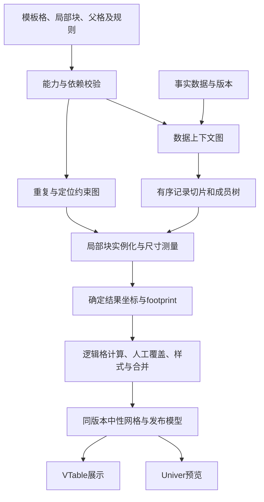

# 单元格驱动展开引擎：取消全局报表布局与指标方向

**最新实施复验（2026-10-21）见[独立验收报告](cell-driven-expansion-acceptance-2026-10-21.md)及整改清单第28节**：基础v2已实现，完整主流程与动态边界尚未通过；本文仍为目标规格，不能将条目存在视为已验收。

日期：2026-10-20。状态：设计修订，待实施；本次未移除业务控件、替换编译器或执行新能力验收。

本文件落实新的产品决策：**单元格驱动模式不再要求用户选择“明细/分组/交叉报表布局”或“指标横向/纵向排列”。报表由模板格的位置、数据行为、扩展方向、父格上下文和局部重复块共同生成。** 原面板配置方式继续保留现有分析布局选择。

本文是[双配置方式方案](dual-mode-report-configuration-design.md)和[动态合并方案](template-dynamic-merge-design.md)的后续修订。涉及cell模式的全局layoutKind/metricDirection要求，以本文为准；旧文档中的配置及回归记录保留其历史含义，不表示新引擎已经上线。

## 1. 为什么需要修改编译模型

当前实现已有单元格属性入口，但执行仍以统一表型为中心：

| 当前代码 | 实际作用 | 对自由设计的限制 |
| --- | --- | --- |
| `CellReportDesigner.tsx` | 工具区修改区域layoutKind和metricDirection | 整个区域共享一个排版选择 |
| `normalizeCellTemplate.ts` | 将格收集到rowDimensions、columnDimensions、measures和detailColumns；指标按全局方向排序 | 模板位置主要影响排序，不能完整决定真实排布 |
| `expandTemplate.ts`的planToNormalizedAxes | 转为共用行列轴模型，生成indicatorsAsCol | 单元格模板重新变成传统透视配置 |
| 同文件expandCellTemplate | 按detail/grouped/pivot选择投影器 | 有限矩阵表型成为排版执行边界 |
| FieldCellContent.expand与CellParents | 已有配置及部分校验 | 当前归一化过程没有把所有格的expand/parents完整编译为局部展开约束；指标父格并不等于所有查询与几何都已按其执行 |

因此这次工作不能只隐藏按钮，也不能“自动识别成三种旧布局”后仍强制全表采用一种方向。原矩阵引擎适合面板模式及严格等价的旧模板优化路径；自由模板需要独立的执行计划。

本次只评估此设计问题，没有重跑第26节动态合并实现记录；文档不据此新增运行失败结论。

## 2. 产品配置方式

### 2.1 保留与取消

| 配置 | 新cell模式 | 原panel模式 |
| --- | --- | --- |
| 明细/分组/交叉全局开关 | 移除，不作为保存必填项 | 保留 |
| 指标横排/竖排全局开关 | 移除，通过放置模板格和局部块决定 | 保留 |
| 字段选择、数据源、格式、公式 | 保留并完善单元格属性 | 保持原有入口 |
| 列表/分组/聚合 | 每个格的数据行为 | 原面板统一配置 |
| 向下/向右扩展 | 局部数据驱动格的行为 | 由原面板布局决定 |
| 父格 | 明确行上下文、列上下文及数据过滤 | 不要求原用户学习 |
| 重复块 | 表示一次重复携带的模板范围、静态标签及跟随关系 | 用户无需新增配置 |
| 示例/快速排版 | 可生成模板格与显式依赖，可继续任意编辑 | 保留分析预设 |

### 2.2 单击基础属性

内容类型提供静态内容、字段、聚合计算、业务公式和工作表公式。字段格配置数据源、字段、列表/分组、分桶、排序、向下/向右展开；聚合格配置SUM等运算与上下文。格式和动态合并沿用原位置。

聚合或业务公式默认不自行枚举数据成员：它在父上下文的交集中计算一次，再由局部重复块复制。它可以同时跟随行和列两条上下文，不用一个含糊的inherit单选表达二维行为。

用户将两个指标放在相邻列，表示它们在一次重复块内横排；放在相邻行，表示竖排；同一区域可有横排汇总卡、竖排明细和二维交叉部分。移动位置只改变几何，不能顺带更换父格或统计口径。

### 2.3 双击高级设置

| 分区 | 设置及要求 |
| --- | --- |
| 数据上下文 | 行父格、列父格及明确的无父格；显示实际生效过滤条件 |
| 重复关系 | 当前驱动格所属重复块、原型范围、组首/组体/组尾和跟随对象 |
| 组合方式 | 同记录对齐、嵌套分组、两个明确上下文的交叉；独立驱动不默认做笛卡尔积 |
| 数据处理 | 本上下文内筛选、分组、排序和空结果策略；仅开放执行器已支持的组合 |
| 自由内容定位 | 固定、每个成员内重复、跟随某块底部或右侧；冲突时拒绝覆盖 |
| 计算范围 | 当前交叉切片、指定祖先组、指定块全量；比例总计重新求分子/分母 |
| 合并 | 覆盖所属重复组、相邻同值、关闭和局部取消例外 |

基础操作可给出默认重复块及父格建议，但必须可视化范围并经应用落源。自动建议在创建或明确重新推断时执行，不能在每次数据刷新按相邻坐标改变关系。高级配置不符合能力时给出具体诊断，不能保存不执行的属性。

### 2.4 快速排版的正确定位

“明细表”“分组汇总”“交叉示例”可以作为创建模板的快捷操作。操作完成后展开为普通格、块与父格依赖，不留下一个控制所有后续排版的隐藏表型参数。可选“横向排列所选格/纵向排列所选格”是一次局部编辑事务，不是全表metricDirection。

## 3. 五层模型

以下为拟新增设计，不是已存在的API；具体接口以实现阶段schema设计为准。

| 层 | 源信息 | 运行结果 |
| --- | --- | --- |
| 模板格 | 稳定templateCellId、位置、内容、样式 | 一个或多个业务实例 |
| 数据上下文 | 数据源、列表/分组/聚合、父格、过滤/分桶/排序 | 带完整路径的记录切片与成员树 |
| 重复块 | 原型范围、驱动/跟随关系、局部跨度、定位策略 | 有序的重复块树与局部坐标 |
| 工作表布局 | 固定内容、块间约束、行列尺寸、碰撞规则 | footprint和实例到结果坐标的映射 |
| 发布 | 逻辑值、格式、动态合并规则及取消例外 | Univer投影、PublishedReport、VTable展示 |

区域继续存在，用于数据源、事务/碰撞边界、局部计算及权限能力，不再必须携带报表布局类型和指标排列方向。一个工作表可放多个显式区域/块，计算与几何分别校验，不用“自由”意味着无限制自动推断。

### 3.1 数据与几何分开定义

数据父关系决定过滤切片，重复归属决定跟随哪个实例，几何约束决定放在哪里。三者可关联但不能混为一条“左父格=往左合并”规则。

同数据集的子分组在父记录切片内枚举，度量在行/列上下文交集中计算。跨数据集不能直接用同名字段继承过滤，首期要求明确关系/参数映射执行器，否则禁止跨源父格；保持每格显示实际数据来源。

静态标签和业务公式也可属于重复块，不能因为它们不是field内容就固定在工作表原坐标。单格span和重复范围分别表达：span描述一个实例占几格，重复块描述一次枚举要携带多大的模板原型。

### 3.2 同记录对齐与二维交叉

明细中的订单号、日期和数量应共享同一个记录驱动，以稳定主键对齐复制；三个列表字段不分别扩展后产生三重组合。不同粒度的列表没有可证明对齐关系时配置错误，不以“取第一条”或按数组下标兜底。

行分组与列分组同时存在时，只有明确同时依赖两者的交叉内容才枚举行×列上下文。空交叉按配置输出空/0，不为不存在的数据创建事实记录。独立重复块默认互相独立，不因画布相交隐式关联。

## 4. 同一报表的两种排布如何表达

### 4.1 指标分三行

| 模板位置 | 配置 |
| --- | --- |
| A5 | 车间分组、向下枚举，生成每个车间的组上下文 |
| C4 | 投产日期分组、向右枚举，日期作为列上下文 |
| C5 | 交付SUM，行父格A5，列父格C4 |
| C6 | 缺陷SUM，行父格A5，列父格C4 |
| C7 | 缺陷率，使用同一交集的缺陷SUM/交付SUM |

局部原型中车间的一次内容高度包含5～7行，日期每次内容宽度为1列。车间组复制这一组体；每个日期交叉位置保留三个指标在模板中的相对行位置。A5按所属组footprint覆盖对应行，日期格根据自身列组footprint呈现。

### 4.2 指标分三列

交付、缺陷、缺陷率分别放B5/C5/D5；日期标题位于B4:D4的模板跨度内，行父格仍是A5、列父格仍是日期驱动格。一次日期原型宽3列，车间组体高1行。数据扩展后每个日期重复这3列，车间按行重复。

这是重排局部原型和更新其几何约束的一次编辑；不改字段、度量ID、行列业务上下文，也不设置全局方向。原来按车间上下文取消的覆盖合并继续保留，暂时没有多行范围时仅不生成merge，切回三行模板后仍受该取消记录约束。

### 4.3 允许同页混合

同一车间块内可以在左侧放竖向三项汇总，在右侧放订单明细，在下方放备注；另一个区域可以放横向日期交叉。各块有清楚的定位/跟随对象和上下文，不能为了发布而重新铺平成全局measures数组。

## 5. 展开与布局执行流程

### 5.1 校验与上下文求值

分别检测数据父格图、公式依赖图和几何跟随图的环；跨图引入尺寸/结果依赖时也检测混合环。校验失效模板格、跨区域/跨源关系、非法父格角色、数据源缺失及重复明细主键。

明确计算作用域：当前记录、当前组、两个父上下文交集、指定祖先组或整个数据块。过滤先作用于事实，再分组/聚合；比例总计在指定事实切片重算，不求各子比例之和。分组排序只调整该父组的兄弟节点，稳定tie-break使用业务键；不会改变身份。

### 5.2 重复块尺寸与摆放

1. 将静态坐标视为模板原型坐标，推导每个驱动所携带的明确块范围，包含已声明跟随内容；空白占位只有属于该原型时才计入跨度。
2. 每个父上下文内，自内向外实例化和测量子块。父级跨度依据子块实际高度/宽度、模板固定间距和padding计算，不使用“指标数量×统一行高”替代自由布局。
3. 同一行/列共享的重复车道按约束对齐。例如同行两张明细块需跟随同一父重复，父实例高度取两者所需高度的最大值，下一父实例从该占用边界后开始，不把它们无条件逐个累加。
4. 先确定局部尺寸，再按稳定顺序自外向内摆放。双轴区域采用共享的行车道高度和列车道宽度，按需要的最大尺寸对齐每个交叉tile；不让同一日期的各行各自算出不同列坐标。
5. 正交扩展可以共享明确声明的交叉内容tile，但不是两块各自复制同一模板格。每个实例拥有唯一owner与完整上下文，交叉单元格生成一次；无法证明所有权/对齐的相交范围报错。
6. 构建占用索引，校验固定内容、不同区域、局部块与合并跨度冲突。拒绝覆盖，不能靠后写格覆盖先写格“解决”碰撞。

只把每格复制N次再把整表插入行列，不足以支持两个独立扩展和嵌套变化；需要显式块图及统一坐标求解。首期采用有限、确定、可解释的约束组合，不宣称任意约束一定有解。

### 5.3 自由文字、组尾和空数据

| 对象 | 定位规则 |
| --- | --- |
| 报表标题 | 固定在模板原位置，或显式锚定到块上方；跨度变化另有明确规则 |
| 组内标签/说明 | 属于组原型，每个父组复制一次 |
| 每组小计 | 绑定所属组及组尾位置，随该组实际高度移动 |
| 报表总计/页尾备注 | 跟随指定块结束后放置，统计scope与几何锚点分别保存 |
| 旁边独立摘要 | 固定或跟随块右侧；数据变宽冲突时诊断，不被静默挤走 |

空数据策略按块显式配置隐藏组体、保留空原型或显示提示。标题、组尾和总计是否保留有明确规则；不得用“数据为空”清空模板、合并策略或取消记录。

### 5.4 公式与格式

业务公式优先引用稳定模板格/度量ID和作用域，跨实例引用必须声明当前实例、父组、全块聚合等选择器；一个模板格展开成多个实例后不能对裸引用默默取第一格。

工作表公式由能力表执行；需在坐标解析后建立公式依赖，支持范围随重复块生成的明确规则。暂不支持的动态引用/循环明确阻断，不能把原公式按最终坐标猜移。业务汇总不依赖Univer才可重算，展示端仍不加载Univer。

## 6. 稳定身份、动态合并与数据变化

实例身份使用模板格/块的稳定ID、区域/数据源契约、完整类型化父组/行列上下文、明细主键及轴定义版本。结果坐标、排序名次、当前跨度和指标摆放方向不进入业务身份。

移动格或局部横纵排版不应生成新metricId；同一度量在不同位置出现时共享语义定义并保留各自templateCellId。重排时必须移动原对象而非删除重建，才能保留覆盖、样式与取消例外。

动态合并方案继续有效，但来源由旧metricDirection推算改为新布局引擎的真实footprint：

- 分组覆盖对目标所属重复组及标签跨度求值，支持组内混合指标、嵌套明细与分片；不只覆盖“指标个数”行/列。
- 横纵相邻同值在最终坐标和逻辑值确定后扫描，沿用户指定的物理轴，仍遵守父组、区域、角色、指标与边界约束。
- 关闭策略对未来实例同样生效；成员例外随语义组；明细实例例外随主键，不因排序、插入或模板重排失效。
- 取消合并只改呈现意图，不删除底层逻辑格、公式和绑定。规则/例外不从Univer当前mergeData全量重建。

原动态合并文档中的“切metricDirection”新引擎用例改为“调整局部原型中指标位置/跨度并往返”；历史旧引擎的方向切换回归仍保留。两个场景均需验证，不能把旧用例删掉来表示新功能通过。

## 7. 保存、预览和正式消费

模板源保存格、数据上下文、重复/定位约束、规则及取消例外；发布缓存保存当前版本的坐标、逻辑值和合并范围。Univer工作簿是编辑投影，不是独立布局真相。

移动/插入/删除行列、重排局部块应转成明确模板事务：移动格保持其ID并更新相关几何约束，删除父格检查依赖，新增格不默认接管旧业务身份。复杂的SDK原生命令尚不能解释时，应限制该命令并提供受支持的模板编辑操作，不能让画布看似改完但保存回到旧布局。

切设计/预览、刷新和保存前提交同一版本的草稿及命令；异步编译/公式等待绑定template/data/layout版本。旧结果不能覆盖新布局，保存成功必须使源模板与publication一致，失败保留草稿。

同一布局求解结果生成BiGridModel/中性实例索引，再输出Univer与PublishedReport。VTable继续消费实际格和merge，不识别“报表属于哪种类型”，不自动重新排版。共享数据查询/聚合原语可以复用，布局不重新降级成旧统一矩阵。

## 8. 兼容与实施顺序

### 8.1 新旧文档明确区分

拟新增`cell-expansion-v2`能力和对应版本化文档；具体schema号由实现阶段统一制定，不复用已有1.1仅动态合并能力标记来冒充新展开引擎。

旧cell模板继续由兼容引擎解释。其layoutKind和metricDirection只在旧协议/迁移适配器中保留，不强制新设计器继续展示；用户可预览旧结果并显式转换。新模板不要求这两个字段，旧reader遇到新能力要拒绝降级写回。

迁移根据旧模板保存的规则构造明确的驱动、父格、重复块、指标位置、总计块与例外映射，不依赖当前样本数据反推布局。先给出迁移前后预览差异，保存原包；确认后保存新文档。无法无损解释的旧模板保持原引擎并说明原因，不能静默改变结果。

### 8.2 分阶段交付

| 阶段 | 实施内容 | 门槛 |
| --- | --- | --- |
| CE-01 | 定义新schema、能力标记、格/驱动/重复块/锚点及实例身份；补校验与reader路由 | 新文档无全局表型必填项，旧协议不变 |
| CE-02 | 实现上下文图与数据求值，复用现有过滤/分桶/聚合原语；明确记录对齐和交叉交集 | 父格、list/group/aggregate真实决定计算，非仅存储 |
| CE-03 | 实现块实例化、嵌套尺寸、双轴对齐、固定/跟随位置和碰撞检查 | 位置和局部块真实决定排版，同页混合可用 |
| CE-04 | 设计器增加块范围/扩展箭头/父格/跟随可视化；移除新模式的两个全局开关 | 单击/双击/移动有明确事务，配置预览一致 |
| CE-05 | 合并resolver接收真实footprint；迁移覆盖、取消例外及局部样式 | 数据和局部重排后身份不丢，不按旧方向推跨度 |
| CE-06 | 接原弹窗原子保存、数据重编译及VTable发布；补旧文档兼容转换 | 真实主流程可保存重开，无Univer展示依赖 |
| CE-07 | 全部新专项、旧引擎回归与性能/上限验证，输出证据 | 再切换新建默认入口，不能先删控件后留旧引擎强制推断 |

建议新增独立cell上下文/布局编译模块；不要把所有逻辑继续堆入planToNormalizedAxes和旧projector。复用现有数据计算、实例覆盖、样式、合并决议与发布适配，减少无关重写。

严格等价的模板可以选择优化为旧执行计划，但要能证明格、上下文、位置与规则均等价；优化失败须有新布局执行路径或明确能力诊断，不能悄悄重新加入全局表型约束。

首期完成单数据集内局部明细、分组、双父交叉及同页混合；跨源关联、复杂动态Excel引用分独立能力逐项开放。几何配置错误仍需校验，可自定义不表示任意重叠都能自动排出正确报表。

## 9. 新验收用例（均待实施后执行）

| ID | 操作 | 必须满足的结果 |
| --- | --- | --- |
| CE-T01 | 新建纯格驱动模板，不填写layoutKind/metricDirection | 可配置、预览、保存重开与VTable展示，不暗中补默认表型 |
| CE-T02 | 同一记录块绑定订单号、日期、数量三个list格 | 按同一主键对齐，无独立列表笛卡尔积 |
| CE-T03 | 工厂→车间→明细嵌套，子记录数量不同 | 同名不同父组分离；每组高度正确，下一组不被覆盖 |
| CE-T04 | 车间向下、日期向右，三个聚合/公式格配置双父 | 每个交集计算正确，空交叉策略明确，每个tile只生成一次 |
| CE-T05 | 将三个指标从三行移动到三列，保存再移回 | 新位置决定排版，ID/口径/实例覆盖保持，无全局方向控制 |
| CE-T06 | 同页放横排摘要、纵排明细及日期交叉块 | 局部排布独立，不被单一measures方向覆盖 |
| CE-T07 | 改列表为分组，或改SUM为AVG，仅改单格配置 | 实际枚举/统计改变，非仅标签变化，无需切全局布局 |
| CE-T08 | 保持几何位置不变，更换父格上下文 | 过滤与聚合范围按新关系变化；不依赖相邻坐标 |
| CE-T09 | 移动模板格但不改父格 | 数据作用域保持，只有几何变化；非法碰撞有诊断 |
| CE-T10 | 多个子块同时变高/变宽 | 父级测量确定，同行/列车道对齐；无迭代漂移 |
| CE-T11 | 组内小计、块后总计、固定标题和旁边摘要 | 各按明确scope和锚点定位，不把比率求和；扩张冲突不静默覆盖 |
| CE-T12 | 数据增删、乱序、分组排序、列成员增删 | 稳定身份不变；位置/跨度重算，旧异步结果不覆盖最新布局 |
| CE-T13 | 清空数据再恢复，保留/隐藏空块两种配置 | 只按策略清空结果，源模板、关闭状态和例外保持 |
| CE-T14 | 分组覆盖与横纵同值，局部横纵重排后往返 | 用真实footprint合并；取消成员/实例不复活 |
| CE-T15 | 新增指标、插入明细、移走被取消成员再恢复 | 组例外覆盖新增子格，实例例外按稳定主键保留 |
| CE-T16 | 父格环、公式环、跟随定位环、跨关系混合环 | 配置定位到具体依赖，阻止无解编译，不无限展开 |
| CE-T17 | 无主键明细、独立列表粒度不一致、未声明跨源关系 | 明确诊断，不用行号对齐，不隐式串值 |
| CE-T18 | 业务公式引用多实例格和组/全量汇总 | 显式scope生效；含糊单格引用拒绝，不取第一格冒充正确 |
| CE-T19 | 旧1.0/1.1不同表型模板迁移、重复迁移、reader降级 | 无损或明确拒绝；源包可恢复，覆盖与取消映射完整 |
| CE-T20 | 真实主应用配置/移动/预览/保存/重开/数据热更新 | 单一源模型，Univer与VTable坐标、文本、公式及合并一致 |
| CE-T21 | 深冻结模板重复编译，StrictMode重复计算，晚返回结果 | 编译纯函数、输出确定、无源回写或跨实例污染 |
| CE-T22 | 测试大数据、两轴成员乘积和深层重复上限 | 编译前估算实例数并限制，记录性能；不以界面卡死代替诊断 |

旧panel及旧cell引擎的验收继续运行；新用例不能用旧模板矩阵投影器的成功代替。证据须包含源模板、语义实例索引、实际坐标、合并例外、保存包和VTable数据。以上22项是设计验收要求，本次未标记执行通过。

## 10. 完成标准

用户能够只通过单元格属性、位置和局部块生成不同结构，不必选择全局报表布局/指标方向；相同工作表中可混合局部结构；父格与扩展配置实际执行。数据变化、模板重排、取消合并和保存重开后，语义身份稳定，结果由VTable正确消费。

只有这些条件满足后，才能把新cell模式作为默认入口。单纯删掉两个控件、自动猜一个旧表型或把未执行属性存进JSON，都不构成本次产品决策的完成。
