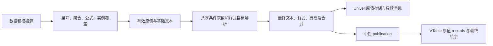

# 第37节条件规则实施与验收

日期：2026-10-26。状态：**功能已实现并完成本次验收**。对应[整改清单](univer-implementation-issues-and-remediation.md)第37节及[原方案](conditional-rules-optimization-plan-2026-10-26.md)。

2026-10-27补充：按用户最新要求，旧条件字段直接忽略，不校验、不报错、不阻断预览和保存；原来的明确拒绝逻辑已移除。以下测试数量为10月26日基线，最新373项回归及浏览器记录见[本次修正](ignore-legacy-conditional-fields-2026-10-27.md)。

2026-10-28补充：模式二及其reducer已删除，条件能力继续由模式三与共享引擎使用；当前入口、测试退役及最新验收见[模式二下线记录](mode2-retirement-and-guided-editing-2026-10-28.md)。下文自由设计器的接线表为实施历史。

后续高级配置按角色和值类型分类，支持日期比较与实际左值类型筛选；当前入口和属性归属见[高级配置约定](advanced-cell-settings-ownership-and-acceptance-2026-10-29.md)，437项阶段回归保留在整改清单第47节及其验收JSON中。以下截图和数量保留其原验收日期。

保留原字段面板、单元格设计器和模式三入口。条件规则现已接入实际模板、动态预览、保存重开和VTable。现有告警条件有效，本次扩展配置能力；不提供旧条件配置迁移或回读。

## 1. 使用方式

1. 在模板中双击字段、指标、公式或静态格，打开原“单元格高级配置”。
2. “条件规则”页可添加、命名、复制、删除、上移/下移及启停多条规则，设置全局执行序和命中后停止。
3. 每条规则可添加条件和子组，切换AND/OR；支持数值、文字、集合、空值判断，以及本格值、显示尺度、基础文本、同上下文字段和同切片指标。
4. 样式、替换显示文本可同时启用。文本支持固定文案、显式空字符串及`{value}`、`{formatted}`、`{fieldLabel}`、`{rowLabel}`、`{columnLabel}`。
5. 普通“样式与排版”和条件动作共用“仅单元格/整行”、文字/背景调色盘，支持可视化选色、HEX/RGB、预设、最近12色、无填充和恢复基础颜色。
6. 点击“应用配置”一次提交源历史，再保存报表。模板态直接保存即可生效，也可先检查动态预览。

试算显示目标、命中、最终触发、被拦截、影响行/格、跳过合并数，以及原值/基础文本/最终文本样本。合法0命中可保存；非法条件、颜色、引用、树结构、角色或重复ID阻止提交。临时取消字段或无法唯一定位时保留规则并休眠。

“整行”覆盖所属报表的实际业务列，包含开启的末尾行总计列，不取工作表预留宽度。纯静态格可指定列范围，多区域静态格需指定所属区域。文本替换只作用于命中的源格实例。

## 2. 保存和执行契约

条件唯一入口为`document.presentationRules`，首版`version=1`，保存`revision`、稳定ID、全局order、sheet/region/源格/字段/角色目标、完整规则数组及可选otherwise动作。规则包含name、enabled、order、predicate、style、text和stopIfTrue。

普通样式使用`document.styleRules`，沿用同一视觉动作语义。预设保存`presetId`及明确样式补丁，自定义颜色规范为HEX；未声明、恢复基础颜色和无填充分开处理。范围切换更新同一条样式记录。完整示例见[交付状态与多条件规则模板](../examples/cell-reports/workshop-delivery-status-rules.json)，使用现有数据源`industrial_lifecycle_orders`。

旧`document.conditionalRules`及单格顶层/content的`conditionRules`直接忽略，包括空数组、非空数组或其他旧数据；不校验、不执行、不迁移，也不阻断预览和保存。仅校验和执行新`presentationRules`，缺省时按无条件规则处理。生成器、示例和当前夹具继续使用新结构。



所有条件读取同一份有效原值/基础文本，前面的文案不进入后面的比较。默认命中后停止，显式继续时才执行后续规则。同层按规则集order、规则order和稳定ID排序。

样式层级：生成基础→普通整行→普通单格→条件整行→条件单格。每次从基础重新合成，禁用、删除或不再命中时清理前次文案和行颜色。

字段条件读取当前事实交集；多记录原始字段必须声明sum/avg/count/min/max，不能任取第一条。结构切换按源ID及字段、角色、区域等身份重定位，有歧义则休眠。

## 3. 原值、公式及合并保护

`BiGridCell.value`、`PublishedCell.v`及工作簿`v/f`保留有效原值和公式；基础文本、最终displayText及displaySource分开保存。文本动作不生成数值覆盖。

Univer使用实际安装的`SheetInterceptorService`/`CELL_CONTENT`只读呈现拦截，在创建工作簿后注册。只处理本项目元数据并核对当前原值；原生公式依赖及save快照继续使用原值。初次装载和增量刷新策略相同。

VTable实际使用rawRecords，fieldFormat及合并文本读取最终文案，展示端无需Univer，也不再求值条件。按2026-10-27最新要求，展示态、模板设计态和动态预览均移除顶部“复制显示内容/复制原始值”操作栏，不保留26像素占位条。表格原有能力不变，本轮不继续扩展复制功能；后续方案另行处理。详见整改清单第40/41节。

跨行合并仅在全部覆盖位置的最终样式一致时整体着色；部分覆盖保留原样式，计入跳过统计。不为着色拆分手工/分组合并。相邻同值合并只在现有候选内按原值、最终文本及样式细分，不因600和650都显示低产而新增合并；取消合并意图保留。

换行和字号参与共用自动行高，显式行高保留。Univer和VTable消费同一行高；VTable接入rowHeightConfig、显式换行及一致的4/6像素内边距。验收发现默认内边距导致大字号文案截断，已修正；24号两行文字的自动行高为66像素。[最终画面](verification/conditional-rules-acceptance-2026-10-26/30-wrapped-vtable-final.png)。未被引用的28/29号过程截图已在项目清理中移除。

## 4. 代码落点

| 模块 | 实现 |
| --- | --- |
| presentationTypes / presentationRules | 新类型、校验、身份解析、条件树、上下文、四层样式、合并边界、统计、自动行高 |
| cellExpansionEngine / expandTemplate / compileCellReport | 统一共享阶段，覆盖明细、分组、透视及纯静态路径；发布保留原值和最终呈现 |
| PresentationRuleEditor / StyleEffectEditor | 列表、AND/OR、文本、范围、调色盘、试算；拖动颜色只改草稿 |
| CellAdvancedSettings | 接入原高级设置，父格独立页，确认时原子提交规则和普通样式 |
| HybridCellDesigner / CellReportDesigner / reducer / hybridTemplateState | 根源状态、保存重开、字段休眠、撤销重做；模式切换等待编辑落地 |
| syncWorkbookToTemplate | 比较原投影与真实样式差异，防止派生颜色/文字冻结为源；原生修改另记显式样式补丁 |
| adapter / buildBiGrid / UniverPreview | 原值及公式、只读呈现、复制口径、增量清理和行高同步 |
| gridAdapter / styleAdapter / ReportTableView | rawRecords、最终绘字、显式false/颜色清除、行高/换行、两种复制 |
| test/presentation-rules.test.mjs | CR-01～38及行高、多区域静态行样式补充用例，共40项 |
| scripts/verify-presentation-rules.mjs | 示例数值验证及1万记录/4万格的共享求值器样本测量 |

新增可选peer依赖`@univerjs/sheets`，宿主增加dedupe。当前实测core/presets/sheets均为1.1.0；未替换React、AntD、VTable或升级整套Univer。

## 5. 验收结果

| 层次 | 结果 | 证据 |
| --- | --- | --- |
| 库构建 | ESM、CJS及声明通过 | [汇总与源码指纹](verification/conditional-rules-acceptance-2026-10-26/checks.json) |
| 全库测试 | **371/371通过**，本次专项40项 | 同上；`npm run test:only`可复验 |
| 示例应用 | TypeScript/Vite构建通过，原有大包提示保留 | 同上 |
| 浏览器及SDK | **17/17通过**，配置经原产品UI，SDK实验单独标注 | [逐项记录](verification/conditional-rules-acceptance-2026-10-26/browser.json) |
| 本机纯TS样本 | 1万记录/4万格、3条规则；初次91.31ms、仅改阈值70.27ms、一个有效值变化78.04ms | [测量](verification/conditional-rules-acceptance-2026-10-26/performance-and-example.json) |

该测量只覆盖共享求值器，未据此宣称浏览器大表滚动、所有Excel菜单或完整xlsx条件规则导出的容量与兼容性。

### 5.1 规则、颜色和公式

| 条件 | 样式 | 文案 | 明细13条 |
| --- | --- | --- | --- |
| ＜700 | 整行红字，自定义背景#FFE6E6 | 低产 | 5 |
| ≥700 AND＜1000 | 单格橙色 | 关注 | 4 |
| ≥1000 | 单格绿色 | 正常 | 4 |

低产影响5行/20格，仅5个交付格替换文案。实际RGB调色盘输入255/230/230，规范保存为#FFE6E6。中间条件切为OR后，在前序停止约束下为5/8/0；取消草稿保留AND。

保存、刷新和重开恢复全部三条规则。复制、移动、删除、启停及取消草稿经实际列表验证。Ctrl+Z恢复原低产文本5条，Ctrl+Y恢复修改后的文本5条。普通样式实测整行→单格及背景回显。

显示复制及VTable实际Canvas原生复制均为5/4/4。原值仍为13个数字、合计10850。源格F2录入`=SUM(D4:D16)`，预览和VTable均算10850。

独立公共SDK实验：600显示低产或空字符串，save中的原值均为number 600，`=A1+1`均为601；取消替换恢复600。[原生公式证据](verification/conditional-rules-acceptance-2026-10-26/final-native-formula-proof.json)。该项是技术实验，未冒充UI配置。

证据：[调色盘](verification/conditional-rules-acceptance-2026-10-26/06-custom-rgb-picker.png)、[预览](verification/conditional-rules-acceptance-2026-10-26/07-final-preview.png)、[VTable](verification/conditional-rules-acceptance-2026-10-26/09-saved-vtable.png)、[重开](verification/conditional-rules-acceptance-2026-10-26/11-reopened-rules.png)、[原生显示复制](verification/conditional-rules-acceptance-2026-10-26/10-vtable-native-copy.tsv)、[原值复制](verification/conditional-rules-acceptance-2026-10-26/10-vtable-raw.tsv)、[普通整行](verification/conditional-rules-acceptance-2026-10-26/26-normal-row-style.png)、[普通单格](verification/conditional-rules-acceptance-2026-10-26/27-normal-cell-style.png)。

### 5.2 数据和结构变化

不打开编辑器或重存配置，通过隔离浏览器响应夹具改变事实，验证已保存规则重算。

| 明细场景 | 事实数 | 低产/关注/正常 | 原值合计 |
| --- | --- | --- | --- |
| 基线 | 13 | 5/4/4 | 10850 |
| 新增交付321及新日期/车间/工件 | 14 | 6/4/4 | 11171 |
| 删除原首车间全部事实 | 8 | 3/2/3 | 6771 |
| 8条逆序 | 8 | 3/2/3 | 6771 |
| 恢复 | 13 | 5/4/4 | 10850 |

同一配置切为行两级分类、列时间+分类的双向透视，原规则按身份继续生效；预览与VTable逻辑矩阵一致。

| 透视场景 | 事实数 | 行组合 | 动态叶列 | 交付原值合计 |
| --- | --- | --- | --- | --- |
| 基线 | 13 | 7 | 12 | 10850 |
| 新增9月及新车间 | 14 | 8 | 13 | 11171 |
| 14条逆序 | 14 | 8 | 13 | 11171 |
| 删除原首车间 | 8 | 6 | 8 | 6771 |
| 恢复 | 13 | 7 | 12 | 10850 |

逆序透视矩阵逐字等于新增后的矩阵，恢复逐字等于基线。整行范围随列变化，规则未冻结为行列坐标；重开仍定位到新的指标源格。

透视空事实交集沿用现有SUM=0语义，0满足＜700，命中数包含这些0值格。业务如需忽略0，可设置“＞0 AND＜700”。这不是把null隐式转换为0。

F2示例`SUM(D4:D16)`保留固定13行引用，新增第14条时仍按声明范围计算。动态交付指标另核对为11171；需随成员变化的合计可使用已有指标聚合或业务公式`[SUM(output_qty)]`。文本替换不改写公式引用。

证据：[明细变化](verification/conditional-rules-acceptance-2026-10-26/data-changes.json)、[透视变化](verification/conditional-rules-acceptance-2026-10-26/pivot-data-changes.json)、[分组预览](verification/conditional-rules-acceptance-2026-10-26/16-grouped-preview.png)、[透视预览](verification/conditional-rules-acceptance-2026-10-26/17-pivot-preview.png)、[已保存明细源](verification/conditional-rules-acceptance-2026-10-26/saved-detail-template.json)、[已保存透视源](verification/conditional-rules-acceptance-2026-10-26/saved-pivot-template.json)。

## 6. 回归范围及复验

CR-01～38覆盖原值类型、0命中、AND/OR、上下文、停止匹配、固定/占位/空文本、保存往返、防回写、源历史、字段休眠、总计角色、静态路径、分组静态说明、合并及颜色/样式。CR-39/40补充自动行高恢复、VTable换行映射和多区域静态行范围。指标方向、合并边界、取消合并意图及辅助静态路径以自动化为主要证据，未扩大成浏览器逐项人工覆盖。

```powershell
npm run build
npm run test:only
node scripts/verify-presentation-rules.mjs
```

库构建完成后，在`dynamic-data-test`运行`npm run build`验证宿主。

本轮使用独立Playwright上下文，数据响应夹具已移除，未改事实源或用户原浏览器存储。开发服务器保留。早期迭代/HMR曾捕获既有Univer依赖异常；本次清洁验收pageerror为0，仍不据此关闭历史H3-OBS01。AntD现有弃用/静态message主题提示保留。此轮未自动提交Git。
