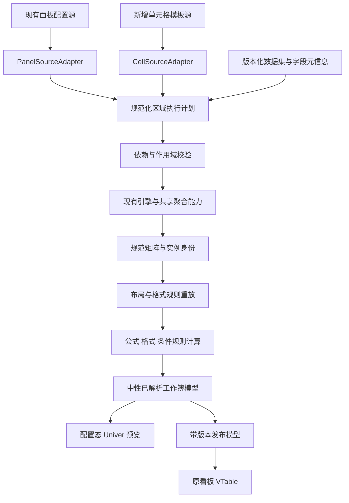

# 双配置方式报表设计方案：保留面板配置，新增单元格设计

**2026-10-20产品决策修订：cell模式取消全局“报表布局”和“指标方向”，由模板格位置、数据行为、父格及局部重复块驱动真实展开。最新引擎规格见[单元格驱动展开引擎设计](cell-driven-expansion-engine-design.md)。** 本文原先的规范区域/固定三表型约束属于旧方案阶段；新模板不再以这些条件为前提。panel模式保留原能力。本修订为设计要求，不表示代码已完成替换。

动态合并专项补充：[分组覆盖与横纵向相邻同值完整设计](template-dynamic-merge-design.md)，包含模板属性、取消规则保留、数据变化、保存/VTable链路及72项待执行验收用例。该补充为后续实施规格，不代表本文件所述能力均已落地。

文档版本：1.0。日期：2026-10-19。源码观察基线：`e8eb3b4`。状态：待实施规格，不代表新增组件、协议或测试已经落地。

用户决策：**完整保留当前配置面板方式，另增单元格驱动的配置方式，二者长期并行。** 既有面板不降级为创建向导，不强制迁移现有报表，不因新增方式改变旧组件的默认行为。

前置评估：[单元格驱动报表配置可行性评估](C:/Users/And19/Desktop/web/micro-bi/doc/cell-driven-report-configuration-feasibility.md)。共用约束：[Univer/VTable 集成方案](C:/Users/And19/Desktop/web/micro-bi/doc/univer-preview-vtable-report-design.md)、[整改清单](C:/Users/And19/Desktop/web/micro-bi/doc/univer-implementation-issues-and-remediation.md)。若前置评估中的“新主入口”“短期并存”等表述与本文件冲突，以本次用户确认的双方式并行规则为准。

## 1. 目标与固定决策

本方案增加一种类似帆软数据单元格设计的新方式：在 Univer 模板画布单击单元格配置基础属性，双击配置高级属性，通过模板规则生成明细、分组和双向交叉报表。

| 决策 | 固定规则 |
| --- | --- |
| 现有面板 | 保留原入口、字段探查、时间/分组/交叉维度、指标配置和既有 API |
| 新配置方式 | 新增“单元格设计”，独立组件与源协议，不改名替换旧面板 |
| 默认入口 | 主“新建分析看板”行为仍进入原面板；新增方式从附加菜单选择 |
| 重开方式 | 按报表保存的 authoringMode 打开；无该字段的历史条目按 panel 处理 |
| 相互转换 | 显式“复制为另一方式”，先校验可表达性，不自动双向回写 |
| 配置态画布 | Univer，用于模板、格式和预览编辑 |
| 展示态 | VTable；不能在展示组件或其 Worker 中创建 Univer |
| 业务计算 | 复用字段探查、数据集注册、聚合和矩阵引擎，新增模板归一化层 |
| 合并/取消及格式 | 跟随工作表规则；VTable 不根据相邻同值再自动合并 |
| 数据更新 | 重放已保存模板并重编译发布缓存，不要求用户重开配置再保存 |
| 编辑的数据性质 | 报表模板、布局与覆盖，不写回注册事实数据或业务接口 |

首版是能够保存、重开和动态运行的完整受约束单元格设计器，不以增加独立演示页或空的高级弹窗作为交付。

## 2. 能力范围与当前基础

### 2.1 首版必须支持

- 一个活动数据区域，放在任意可编辑工作表；每个区域一个数据集。工作簿可有多张表，其他表可放普通内容和受支持的工作表公式。
- 明细重复行、多级行分组、行列多级双向交叉、多指标横向/纵向排列。
- 字段绑定、时间分桶、列表/分组/汇总、基础排序、总计/小计、现有业务计算表达式。
- 区域级数据过滤、父格上下文、格式、条件格式的首批明确能力、合并与取消、手工内容块。
- 单元格选中、双击高级、内容编辑、作用域选择、撤销重做、保存取消与恢复。
- 稳定模板/实例身份、数据变化后的规则重放、孤立编辑、覆盖冲突和 VTable 自动消费。

“多工作表”不等于首版已经支持多个独立扩展数据区域。模型预留 regions 数组，第一版校验活动数据区域数量不超过 1，不再像当前代码一样静默只处理数组第一项。

### 2.2 后续能力

任意位置父子格、多个独立扩展区域、单格独立数据过滤、跨数据集关联、深层嵌套分栏、所有 Excel 函数及任意文件互通分阶段扩展。未支持的能力不开放可成功保存却不能执行的配置。

### 2.3 可复用与新增边界

| 模块 | 复用方式 | 必须新增或修正的部分 |
| --- | --- | --- |
| datasetRegistry / profiler | 注册、异步解析、缓存、字段探查与纠偏 | 数据/schema 版本、可声明的稳定主键元数据 |
| DynamicDataConfigPanel / ReportConfigPanel | 完整保留 panel 方式 | 通过适配层进入共用执行与发布服务，不改变旧公开签名 |
| engine / report projectors | 聚合、业务公式、分组与双轴矩阵 | 明确的区域执行计划、排序与指标身份映射 |
| UniverPreview / adapter | 画布能力与已核对的 SDK 接入经验 | 模板选区、事件路由、模板/实例映射和批量事务 |
| ReportBinding | 运行实例语义绑定基础 | templateCellId、重复区域和版本关联 |
| compileReport / ReportTableView | 中性发布模型和 VTable 消费 | 同版本文本/格式、模板编译、能力校验、动态缓存 |

新增方式不代表现有整改问题已关闭。共享保存、绑定、公式等待和渲染逻辑仍需按整改清单提供独立验收证据。

## 3. 两种入口与主应用路由

### 3.1 新建

保留主按钮“新建分析看板”的原点击行为，进入面板配置。附加下拉菜单提供“使用单元格设计新建”。也可采用等价的两个清晰入口，但不能给旧用户强制增加每次都要回答的选择弹窗。

两个方式使用同一主应用、相同数据集注册中心和看板列表，不把新增方式放到必须绕行的独立报表演示页。

### 3.2 编辑和恢复

| 条目 | 配置按钮行为 |
| --- | --- |
| 历史 config-only 或现有 report 包，没有 authoringMode | 打开原 DashboardEditModal / ReportConfigPanel |
| 明确 authoringMode=panel | 打开原面板 |
| authoringMode=cell，协议支持 | 打开新增 CellReportEditModal / CellReportDesigner |
| cell 协议损坏、版本未知 | 保留原内容并报错；不能退回一个空面板覆盖原模板 |

编辑弹窗不提供会即时丢弃当前内容的模式切换。想换方式，使用“复制为单元格设计”或符合条件时的“复制为面板配置”，创建新条目，保留来源报表。

### 3.3 保存边界

原 DashboardEditModal.onSave 和库现有面板 Ref/API 保持兼容。新增方式使用独立保存回调，由宿主路由适配为同一看板列表中的不同条目类型；不要求旧调用方同时升级新协议。

旧面板继续支持其现有图表路径。首版 cell 条目默认以表格发布；不把任意自由模板强行投影成单个图表的 config。后续图表接入必须显式选择一个可转换的数据区域。

## 4. 单元格设计器布局与交互

### 4.1 工作区布局

```text
┌ 标题 / 数据状态 ── 设计 | 预览 ── 撤销 重做 ── 保存 取消 ┐
│ 数据集与字段    │             Univer 画布               │ 属性 │
│ 搜索/类型/样本  │ 格式工具栏、公式栏、行列、工作表页签   │ 基础 │
│ 字段选择或拖入  │ 区域边界、字段标记、扩展箭头、父格提示 │ 高级 │
└───────────────────────────────────────────────────────────────┘
```

数据源沿用全局注册、局部多源列表和单源锁定三种接入；单源锁定时不显示可更换的数据集选择。第一版字段绑定只使用当前区域的数据集。

设计视图展示模板占位符和区域规则；预览视图展示当前数据真正展开后的内容。它们是同一源模型的视图，不能各自保存一套独立配置。

### 4.2 单击与双击：固定采用设计态路由

| 操作 | 设计视图 | 预览视图 |
| --- | --- | --- |
| 单击/键盘移动 | 更新右侧基础属性，选中对应模板格，不弹窗 | 显示来源模板、业务成员和当前编辑作用域 |
| 双击 | 打开目标模板格高级设置，只触发一次 | 打开当前实例高级属性；修改数据绑定须显式“编辑来源模板” |
| F2 / 公式栏 | 普通文本或工作表公式进入原生内容编辑；数据模板格定位到绑定配置 | 对允许覆盖的业务格编辑报表覆盖；自由内容按对应内容规则编辑 |
| 高级按钮/上下文菜单 | 与双击相同的高级入口 | 与双击相同的实例高级入口 |
| Esc | 取消当前输入或属性弹窗；不顺带丢弃其他草稿 | 同左 |
| Enter / 应用 | 提交当前单元格属性事务，不等于保存整张报表 | 提交当前作用域编辑，不改事实数据 |

数据模板格的字段标记不是普通字符串。键入文字不能静默替换并丢失绑定；需要通过“转换为普通单元格”明确变更内容类型。普通格 F2/公式栏保留 Excel 内容编辑能力，双击高级不能导致内容无法修改。

### 4.3 选区和属性草稿

- 单击只选中，不创建绑定、不请求数据、不触发整表重算。
- 属性控件先形成 inspectorDraft；“应用”或 Enter 校验后，以一个事务更新模板和画布。
- 切换选区时，合法草稿可以自动提交到原目标；非法草稿保留并定位错误，不写到新选中的格。事务始终携带原 templateCellId 和编辑序号。
- 高级弹窗的取消只撤销本次弹窗草稿，不撤销此前已应用的其他单元格编辑。
- 合并格先解析主格；多选只开放兼容的格式批量操作，数据批量绑定需明确字段与槽位映射。

### 4.4 区域与自由内容

2026-10-20修订：新cell模式在绑定时建立数据源与局部区域，不再要求先选择“明细 / 分组 / 交叉”表型。受管区域承担数据/事务和碰撞边界；模板格位置、父上下文与重复块决定其内部排版。标题、备注和小计可固定或明确跟随某个块。

旧cell模板继续按原规范矩阵引擎解释，迁移时生成明确的块/父格/位置约束。新模板对无解依赖、非法跨源和碰撞给出具体诊断，不用统一表型决定用户能否排版。详见[新展开流程与迁移顺序](cell-driven-expansion-engine-design.md)。

## 5. 属性配置规格

### 5.1 基础属性

| 属性 | 规则 |
| --- | --- |
| 内容类型 | 普通内容、数据字段、业务计算、工作表公式分别处理 |
| 数据集 | 区域级来源；切换数据集是区域事务，不只修改一个格的下拉框 |
| 字段 | 搜索、业务名称、类型与样本；绑定 fieldId，保留实际 fieldKey |
| 业务角色 | 明细列、行维度、列维度、指标、汇总/小计、自由内容 |
| 数据行为 | 列表、分组、SUM/AVG/MIN/MAX/COUNT；合法组合校验 |
| 时间处理 | 小时/日/周/月/季/年/自定义周期，以及时区和周起始口径 |
| 扩展 | 向下、向右、不独立扩展；由区域角色和父格共同决定实例化 |
| 显示名称和格式 | 显示标签不改变字段、模板格或指标身份 |

字段类型探查只推荐默认值，允许用户纠偏。数值设备编号可以分组，时间可作为明细字段，文本可以计数；不能按类型强制唯一业务角色。

### 5.2 高级属性及首版能力

| 分组 | 首版可用项 | 暂不开放项 |
| --- | --- | --- |
| 父格 | 同区域规范行/列轴、上一级分组、自动建议/无/自定义选择 | 任意跨区域和跨数据集父格 |
| 过滤 | 区域级字段条件，先过滤事实再聚合；沿父级成员继承上下文 | 各指标/单格独立结果集和关联查询过滤 |
| 排序 | 区域/轴维度排序、受支持的指标排序、稳定同值顺序 | 未定义作用域的任意整表原生排序 |
| 汇总 | 行列总计/小计、标签、事实切片口径 | 将比例或桶均值直接相加的快捷实现 |
| 业务计算 | 现有表达式语法、row/summary 范围、精度 | 未接入执行器的自定义函数 |
| 工作表公式 | 能力表内的公式与可解析引用 | 超出动态重算能力的函数或外部引用 |
| 格式与布局 | 字体、边框、对齐、数字格式、行列尺寸、隐藏、冻结、合并/取消 | 不能发布到 VTable 的对象能力 |
| 规则作用域 | 模板全部实例、当前成员切片、自由块 | 根据坐标自动猜测应推广到所有成员 |
| 覆盖策略 | 报表级人工值/公式，固定基线、冲突和恢复源值 | 隐式改写底层事实数据 |

高级属性只展示本版本可正确编译和执行的控件。首版没有单格独立过滤执行器，就不允许保存一个永远不生效的“高级过滤”。

### 5.3 父格的含义

新引擎进一步区分数据上下文、重复归属和几何锚点；聚合格可同时跟随行/列父上下文。下面保留父格语义基础，具体执行约束以新展开引擎文档为准。

行父格控制行成员上下文，通常对应左侧的分组；列父格控制列成员上下文，通常对应上方的列维度。父格是一种语义依赖，不是合并范围，也不要求永远物理相邻。

“自动”只在创建或用户明确重新推断时给出建议；应用后保存稳定父格 ID。移动模板格不能让系统按新的相邻位置悄悄换父格。“无”明确表示不继承该方向的父级上下文。

禁止循环、失效父格、同区域内不合法角色和未定义跨源关系。更改父格时必须重新验证整个受影响区域。

## 6. 三类报表与固定示例

### 6.1 共用数据 D0

示例将下列数据注册为 production，声明主键 id；字段目录为示例分配 f-workshop、f-date、f-qty 等稳定 ID，实际取数仍使用对应 fieldKey。

| id | workshop | line | date | qty | defect |
| --- | --- | --- | --- | ---: | ---: |
| a1 | A | L1 | 2026-10-01 | 10 | 1 |
| a2 | A | L2 | 2026-10-02 | 20 | 2 |
| a3 | A | L1 | 2026-11-01 | 30 | 3 |
| b1 | B | L1 | 2026-10-03 | 100 | 30 |
| b2 | B | L2 | 2026-11-02 | 40 | 4 |

共同期望：SUM(qty)=200，COUNT(id)=5，AVG(qty)=40；A=60、B=140，十月=130、十一月=70。不良率原值为 `40/200=0.2`，使用百分比格式显示 `20.00%`，不再额外乘 100 后套百分比格式。

### 6.2 明细

A2、B2、C2 分别绑定 id、workshop、qty，数据行为为列表，共享同一个 detail repeatBand。一次记录实例携带三个字段，不能把三列分别展开再做笛卡尔积。

当前数据产生 5 条明细，重复字段值不去重。稳定记录身份来自声明的主键；重排后 a1 的格式和覆盖仍属于 a1。

### 6.3 分组

A2 绑定 workshop 分组向下；B2 绑定 SUM(qty)，C2 绑定 AVG(qty)，二者行父格均为 A2。页尾总计使用 region-total 作用域，不继承最后一个车间。

| 展开成员 | SUM(qty) | AVG(qty) |
| --- | ---: | ---: |
| A | 60 | 20 |
| B | 140 | 70 |
| 总计 | 200 | 40 |

增加 line 层级时，L1 的身份包含所在 workshop，不跨 A/B 混算。AVG 总计重算原始事实，不计算 `(20+70)/2`。

### 6.4 双向交叉

| 模板格 | 配置 | 上下文 |
| --- | --- | --- |
| A2 | workshop 分组，向下 | 行成员集合 |
| B1 | date 按月分组，向右 | 列成员集合 |
| B2 | SUM(qty)，不新建独立扩展轴 | 行父格 A2、列父格 B1 的交集 |

| 成员 | 十月 | 十一月 | 行总计 |
| --- | ---: | ---: | ---: |
| A | 30 | 30 | 60 |
| B | 100 | 40 | 140 |
| 列总计 | 130 | 70 | 200 |

多指标使用区域的 metricDirection=columns/rows 决定指标带排布。表头位置与指标带宽度由区域编译器确定，稳定 ID 不因方向改变而变化。

用户可以选择多级行轴和列轴；首版仍是规范化交叉区域，任意位置嵌套扩展留给后续。选择初始布局后，合并/取消由工作表规则控制，不由 VTable 根据重复标题补做。

## 7. 模板、实例与版本协议

以下为拟新增契约，不是当前已有的导出接口。新增模板采用独立 documentType，不能直接塞入现有 `ReportDocument.version='1.0'` 并假设旧组件能够理解。

### 7.1 CellTemplateDocumentV1

| 字段 | 内容与责任 |
| --- | --- |
| documentType / schemaVersion | `cell-template` / `1.0`，独立协议命名空间 |
| id / templateRevision | 文档身份与模板修订号 |
| sheets | 稳定 sheetId、名称、可见性及行列布局 |
| regions | 区域 ID、数据集、规范布局类型、锚点、指标方向、过滤与总计配置 |
| cells | 稳定 templateCellId、当前位置、内容定义、父格、格式引用 |
| layoutRules | 合并、解除、手工块、锚点、隐藏与冻结等可重放意图 |
| styleRules / conditionalRules | 明确作用域、优先级和条件，不仅保存当前颜色 |
| instanceOverrides / orphanedEdits | 按业务实例保存的覆盖、原基线、冲突与孤立状态 |
| capabilitiesVersion | 本模板使用的公式、格式、布局能力版本 |

源模型拥有数据绑定和版式意图；Univer 快照是同版本恢复缓存，不能成为独立可回写的第二份业务配置。原生内容/格式操作也需转换为源模型事务；快照中的插件资源仅在能力范围内保留和校验。

### 7.2 单元格定义

| 内容类型 | 必须保存的语义 |
| --- | --- |
| literal | 原始值、格式与布局；普通文本不被识别为字段名 |
| field | regionId、fieldId/fieldKey、业务角色、列表/分组/聚合、时间桶、父格引用 |
| business-formula | 稳定 metricId、业务表达式、row/summary 范围、指标依赖 |
| sheet-formula | 工作表公式及被解析的模板/成员/名称引用，保留绝对相对意图 |

区域保存规范布局和唯一数据集；实际行列轴与指标集合从单元格角色、父格和槽位顺序派生，不再独立存一份可随意修改的 axes 配置。

### 7.3 交叉模板最小示意

```json
{
  "documentType": "cell-template",
  "schemaVersion": "1.0",
  "id": "cell-report-1",
  "templateRevision": 1,
  "sheets": [{ "id": "sheet-1", "name": "产量报表" }],
  "regions": [{
    "id": "r1", "datasetId": "production", "layoutKind": "pivot",
    "sheetId": "sheet-1", "anchor": { "row": 0, "column": 0 },
    "metricDirection": "columns", "filters": [],
    "rowTotals": { "showGrandTotals": true },
    "columnTotals": { "showGrandTotals": true }
  }],
  "cells": [
    { "id": "c-row", "regionId": "r1", "sheetId": "sheet-1",
      "position": { "row": 1, "column": 0 },
      "content": { "kind": "field", "fieldId": "f-workshop", "fieldKey": "workshop",
        "role": "row-dimension", "operation": "group", "expand": "down" },
      "parents": { "row": null, "column": null } },
    { "id": "c-col", "regionId": "r1", "sheetId": "sheet-1",
      "position": { "row": 0, "column": 1 },
      "content": { "kind": "field", "fieldId": "f-date", "fieldKey": "date",
        "role": "column-dimension", "operation": "group", "expand": "right",
        "timeBucket": { "granularity": "month", "timezone": "Asia/Shanghai" } },
      "parents": { "row": null, "column": null } },
    { "id": "c-value", "regionId": "r1", "sheetId": "sheet-1",
      "position": { "row": 1, "column": 1 },
      "content": { "kind": "field", "fieldId": "f-qty", "fieldKey": "qty",
        "role": "measure", "metricId": "m-qty-sum", "operation": "sum", "expand": "inherit" },
      "parents": { "row": "c-row", "column": "c-col" } }
  ],
  "layoutRules": [], "styleRules": [], "conditionalRules": [],
  "instanceOverrides": [], "orphanedEdits": [], "capabilitiesVersion": "cell-v1"
}
```

示意中没有合并规则，因此不能仅因成员相同而自动合并。字段时区等新增属性须由归一化适配层解释，不能原样赋给当前 TimeBucketConfig 后假设引擎已经支持。

### 7.4 展开实例身份

实例键由规范编码生成：`templateCellId + regionId + 明细主键/完整行路径 + 完整列路径 + metricId + role`。数值 1、字符串 1、null、空串和字面空白标签必须区分；不能用数组下标或显示标题识别成员。

主键元数据通过兼容的可选 schema 或 sidecar 提供，旧数据集注册不必新增必填参数。明细覆盖要求唯一、非空主键；分组按类型化成员元组识别。主键唯一性在实际完整数据上检查，不只检查 profiler 样本。

### 7.5 版本戳

RenderStamp 包含 templateRevision、各 dataset 的 dataRevision/schemaRevision、compilerVersion。编辑会话另有 sessionId、editSequence 和请求序号。

快照、实例绑定和 publication 都标记来源版本；选中格的坐标只是该版本的布局结果，不能用旧绑定为新版本写覆盖。

## 8. 双方式存储与兼容

### 8.1 保留旧格式，新增独立源

| 记录 | 读写策略 |
| --- | --- |
| 既有 config-only 条目 | 保持原格式与 panel 默认路由 |
| 既有 SavedReportBundle(document, publication) | 保持 ReportDocument 和原保存入口，不强制转换 |
| 新 cell 条目 | authoringMode=cell，保存独立 CellSavedReportBundleV1 |

新增 cell 保存包包含 kind、schemaVersion、完整模板、可选编辑快照以及 lastSuccessfulPublication `{stamp, report}`。历史 panel 条目不因引入新功能而被批量改写。

宿主条目建议采用有判别字段的联合类型：旧 AnalysisViewItem 保持兼容，新增 CellAnalysisViewItem 不强制要求旧 config。不得为 cell 条目伪造一个 `columns: []` 的旧 config 以绕过类型检查。

### 8.2 单一可编辑来源

- panel 条目仍以其现有面板文档/DSL 为源，由 PanelSourceAdapter 读取。
- cell 条目仅以 CellTemplateDocument 为源，由 CellSourceAdapter 读取。
- 两者派生同一规范化执行计划和发布输入，但派生计划不作为第三份可编辑配置。
- 同一份报表不同时让两个设计器对不同源对象自由回写。

Panel 含合法 ReportDocument 时，共用执行适配器读取文档内相应分析配置，宿主 config 是兼容投影；config-only 条目仍读取原 config。若已有两份配置不一致，应诊断并保留旧正式结果，不静默互相覆盖；保存从同一最终配置生成两者，旧回调签名保持不变。

### 8.3 显式复制转换

Panel→Cell 仅转换可以完整表达的单区域配置，生成模板 ID、角色、父格和初始布局。已有手工格式/公式/覆盖逐项映射；不能识别的内容形成转换诊断，不能静默丢弃。初始来源单据保留不变。

Cell→Panel 只有在严格可表达时允许复制：规范单区域、所有数据角色/时间/表达式可映射、没有不能保留的局部规则或自由扩展。否则禁止有损转换，仍可继续用单元格方式编辑。第一版可以只交付 Panel→Cell 复制，不承诺任意双向转换。

## 9. 共用执行架构



NormalizedRegionPlan 明确区域类型、数据集和版本、区域过滤、行列轴、指标、业务作用域、排序、总计及模板槽位。它是内部派生模型，不要求修改原 DynamicTransformConfig 的调用方式。

CellSourceAdapter 首版把受约束角色转换为已有 categories/timeBucket/columnCategories/columnTimeBucket/columns 和布局信息。当前 DSL 表达不了的字段不能忽略或强塞进去；由新计划层先执行区域过滤等明确步骤，再复用聚合和 projector。

现有引擎输出键与稳定 metricId 建立映射，避免改标题或调整顺序导致模板指标丢失。原面板、单元格设计和纯发布编译在同一口径上执行，不能再维护两套结果不一致的聚合算法。

## 10. 取数、过滤、聚合与依赖

### 10.1 数据处理顺序

```text
解析完整数据与状态 → 类型/主键/schema校验 → 区域事实过滤
→ 行级业务增强 → 按完整行列路径聚合 → 汇总后计算
→ 轴/指标排序与总计 → 模板实例和布局 → 覆盖/工作表公式
→ 显示格式与条件规则 → 最终发布
```

区域字段过滤与父格成员上下文在聚合前生效；条件格式是结果渲染规则，不改变聚合输入。若未来支持汇总后筛选，应使用独立阶段定义，不能混进事实过滤。

### 10.2 统计语义

SUM/COUNT/AVG/MIN/MAX 复用共享聚合函数；AVG 用底层 sum/count，不平均已显示桶均值。COUNT 的对象、nullAsZero、COUNT(id) 与非空数量需明确。

比例默认保存真实比值并应用百分比显示。组级、小计和总计从各自事实范围重新求值。业务公式和用户工作表公式各按其明确定义执行，不互相假冒。

### 10.3 父格校验

构建稳定 ID 的有向依赖图，校验缺失、循环、同区域限制、父子角色和同数据集。metric 格同时引用行/列父格时，其数据为两个成员范围的交集，不因物理相邻重复套过滤。

一组明细字段必须共享 repeatBand 的记录实例；无主键时允许只读列表，但成员级覆盖和稳定重排必须给出无法可靠定位的诊断，不退回行号假装可用。

### 10.4 计算复用与预算

按数据集版本、过滤签名和区域计划合并取数与计算；每个区域解析一次数据，共用成员索引和聚合缓存。选中格只改变属性面板，不发起每格查询。

预估行成员数×列成员数×指标数以及布局开销，超过可配置预算时提示并阻止假完整输出；不能截断样本却标成正式全量结果。性能阈值通过实测确定，不预先承诺任意规模。

## 11. 模板扩展与布局规则

### 11.1 各种重复区域

| 区域 | 模板到结果的扩展 |
| --- | --- |
| detail | 一个 bodyBand 按记录主键复制，格与格共享记录上下文 |
| grouped | 按有序分组树生成叶子/小计/总计，再按模板槽位放置维度和指标 |
| pivot | 行成员树×列成员树×指标带形成交叉实例，小计/总计在同一计划生成 |
| free content | 普通标题、备注和工作表公式不作为额外数据轴，由锚点放置 |

同一业务格只有一个扩展所有者，measure 继承行列上下文，不再独立遍历整个数据集。行/列轴各层级、指标带及页尾尺寸在写入画布前一次确定。

维度分组和标签的视觉重复分开处理。模板明确保存一次显示、随叶子重复等标签布局意图；用户合并或取消后的内容依实际工作表结果保存，不能仅因拆分或刷新就把主格文本复制进所有空格。现有 projector 的重复维度值和建议 merges 需要经过模板布局适配，不能原样当成最终版式。

### 11.2 自由内容锚点

自由块使用稳定 ID，可相对区域 before/after、组前/组后、总计前/后定位，或位于固定自由区。数据区域增长前先解析锚点和占用范围；碰撞时生成阻断诊断，不先写值覆盖备注。

首版不允许两个独立动态区域相互挤压，也不允许跨受管区/自由区的模糊合并。新增用户行列须转成明确布局规则，再通过规范化计划重算位置。

### 11.3 真实工作表容量

实例化计划同时输出所需行列数、旧范围差集、最终合并、尺寸、隐藏和冻结。配置适配器先扩容再写入；不能仅把数据写到 cellData 中更大的坐标，实际画布却仍访问不到新增行列。

仅清理失效业务内容，保留已迁移自由块。实例、主格 metadata、样式和绑定同一事务更新；不通过私有矩阵删值代替完整的 SDK 布局事务。

## 12. 格式、合并与公式

### 12.1 格式规则

按基础主题→区域→模板格/成员集合→实例例外合成格式，同层使用持久化优先级与编辑顺序。新增成员继承匹配规则，单格例外不扩散。

格式至少区分原始 v、格式定义和 displayText；日期/百分比/精度不能直接改变基础计算值。预览与发布使用同一格式口径，不能把历史 custom.displayText 当成最新结果。

条件格式保存条件、范围和优先级，刷新重新求值。首版具体色阶/数据条/图标等能力须逐项建立编译和 VTable 等价处理；未支持项目不开放保存。

### 12.2 合并和取消合并

合并唯一跟随模板中的 Excel/Univer 编辑意图。普通新模板没有合并；明确选用预设时，可把初始合并作为低优先级布局规则展示在配置画布中。

合并/解除操作保存作用域和编辑序号，人工最新编辑优先于初始化预设；取消后再次合并应生效，不能让解除标记永久压住新操作。

动态刷新重放有效规则，不能再用初始分组 merges 恢复用户已取消的范围。`merges: []` 明确表示不合并。原表格的 mergeCells、tableFeatures.mergeCells、列级 mergeCell 及高级选项均不覆盖 cell 报表发布结果。

VTable 合并项明确提供主格 text，按当前格式文本转换为字符串，保留 0、false 和有意的格式空串；样式以主格和已解析规则为准。复制和导出使用同一最终范围。

### 12.3 两类公式与动态引用

- 业务计算：现有字段/聚合表达式，在 row 或 summary 阶段执行。
- 工作表公式：工作表单元格、名称、模板实例或动态集合的引用，在布局和覆盖后执行。

动态区引用解析为稳定语义目标，保留绝对、相对和混合引用；自由区坐标引用保留其明确位置含义。“固定十一月”与“当前月/上月”分开，“所有成员”与“当前选中的固定成员”也分开。

定义 FormulaRunner 接口和能力版本。配置端原生公式交互通过适配器同步，正式动态重编译使用经过验证的纯 TS 执行器；更广公式覆盖可接独立编译服务。展示端不能为重算而导入 Univer。暂不支持动态计算的公式必须在保存时诊断，不能发布旧缓存值。

循环引用、失效成员、除零和不支持函数都进入发布诊断。首版通过公式白名单及同输入差分测试固定范围，不能声称兼容任意 Excel 工作簿。

## 13. 数据变化后的生效过程

### 13.1 重编译事务

```text
取得新数据/schema版本及会话标识
→ 用已保存源生成新执行计划与基础实例
→ 对比旧基线、新基线和用户意图
→ 重放格式、布局、合并/解除、公式与覆盖
→ 处理冲突和孤立编辑
→ 计算最终值、显示文本和布局
→ 校验并原子提交当前版本publication
```

模板修改需要保存；普通数据更新自动消费已保存源，不修改 templateRevision，也不等待用户重开编辑器。数据编译结果只替换派生缓存，不反过来重写模板业务定义。

### 13.2 各类变化

| 变化 | 生效要求 |
| --- | --- |
| 事实值变化 | 按原模板重算，格式/备注仍按身份保留，条件规则重新求值 |
| 新增/删除明细 | 按主键创建/移除实例，消失成员编辑进入孤立集合 |
| 新增组或月份 | 重新布局并继承明确规则，局部月份例外不扩散 |
| 排序 | 同一业务身份换位置，样式和覆盖不能留在旧坐标 |
| 分组层级变化 | 重建受影响区域并检验作用域兼容，不跨父组串用 |
| 横/纵指标切换 | 保持模板格/指标语义，重新解析物理行列、合并和冻结 |
| 字段只改标题 | 保留 fieldId、模板格 ID 和相关规则 |
| 换字段、聚合、时间口径 | 视为含义变化，更新语义签名/指标定义身份，旧覆盖须迁移或冲突处理 |
| ready-empty | 清除旧业务实例，保留模板自由内容；SUM/COUNT可为0，AVG等按空值策略显示，不能回退旧静态数组 |
| loading/error | 不伪装为合法空数据；保留上次成功结果并显示状态 |

### 13.3 覆盖与冲突

人工覆盖记录 target、原始基础值/hash、原 dataRevision、v/formula 和状态。默认只影响报表层，业务总计继续按事实计算；若需要人工调整参与统计，建立显式调整指标。

未解决冲突跨多次刷新保留，不因 region.baseValues 更新而消失。原成员回归时重新检查旧基线；不把旧人工值移给新坐标的另一个成员。

定义冲突解决动作：保留覆盖并确认新基线、恢复数据值、转为明确调整规则、移除或重绑失效规则。存在未解决的阻断冲突时不提交新 publication。

### 13.4 并发和缓存

缓存键包含源类型、报表 ID、模板修订、全部数据/schema版本和编译器版本。旧请求、旧会话和已卸载编辑器的异步结果必须丢弃。

配置态默认固定一次编辑数据基线，发现新数据时提示并执行受控重基；不得后台无条件写值打断输入。正式 VTable 可以自动接收已保存模板的新编译结果；两者的修订和来源版本清楚区分。

## 14. 保存、取消与重开

### 14.1 cell 保存事务

1. 提交正在输入的普通格/公式和属性草稿，等待对应编辑事件落地。
2. 从最新源模型读取模板及 editSequence，不使用初始化闭包中的旧 document。
3. 校验数据版本、模板角色、父格、能力、主键、规则和布局；必要时重基。
4. 等待公式结果稳定，处理 reject/超时；空闲、无公式和计算中状态分开，不用固定延迟冒充完成。
5. 从同一版本产生模板、编辑快照和 publication，确认保存期间没有更新编辑序号。
6. 宿主以一个提交写入新 CellSavedReportBundle 并替换目标条目，成功后关闭原主应用内的编辑弹窗。

失败时保持弹窗、草稿和上次正式结果；不能先更新标题/config，再异步覆盖一个不同版本的 report。

### 14.2 状态转换

| 状态 | 可执行动作与结果 |
| --- | --- |
| loading | 恢复源与快照，不能点击未就绪保存 |
| clean/dirty | 可编辑；dirty只影响草稿，不写正式条目 |
| validating/compiling | 禁止重复提交，记录版本和编辑序号 |
| conflict/error | 保留草稿，可修正、重试或取消 |
| saved | 更新正式条目并结束会话 |
| cancelled | 丢弃本次草稿，不撤销此前成功保存的版本 |

重开以 authoringMode 和源协议选择设计器，快照版本匹配才直接恢复；源数据已变时受控重基。协议不兼容、快照损坏或资源缺失需明确诊断，不能默默新建空白模板。

## 15. Univer 事件与命令适配

### 15.1 当前可核对的接入点

本地 SDK 声明有 `SelectionChanged`、`CellClicked`、`BeforeSheetEditStart`。后者携带工作簿/表、行列、eventType、keycode，并支持取消。双击在已安装版本的编辑路径中使用 `DeviceInputEventType.Dblclick`。

不存在本方案已经验证过的 `CellDoubleClicked` 公共事件，不能仅凭名称直接调用。最小原型必须证明在 BeforeSheetEditStart 的目标双击路径取消原生编辑并打开高级设置可行，F2/键入不受误拦截。

### 15.2 事件路由边界

- 仅处理当前 workbook/sheet/session，合并区域先定位主格。
- SelectionChanged 统一支持鼠标和键盘；不从 DOM td 查 Canvas 坐标。
- CellClicked 只更新选区，单击不能先弹基础窗口而挡住第二击。
- 双击只负责打开高级属性；把弹窗状态更新与原命令取消分开，防止重入和双次提交。
- 模板内容、格式、合并、插删行列、拖动和粘贴转换为类型化事务；不能仅用宽泛命令名包含匹配所有变化。

### 15.3 输入和程序写回隔离

事务标记至少包括 source=user/restore/refresh/calculation、transactionId、sessionId、目标模板或实例。标记贯穿异步命令，不能仅使用立即复位的全局 boolean。

批量粘贴解析标量、二维数组和稀疏矩阵，逐格获得正确值/公式/坐标；一次逻辑编辑只生成一个源事务。复制数据模板格默认复制可识别的模板语义并创建新 ID；复制运行结果默认是普通内容，复制活动区域使用显式命令并遵守首版区域数量限制。

原生剪切/移动须同步稳定 ID 的位置，撤销重做同时恢复源模型、工作表和实例绑定。卸载时释放所有监听、订阅、任务和临时对象，旧清理不能销毁新实例。

复制模板格时，除新 templateCellId 外，指标/业务计算也分配新 metricId；字段引用可以复用，块内父格与公式引用按复制映射调整。不能只换显示位置却共用两个独立输出格的业务身份。

## 16. VTable 展示与导出

Cell 条目调用纯编译服务后，原卡片直接消费最新 PublishedReport。仍使用已有 ReportTableView，并补齐共同的发布一致性要求：

- 工作簿业务表头是实际单元格，保持 showHeader=false，禁止第二次透视展开。
- 坐标、合并范围、主格 text、当前显示文本和格式完全来自同版本解析模型。
- 0、false、空串、百分比、日期与错误文本分别处理，不能被 truthy 判断丢失。
- 适配行高列宽、隐藏和冻结；已保存固定列宽不能被默认自动填满策略重新分配。
- 不混入旧 tableFeatures.mergeCells、自动总计、自动排序或外部高级选项的结构覆盖。
- 复制、CSV 与真实 Excel 文件导出使用明确协议和同一业务范围；CSV不宣称保留样式/合并，文件导出能力按实际实现验收。

编译失败且有上次成功结果时保留它，并标识实际数据版本及失败状态；没有成功缓存时显示失败态。不能用旧数据画面冒充已更新成功。

正式展示入口只导入纯计算/发布与 VTable。新设计器和相关 Univer/CSS 在打开配置时加载；独立编译服务如采用无 UI 工作簿引擎，也不改变展示浏览器的依赖限制。

## 17. 新增模块、API 与宿主改造

下表标为新增的文件/导出均为待建设内容，不代表当前已存在。

| 位置 | 改造内容 |
| --- | --- |
| 新增 `src/cell-designer/CellReportDesigner.tsx` | 三栏工作区、设计/预览、选区和保存协调 |
| 新增 `CellInspector.tsx`、`CellAdvancedSettings.tsx` | 基础属性和双击高级，复用字段元信息 |
| 新增 `designerReducer.ts`、`univerEvents.ts` | 单一草稿事务、撤销、模式/作用域和 SDK 事件桥 |
| 新增 `src/report-template/types.ts`、`validator.ts` | cell源、区域、引用、规则、schema 与能力校验 |
| 新增 `normalizeCellTemplate.ts`、`executionPlan.ts` | 模板→规范化执行计划，PanelSourceAdapter 共用出口 |
| 新增 `expandTemplate.ts`、`layoutResolver.ts` | 重复区域、指标带、自由块和容量计划 |
| 新增 `rebaseTemplate.ts`、`identity.ts` | 新旧基线、语义键、冲突和孤立编辑 |
| 新增 `formulaRunner.ts`、`formatResolver.ts`、`compileCellReport.ts` | 公式/格式/条件求值和中性发布 |
| 现有 `src/report/` / `src/engine/` | 复用并修正共用口径；保留旧导出和调用签名 |
| 现有 `src/ui/presentation/report/` | 消费新旧来源生成的同一发布契约，完善共同渲染问题 |
| 新增包入口 `micro-bi/cell-designer` | 只导出新增编辑器与类型；编辑依赖按需加载 |
| 现有 `micro-bi/report` | 可增纯模型/编译导出，不反向导入 Univer 或 React UI |
| 宿主新增 `CellReportEditModal.tsx` / `ReportEditorRouter.tsx` | 在原主应用路由新旧方式，不替换 DashboardEditModal |
| 宿主 `HeaderBar.tsx`、`App.tsx` | 附加新建入口、条目判别、保存路由和动态 publication 服务 |
| 宿主 `types/dashboard.ts`、`DashboardCard.tsx` | 联合条目类型和 VTable 消费；cell 条目不走旧 config 强制计算 |

### 17.1 拟新增编辑器接口

接口职责固定为：输入 cell 源、数据集接入选项、主题语言和诊断回调；输出源模型变化与显式保存结果。Ref 提供 `flush`、`validateAndCompile`、`getTemplate` 和取消/重置当前草稿能力。

保存成功返回完整 template、editorSnapshot、publication 和 RenderStamp；失败返回有目标位置的 diagnostics。不能用 `getConfig(): DynamicTransformConfig` 冒充能够完整表达自由模板的唯一保存结果。

### 17.2 保护既有 API

DynamicDataConfigPanel、ReportConfigPanel 及旧 Modal.onSave 的公开签名不因新增方式改成必传新对象。新统一路由只在宿主或内部适配层做判别，不要求所有旧消费者同时迁移。

新增导出应补 exports、typesVersions、ESM/CJS 和样式加载说明；纯展示最小消费样例验证不会间接打包编辑器。React 17/18 和 StrictMode 均验收。

## 18. 实施顺序与阶段门槛

### 阶段 A：保护旧方式与固定协议

- [ ] 固定旧组件/API/持久化和原卡片流程的基线回归。
- [ ] 增加 authoringMode 判别与新增入口，缺省仍 panel。
- [ ] 定义 cell模板、实例、执行计划和版本协议，建立 validator 与 D0 数值样例。

门槛：旧配置无需改动仍可创建、保存和重开；未知 cell 协议不被空配置覆盖。

### 阶段 B：选格与高级配置原型

- [ ] 在原应用的新方式弹窗接入选区、单击侧栏和设计态双击高级。
- [ ] 验证 F2/公式栏、输入提交、焦点、多选与合并主格。
- [ ] 建立源事务和SDK写回隔离，不先堆放未执行的高级控件。

门槛：只有一份草稿，双击不同时出现两个编辑入口，取消行为正确。

### 阶段 C：首版区域编译

- [ ] 完成同数据集明细、分组和交叉三种规范区域，复用共用聚合。
- [ ] 支持两种指标方向、区域过滤、父格、排序与总计，并实现真实容量更新。
- [ ] 支持自由块、已开放公式/格式和合并/取消重放。

门槛：D0各口径及模板→实例映射正确，不通过截断数据或仅改变显示标签伪造结果。

### 阶段 D：保存与动态展示闭环

- [ ] 在原新方式弹窗完成原子保存、取消、重开和当前输入提交。
- [ ] 已保存源随数据变化自动重编译，原卡片通过 VTable 展示。
- [ ] 成员增删、排序、分组和透视列变化后，规则与覆盖正确且无污染。

门槛：关闭编辑器也能得到正确新报表；展示依赖不包含 Univer。

### 阶段 E：共存、转换与灰度

- [ ] 完成可表达的 Panel→Cell 复制与无损校验，不强制转换已有条目。
- [ ] 将新入口按功能开关开放，旧方式继续完整可用。
- [ ] 补文档、导出、协议迁移、异常恢复和回退验证，再开放后续自由扩展。

门槛：无旧方式回归；新方式关闭创建后已有源和发布数据可保留，不被自动降级。

以上按依赖划分，不以未经原型和性能测试确认的工期数字作为承诺。

## 19. 测试矩阵与数值验收

下列均为待建设、待执行的验收要求。本次只生成方案文档，没有把这些用例标为通过。

| 编号 | 场景 | 必须结果 |
| --- | --- | --- |
| CD-01 | 原配置按钮、原新建主按钮 | 继续进入完整旧面板，原维度/指标能力不减少 |
| CD-02 | 无 authoringMode 的旧条目 | 按 panel 打开，存储和原回调兼容 |
| CD-03 | 附加菜单新建 cell | 在原主应用打开新设计器，初始空模板可配置 |
| CD-04 | 分别保存/重开 panel 与 cell | 始终回到各自方式，不误开或互相覆盖 |
| CD-05 | 旧 config-only 与旧 report 包恢复 | 仍可展示、编辑、保存，不要求批量升级 |
| CD-06 | 新旧条目同时展示 | 纯 VTable 报表分支正确，浏览展示不加载 Univer |
| CD-07 | Panel→Cell 复制 | 生成新ID和新条目，源报表不变，数值与可迁移编辑保留 |
| CD-08 | 不能完整回转的 cell 模板 | 明确拒绝有损转换，不清空局部规则或自由内容 |
| CD-09 | 时间/数字/文本探查及用户纠偏 | 推荐合理，数值ID可分组，类型不强制业务角色 |
| CD-10 | 鼠标单击与键盘移动 | 只更新侧栏，不弹窗、不误绑定、不逐格取数 |
| CD-11 | 设计态双击普通格/数据格/合并格 | 高级只打开一次，目标模板正确，原生编辑器不竞争 |
| CD-12 | F2、公式栏、Enter、Esc | 内容编辑/绑定路由清楚，焦点和取消范围正确 |
| CD-13 | 属性未提交时换选区、输入非法配置 | 合法内容提交原目标，非法内容不写新格 |
| CD-14 | 多选批量格式和绑定 | 兼容属性批量应用，绑定需明确映射，不串单元格 |
| CD-15 | 明细重复字段值与重排 | D0保持5条，每列按同一记录主键对齐 |
| CD-16 | 主键重复/缺失、数字1与字符串1、组合键 | 类型不碰撞，非法身份有诊断，不退回行号 |
| CD-17 | workshop×line 多级分组与同名L1 | 不跨父组混算，父格引用与实例身份正确 |
| CD-18 | D0 SUM/COUNT/AVG及各级总计 | 200、5、40，A均值20/B均值70，总均值不能45 |
| CD-19 | D0车间×月份交叉 | A为30/30，B为100/40，列130/70，总量200 |
| CD-20 | 多指标横向/纵向切换 | 业务口径和ID一致，行列容量、表头与合并重建正确 |
| CD-21 | 不良率与百分比格式 | 全局原值0.2显示20.00%，公式与显示精度分别正确 |
| CD-22 | ready-empty、loading、失败重试 | 无旧数据残留，失败不伪装空数组，不用旧静态数据回填 |
| CD-23 | 仅事实值变化 | VTable自动显示新值，样式/备注保留且不扩散 |
| CD-24 | 增删组/明细后成员回归 | 新实例继承规则，消失编辑归档，回归时校验基线恢复 |
| CD-25 | 升降序与连续两次重排 | 样式和覆盖只跟随原成员，旧坐标无污染 |
| CD-26 | 更改分组层级、父格、区域类型 | 兼容规则迁移，失效规则诊断，不静默猜测范围 |
| CD-27 | 透视新增十二月qty=50、删十一月、前插月份 | 新总量250；格式和局部公式按作用域生效，旧列清理 |
| CD-28 | 改显示名、换字段/类型、月改季 | 改名不改ID，含义变化需迁移/冲突，不错误继承覆盖 |
| CD-29 | 人工999的源值改变并连续刷新 | 冲突持续直到解决，不能第二次刷新就消失 |
| CD-30 | 合并→取消→再次合并及数据变化 | 按最新工作表意图，旧自动合并开关不覆盖 |
| CD-31 | 手工块与自动区域扩展碰撞 | 迁移成功或阻断，不覆盖备注/标题，不部分提交 |
| CD-32 | 输入焦点中保存、连续编辑、双击保存、保存失败 | 同版本原子提交，编辑不丢、条目不重复，失败保留草稿 |
| CD-33 | D1慢/D2快、切源、切文档、关闭后晚返回 | 只允许当前版本提交，无旧任务回写 |
| CD-34 | StrictMode反复打开关闭、滚动、resize | 无空画布、已销毁依赖访问、悬挂监听或旧清理误销毁 |
| CD-35 | 剪切/复制模板和结果、插删行列、撤销重做 | 稳定ID与作用域正确，普通结果粘贴不克隆刷新所有权 |
| CD-36 | 格式、0/false/空串、条件阈值变化、合并主格、行高列宽与导出 | 发布值与VTable可见文本一致，条件规则重算，格式不误改基础值 |
| CD-37 | 多行多列粘贴与清空 | 逐格捕获正确值/公式，一个逻辑事务，不只记录起点 |
| CD-38 | 非默认工作表、非零anchor、多表切换 | 坐标/页签/隐藏/冻结正确，操作不影响另一张表 |
| CD-39 | 父格循环、未知函数、超时、失效引用 | 明确诊断并阻断不完整发布，保留源模型和上次成功结果 |
| CD-40 | 大量行列成员、高频刷新、超预算/取消 | 有耗时与内存证据、支持合并刷新/取消，不静默截断 |

必须同时运行：纯模板/计划测试、真实 SDK 事件测试、原主应用浏览器测试。模拟事件或只检查JSON不能替代双击、输入提交和Canvas结果。

数值差分以相同事实数据和作用域对照 panel 和 cell 两条路径，比较业务语义而非物理坐标；再比较模板预览和发布模型的值、显示文本、格式、合并和布局。

库现有检查可运行 `npm run typecheck`、`npm test`，随后顺序执行宿主 `npm run build`。新增测试文件/浏览器脚本属于实施交付物，不能将尚不存在的命令写成已执行结果。

## 20. 灰度、回退与最终交付

### 20.1 灰度与数据保护

新建 cell 入口由独立 creationEnabled 开关控制，缺省不改变旧主按钮行为。先对固定样例和测试用户开放，再逐步扩大。

关闭新建开关不删除已有 cell 文档，不自动改成 panel。已有条目保留模板、快照和成功 publication；编辑能力按实际兼容版本恢复，编译失败不能抹掉上一次成功数据。

回退前检查协议兼容性，旧程序不能解释的新源必须保留原文；必要时仅展示已有 publication 并标明数据版本，不伪装为仍在动态更新。

### 20.2 交付物

- 两种完整可用且可识别的配置方式，原主流程与历史接口保持兼容。
- Cell源协议、规范化执行计划、模板/实例映射、规则重放和版本迁移说明。
- 新方式的主入口、基本属性、双击高级、内容编辑与作用域的可操作实现。
- 保存/取消/重开与动态数据更新后的原卡片 VTable 全链路。
- 能力清单、错误定位、源数据/草稿保护和灰度回退机制。
- CD-01～40 的实际结果、旧用例回归、数据与画面差分、依赖隔离和性能记录。

### 20.3 完成标准

旧面板不退化，新单元格方式不是独立演示页；同一数据下结果一致，动态变化后编辑正确保留，VTable消费当前成功版本。只有上述功能和验证完成，才能将本设计标为已实施。

本次文档交付不修改业务代码、不声称完成这些测试，也不因新增方案提前关闭原整改问题。

## 21. 依据与关联资料

帆软参考的是 FineReport 的数据列属性、扩展及父格机制：选格配置、双击属性、列表/分组/汇总和行列交叉上下文。产品中的“双击直接打开高级页”、首版受约束区域及双方式共存是本项目的设计决策，不表述成帆软原生默认规则。

- [FineReport 数据列属性](https://help.fanruan.com/finereport/doc-view-1232.html)。
- [FineReport 数据显示方式](https://help.fanruan.com/finereport/doc-view-151.html)。
- [FineReport 扩展属性简介](https://help.fanruan.com/finereport/doc-view-215.html)。
- [FineReport 父子格设置](https://help.fanruan.com/finereport/doc-view-141.html)。
- [FineReport 交叉报表](https://help.fanruan.com/finereport/doc-view-2107.html)。

SDK 事件和类型以本地锁定版本及原型验证为准。参考资料用于说明可借鉴机制，不代表本项目已实现完整帆软功能。
