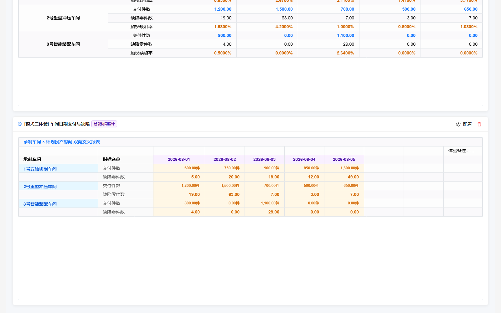
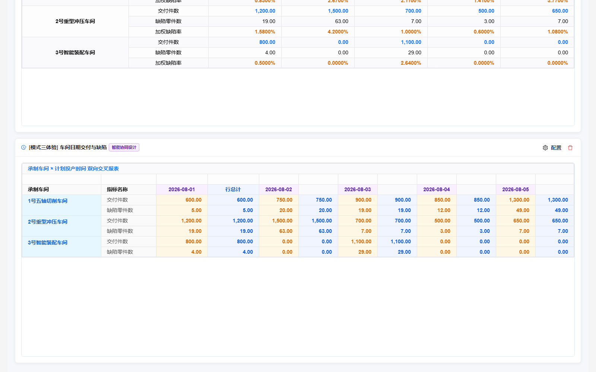

# 新建看板模式三实际体验记录

> 本文保留首次体验的历史结果。H3-F01～H3-F03已在后续整改和复验中关闭，最新实现、测试与生命周期观察见[整改清单第30节](univer-implementation-issues-and-remediation.md#30-模式三清单整改与复验结果2026-10-23)。

日期：2026-10-23。对象：`http://localhost:5174/`原主应用的“智能协同设计新建（模式三：面板选字段 + Excel展开）”。

## 1. 体验结论与范围

**模式三的基础配置、预览、保存和重开已经可用，上手成本比逐格绑定低；总计及保存回显仍有3项需整改。** 本轮12项实际交互检查9通过、3失败，没有据此宣称全部动态报表功能通过。

本次使用项目现有Playwright 1.60.0启动独立Chromium上下文，通过真实菜单、控件、键盘、画布和VTable复制完成操作。没有读写应用内部React状态，没有直接修改应用存储或模板来冒充用户配置。当前内置浏览器的已有看板未受影响；体验看板仅存在于隔离测试会话，关闭会话后不承诺它出现在用户当前看板列表。

没有修改业务源码、包依赖或事实数据，没有重跑全量单测/构建。证据见[实际交互记录](verification/hybrid-experience-2026-10-23/browser.json)及[版本与源码指纹](verification/hybrid-experience-2026-10-23/checks.json)。

## 2. 实际配置和操作

体验看板名称：`[模式三体验] 车间日期交付与缺陷`。使用工单生命周期数据集13条事实。

1. 从原新建按钮的下拉菜单进入模式三。默认是工单号行分组、投产月列分组和两个数值指标。
2. 将行分组改为承制车间，列时间粒度改为日；指标选择交付件数、缺陷零件数，保留两位小数。
3. 动态预览核对三个车间及2026-08-01～05的数据，车间标签覆盖相应指标行。
4. 开启行总计，保存至新卡片，选中VTable复制完整二维结果。
5. 重开核对字段及选项；关闭行总计和同类项合并，切回设计态，在F2通过原生F2输入`体验备注：按车间与日期统计`，再预览、保存。
6. 刷新页面并再次编辑，核对关闭状态、备注和字段；确认行总计错误恢复为勾选。
7. 双击交付指标C4打开高级设置，为数值增加“件”后缀，再次关闭行总计并保存。刷新后核对VTable中`600.00件`及完整备注仍保留。

高级设置和最后一次保存没有修改事实数值。最终输出中行总计已不显示，但这不否定中间保存路径发生的恢复问题；失败截图和二维数据均已保留。

## 3. 实际检查结果

| ID | 检查 | 结果 | 证据 |
| --- | --- | --- | --- |
| H3-01 | 原主应用新建菜单进入模式三，字段面板/画布加载 | 通过 | [新建设计器](verification/hybrid-experience-2026-10-23/new-designer.png) |
| H3-02 | 车间×投产日、交付/缺陷两指标展开 | 通过 | [配置预览](verification/hybrid-experience-2026-10-23/configured-preview.png) |
| H3-03 | 行总计跨日期汇总且只出现一次 | **失败** | [保存的VTable数据](verification/hybrid-experience-2026-10-23/saved-vtable.tsv) |
| H3-04 | 保存新卡片并由VTable展示 | 通过，基本值正常；总计错误另计H3-03 | [保存卡片](verification/hybrid-experience-2026-10-23/saved-card.png) |
| H3-05 | 第一次重开恢复车间、日粒度和两项指标 | 通过 | [重开预览](verification/hybrid-experience-2026-10-23/reopened-preview.png) |
| H3-06 | 两位小数选项准确回显 | **失败**，控件变为常规数值 | 同上；实际数值仍有两位小数，未认定已丢失显示格式 |
| H3-07 | 同类项合并关闭后保存/重开仍关闭 | 通过 | [重开选项](verification/hybrid-experience-2026-10-23/reopened-disabled-options.png) |
| H3-08 | 行总计关闭后无残留、重开仍关闭 | **失败**，表头残留，重开又勾选 | [关闭后的数据](verification/hybrid-experience-2026-10-23/after-disable-vtable.tsv)、重开选项截图 |
| H3-09 | F2输入自由备注并保存 | 通过 | 关闭后的数据包含完整备注 |
| H3-10 | 页面刷新后卡片及备注恢复 | 通过 | [刷新截图](verification/hybrid-experience-2026-10-23/after-reload.png) |
| H3-11 | 双击指标格进入高级设置 | 通过 | [高级设置](verification/hybrid-experience-2026-10-23/advanced-settings.png) |
| H3-12 | 高级单位后缀保存、刷新后保留 | 通过 | [最终刷新数据](verification/hybrid-experience-2026-10-23/reloaded-final-vtable.tsv) |

本轮未执行数据源切换、事实增删/排序、大数据性能或全部高级属性。没有捕获到页面pageerror；不把这一点扩展为所有控制台警告/网络请求均已检查。

## 4. 确认的问题与具体整改

### H3-F01：行总计变成每个日期后的重复值

**P1，对应H3-03。**

预期每个车间每项指标在末尾有一项跨日期总计。例如交付应分别为4,400、4,550、1,900；缺陷应为105、99、33。

实际第一车间交付行是`600,600,750,750,900,900,850,850,1300,1300`：每个日期后复制了该日值；表头只在第一组后出现“行总计”，后续重复列没有相应标签。该错误在动态预览、保存后的VTable和重开预览中均可见。

定位：`panelToTemplateAdapter.ts:248～285`将行总计格放在`anchorC+3`，声明行父格default、列父格null。需要同时检查引擎对明确“不继承列父格”的执行，以及总计格是否错误进入日期重复原型；当前结果证明复制范围及聚合scope没有达到水平总计要求，不能只修表头位置。

整改步骤：

1. 总计格使用当前车间的完整行切片，不继承某一天列上下文；明确区分column=null与default自动继承。
2. 将总计列锚定到整个透视列块末尾，不属于每个日期tile；标签与数值共用独立总计角色/owner。
3. 保留度量原聚合语义，SUM求全行、AVG/比例按事实切片重新计算，不能直接复制首日值或累加比例。
4. 以单日/多日、日期新增/删除/逆序、保存重开及两项指标测试：仅有一列总计，位置和值都正确。

关闭标准：本例右侧只出现一次行总计，交付4,400/4,550/1,900、缺陷105/99/33，Univer、VTable和复制结果一致。

### H3-F02：关闭总计后残留表头，重开又被认定为开启

**P1，对应H3-08。**

本轮准确复现路径：含总计保存→重新编辑→同时关闭总计与合并→切设计态添加F2备注→预览并保存→刷新后重新编辑。

关闭后数值总计已移除，但VTable仍残留“行总计”表头；再编辑时“开启行总计”变成勾选。同类项合并仍为关闭，因此不能泛化为所有开关都未持久化。纯关闭总计、不带其他编辑的路径本轮未单独断言。

源码相关链路：`HybridCellDesigner.tsx:335`依据`hdr-row-total`或`meas-rowtotal-*`的存在反解开关；旧生成表头一旦被归入extras，就会使用户关闭意图被反向覆盖。需检查重开restoredExtras及flushCanvasToTemplate的来源/版本识别，不能依靠文本“行总计”批量删除。

整改步骤：

1. 给面板生成格保存稳定owner及generation；关闭总计时清理该功能拥有的表头、计算格和样式覆盖，不删除用户自写的同名文字。
2. 快照同步使用渲染时的管理清单，避免用新配置的管理范围解释旧画布，把旧生成内容收编成自由格。
3. 持久化明确的关闭意图；旧文档反解只作迁移，不以一个孤立残留标签推翻新关闭状态。
4. 覆盖“切模式+备注”“高级属性”“关闭再开”“刷新重开”等组合；验证用户自定义备注保留，总计系统格彻底移除。

后续添加高级单位并再次关闭后，最终输出没有残留总计；这说明失败与具体状态/同步路径有关，本报告没有把它描述为所有关闭操作必然失败。

### H3-F03：格式简化控件与实际格式回显不一致

**P2，对应H3-06。**

新建时交付与缺陷选择“两位小数”，重开左侧均变成“常规数值”；画布和VTable仍为`600.00`、`5.00`。高级弹窗也能读到两位小数，之后增加“件”后缀可以保存并刷新保留。**目前确认的是控件回显错误，没有将其写成数值或后缀已经丢失。**

定位：`HybridCellDesigner.tsx:313～332`只用content.format反解measureFormats，而侧栏第1710/1748行使用number/decimal2等枚举。简化格式枚举与规范formatOptions之间缺少无损的双向映射。

整改步骤：统一规范格式描述与侧栏反向解析；常规、整数、两位小数及自定义格式有明确映射。高级前后缀、精度与缩放不能被简单控件默认值覆盖；超出简化选项的格式显示“自定义”，不冒充常规。补未编辑重存、改变精度、添加单位、刷新重开及非目标指标不变的用例。

## 5. 体验建议与未验证项

- 行、列、度量按颜色分区且实时生成模板，便于建立配置与结果的联系；保留这种交互方向。
- 当前默认“工单号×月”不一定是最常用的分析起点，可以提供“按车间汇总/按时间趋势/明细”快捷配置，减少第一次清理默认字段的成本。
- 界面的“已编译N个规则格”建议改为更面向业务的“车间/日期/指标数量”，技术细节放到高级信息。
- 转入自由设计器的宿主回调已接线，但本轮模式三界面未发现可见入口；`onEjectToFreeDesigner`在HybridCellDesigner中只声明/解构，未发现调用。该路径未体验，不计入12项通过/失败；如需开放应提供明确按钮及取消/草稿保留说明。
- 高级弹窗在中文界面仍显示Cancel/OK，可统一文案。自由备注最终列宽有限，截图中缩略但复制数据完整；可以改善自动换行/列宽设置的可发现性。

## 6. 留存与范围说明

截图及TSV位于[本轮证据目录](verification/hybrid-experience-2026-10-23/browser.json)。最终体验卡片为车间×投产日、交付/缺陷两指标、关闭合并、交付单位“件”及自由备注；最终刷新前后TSV完全相同。测试浏览器已关闭，用户内置浏览器及其既有看板未操作。

事实文件`dynamic-data-test/src/mockData.ts` SHA-256仍为`7ae500177b538d96817ecb646f80804965e0ed2c85f21a7a11d7aa13f59ba125`。本次为UI体验及问题记录，未把前几轮原生Windows浏览器识别失败或旧函数测试结果冒作本轮证据。
