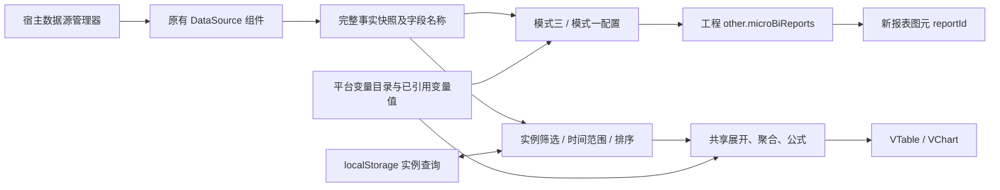

# 新报表接入 webEditor / hwComponent：实施与验收

日期：2026-11-02。三个仓库均在 `feat/micro-bi-report-integration` 分支。本轮实现真实编辑器入口、独立新报表管理和报表图元，未提交、推送或发布 npm 包。

## 1. 落地结果与边界

入口为 **设置 → 新报表**。新建表格报表打开模式三向导和 Univer 画布；新建图表报表打开模式一 VChart 配置。画面中插入 **新报表** 图元，选择资产后显示数据，图元也可关闭查询工具栏。

- 数据区域由模式三面板生成，保留现有公式、条件、原生样式、动态合并和实例覆盖链路。
- 配置态及动态预览使用 Univer，正式表格使用 VTable，图表使用 VChart。模式二不恢复。
- 新报表管理使用独立模型，不读写或转换旧 XLS 报表。旧报表与滚动表格保持原有入口。
- 数据源给出完整事实集，统计和运行时筛选在前端完成。本轮不增加远端查询接口、SQL 或自动补数。
- 变量引用接入实际平台目录和实时值；并非让 npm 包自行调用平台私有接口。



## 2. 数据源复用和错误处理

图元继续使用 `hwComponent/src/components/dataSource`。静态、实时变量、平台历史、接口数据等模式的加载、错误、刷新和页面可见性仍由原有组件及管理器处理，新报表没有另一套轮询或数据修复机制。

设计器通过 `registerMicroBiSourceFeed(loader)` 接收图元包注册的同一组件。编辑器不再直接导入兄弟仓库的 TSX 文件；打开设计器时才加载数据源组件，避免循环初始化和 npm 输出目录扩大。

| 情况 | 行为 |
| --- | --- |
| 数据增加、减少、排序改变 | 新快照重新展开，同一源模板重新匹配规则、合并及业务身份 |
| 数据源正在加载或报错 | 使用现有 DataSource 状态；设计器提供宿主刷新回调；不另建请求通道 |
| 空数据 | 展示“当前数据源没有数据”；不把暂时空结果认作全部字段被删除，恢复后重新展示 |
| 字段改名或删除 | 不猜测新字段。表格显示红色失配提示、字段名及模板中对应红色单元格；修正前不以 0 充当计算结果；图表沿现有校验显示字段不存在 |
| 仅更改字段别名 | headers 用作名称，实际匹配仍按字段 key；不会改写事实 |
| 字段类型 | 从样本值推断；不要求宿主提供可靠 schema。沿用设计器已有手动纠偏能力 |
| 删除数据源或报表资产 | 显示原有数据源错误或“新报表不存在或已被删除”，不回退到模拟数据 |

`createSnapshotCache` 在值相同时复用记录和 headers 引用；loading、分页等界面变化不会制造新的事实副本。Date、undefined、bigint 有类型标记，避免简单 JSON 比较漏掉变化。数据变化仍需比较完整快照；这不是增量数据引擎。

字段诊断使用当前 records/headers 的字段集合。空样本不推断字段删除；平台 headers 表达的有效字段即使当前记录值为空，也仍可作为字段元信息。字段 key 消失与单条记录缺值是不同情况。

## 3. 资产保存与图元状态分离

新资产结构：

```ts
interface MicroBiReport {
  id: string;
  title: string;
  revision: number;
  updatedAt: number;
  definition: {
    kind: 'micro-bi-report';
    version: 1;
    renderer: 'table' | 'chart';
    datasetId: string;
    template?: CellTemplateDocumentV1;
    chartConfig?: ChartConfigV1;
  };
}
```

表格保存源模板，图表保存 ChartConfigV1。**不将当时的事实数组、展开 publication 或临时下钻 Sheet 固化到资产中**。保存动作写入 `managerMicroBiReport` 并将工程标记为待发布；工程发布沿既有 `ProjectConfig.other` 保存到 `other.microBiReports`，再次打开时恢复。后端仍使用既有工程配置存储协议。

图元 values 保存 `reportId` 和 `showToolbar`，唯一 ID 使用现有图元工厂生成。不同图元引用同一资产，资产编辑统一生效，查询状态分别保存：

```text
micro-bi:query:v1:[projectId,pageId,componentId,reportId]
```

localStorage 仅保存 `filters/match/timeRange/sort/hiddenColumns/page/pageSize/activeSheetId`，不保存事实、变量快照、用户凭据或临时下钻数据。重开、切页面、重新挂载图元时按同一 key 恢复；跨工程、页面、图元、报表不串用。存储损坏回到默认状态；写入失败提示本次查询已生效但不能恢复。

这种状态限定于当前浏览器及 origin，不自动跨设备同步。复制图元会产生新的 componentId，默认不会继承原实例的本地查询。

## 4. 运行时操作与 VTable API

工具栏支持时间范围（今天、最近 7 天、本月及自选）、多条件 AND/OR、字段排序、显示列、刷新、Excel 导出、重置查询。查询不会改写报表源模板。

| 操作 | 实现及统计顺序 |
| --- | --- |
| 条件筛选 | `CachedDataSource.updateFilterRules`，在完整事实上执行；时间范围始终与其他条件组合取 AND |
| 明细排序 | `CachedDataSource.sort`，按原始类型比较，不排序格式化文案 |
| 分组/交叉排序 | 将排序比较器传给展开器，对所选维度的成员排序；不直接排序已经合并的矩阵，不破坏父子关系 |
| 分页 | 先完整聚合，再用 `updatePagination` 选择展示行；每页重复表头，按显示行计数，合并组跨页时携带主格值 |
| 显示列 | 用语义 bindingId、源表头身份和完整表头路径保存隐藏列；新增较早的日期不会使旧隐藏状态套到新列 |
| 合并/冻结/绘制 | 继续使用现有 publication → ListTable 适配器，不替换为 DOM 表格 |
| 导出 | 官方 TableExportPlugin 和真实 xlsx。导出当前源工作表的全部筛选结果及当前可见列，不局限当前分页；取消、数据或查询变化时释放导出任务 |
| 下钻 | 现有 DrillSession + 完整筛选事实。汇总格双击打开临时明细，按行列交集查询；显示投影同步重映射下钻坐标和版本 |

公开 API 依据：[筛选与数据分析](https://www.visactor.io/vtable/guide/data_analysis/list_table_dataAnalysis)、[排序](https://www.visactor.io/vtable/guide/basic_function/sort)、[分页示例](https://www.visactor.io/vtable/demo/basic-functionality/pagination)、[Excel导出](https://visactor.io/vtable/guide/export/excel)。实际调用以锁定版本 `@visactor/vtable@1.26.8` 的源码及自动测试为准。

矩阵显示投影 `projectReportSheet` 处理坐标、冻结区、合并主格、下钻版本，不再实现统计或另一套表格渲染。这里保留适配层，是因为源模板展开得到的是带业务身份的出版矩阵，不能对该矩阵按普通事实逐行过滤或排序。

当前分组/交叉运行时排序选择维度字段；**未提供按聚合指标值排序的运行时入口**。模式一配置内已有指标排序能力。当前列显隐属于实例视图，不是删模板列。

顶层“导出Excel”导出源报表；临时下钻 Sheet 不作为资产或顶层报表导出目标。分页是显示行分页，未实现按完整分组块分页。表格/图表互转、跨数据源 join、同比环比向导及层级钻入不在本轮新增范围。

## 5. 宿主变量引用

宿主继续负责接口、鉴权、平台变量实时订阅和变量目录。`managerVariable.getDirectory()` 提供目录元数据；设计器按 fullTitle 分层展示可搜索树，选择后在当前静态或空白单元格插入 `{{address}}`。禁止向面板控制的数据区直接插入。

完整单元格 token 才解析，`文字 {{address}}` 不作为插值语法。引用使用变量稳定 key，不以树节点显示名匹配。合并或多选区域插入只写左上角，避免将同一变量写满整个区域。

编辑态显示源 token，动态预览和正式展示用本轮 variableValues 生成临时计算副本：

- 字符串、数值、0、false、空字符串、null 保持原始类型；数字可参与工作表公式。
- 未提供/移除变量值显示 `⟪变量未提供：address⟫`，不继续残留上次值。
- 值以 `=` 开头仍是普通文字，不转为公式。
- 原生输入、插入按钮、保存重开均保留 token；变量值变化不写回源模板和撤销历史。
- 图元登记变量关联，纳入宿主原有运行变量识别和额度统计，不单独建立绕过平台的请求。

只读取当前引用的变量值；未引用变量值变化不订阅当前报表。目录、变量快照及事实引用有稳定缓存。**已引用变量变更目前会重新编译本报表**，尚未实现第 61 节规划的“仅重算引用格及依赖公式”。本地 60 条事实、两个图元的单次更新观测约 40ms，仅作为该样本结果，不是 P95 承诺。万变量目录、五万单元格、高频批量和乱序版本调度仍需专项优化与验收。

## 6. React 和依赖决策

宿主保留 React17、AntD4 和 TS4.3。新增伴随包 `micro-bi/embedded`，名称 `@hw/micro-bi-embed`，内部打包 React18.3.1、AntD5.29.3、Univer 及 VisActor。对宿主只暴露类型和原生命令式 API，不传递 React 节点：

```ts
const designer = await mountDesigner(element, options);
designer.update(nextOptions);
const definition = await designer.save();
designer.unmount();

const viewer = await mountViewer(element, options);
viewer.update(nextOptions);
viewer.unmount();
```

独立 ESM 资产通过 `import(/* webpackIgnore: true */ url)` 加载，避免宿主 webpack 的 React/AntD alias 替换 SDK 内部运行时。设计器及 viewer 按需分包，导出插件继续懒加载。AntD 使用 `mbi/mbiicon` 前缀；Univer 的基础全局 CSS 限定到 SDK 范围；弹层层级高于宿主普通配置弹窗。生命周期由 DOM 宿主持有，卸载时释放独立 React 根、表格和编辑器资源。

CopyWebpackPlugin为SDK资源设置 `info.minimized: true`，保持SDK构建结果原样，禁止宿主Terser二次压缩。生产资源专项验收发现二次压缩会导致初始化异常；普通开发服务加载通过不能代替生产资源复验。

宿主快捷键在设计器打开或焦点位于 SDK 时让位给画布，防止 F2、撤销和方向键同时触发宿主操作。没有全局升级宿主 React，也没有使用 host ReactDOM.render 挂载 React18 组件。

当前源码工作区使用 `file:../micro-bi/embedded`；构建脚本准备独立资产，webpack CopyWebpackPlugin 将它们复制到开发环境 `/micro-bi/`、生产环境 `/editor/micro-bi/`。可设置 `setting.microBiAssetBaseUrl` 指向自部署目录/CDN；自定义地址需以 `/` 结束，并允许浏览器加载 ESM。

构建使用 Vite8.3.5，建议 Node22.12+（本次22.22）；此要求用于构建伴随包，不表示运行时必须升级旧宿主框架。主库原来的独立 ESM/CJS/声明输出继续存在。伴随资产整体约 22.5MB（未 gzip，历史入口新增后88个文件，含延迟加载模块），不是全部首屏下载，也不能称为极小 SDK；仍需在真实网络、终端和业务量下测量首次打开及内存。

## 7. 运行、构建和发包步骤

工作区目录为并列 `micro-bi/`、`webEditor/`、`hwComponent/`：

```powershell
cd micro-bi
npm ci
npm test
npx tsc -p embedded/tsconfig.json --noEmit

cd ../webEditor
npm run prepare:micro-bi
npm run editor:dev
# 生产检查，不发布 npm
npm run build
npm run npmlocal

cd ../hwComponent
npm run typecheck:integration
```

webEditor 现有宿主依赖仍按其 Yarn 配置安装；本机已有依赖未全量重装。`prepare:micro-bi` 在本地源码存在时构建并同步包内 dist/声明；只有已安装包时检查其入口。`preeditor:dev/preactual:dev/preeditor:build/preactual:build/preeditor:cdn/preactual:cdn` 自动准备资源。

正式发包顺序是：构建并发布伴随包 → 将 webEditor 的 file 依赖替换为真实发布版本并发布 webEditor → hwComponent 升级到该 webEditor 版本。必须成套上线，并部署 `/editor/micro-bi/` 全部 chunk。**本轮未发布这些包，不能把仓库内 file 依赖视为已经可供外部项目安装的发布版本。**

图元仓库当前 node_modules 中安装的是较旧的 editor，直接对该旧依赖执行默认 tsc 会缺少新导出，且另有既存 API 差异。新增 `typecheck:integration` 对 `webEditor` 最新生成的 `lib/index.d.ts` 检查，通过后才可推进成套发版；生产 webpack 联仓源码构建亦已通过。不通过修改旧包缓存或补兼容代码掩盖版本差异。

禁止将 `build:npm` 当验证命令：两个旧仓库的该命令会执行 npm publish。此次只执行不发布的构建。

## 8. 验收环境及用例

使用真实 webEditor 页面、真实图元工厂、真实 DataSource、独立 React18 SDK、Univer/VTable/VChart。浏览器 context 独立，所有 `/api/` 请求由 Playwright 内存 fixture 接管；“发布”写入隔离路由并重开读取，**未连接真实私有平台账户或写入真实工程**。

样本为 60 条工单、3 个车间、5 天，qty 合计2370；一车间在8月1日为130，组成事实为10、25、40、55。报表从真实新报表管理 UI 创建，包括交叉表、明细表和图表；通过真实图元工厂生成四个实例。

| 编号 | 操作 | 结果 |
| --- | --- | --- |
| HOST-01 | 设置进入新报表管理，新建两类资产 | 正确打开模式三/模式一，保存并被图元选用 |
| HOST-02 | 同资产两个图元，A筛一车间，B排序并隐藏8月2日 | A20/60、B60/60，互不影响；唯一ID不同 |
| HOST-03 | 新增同切片qty100，新增日期及车间 | A切片130→230；B生成新增行列；删除、逆序后正确收回及重算 |
| HOST-04 | 删除8月5日数据，空数据，再恢复 | 日期列减少；空状态明确；恢复原结构与查询 |
| HOST-05 | qty→newQty，再恢复 | 表格红色字段提示及模板定位；图表提示字段不存在；未自动重映射，恢复可用 |
| HOST-06 | 隐藏8月2日，再插入更早7月31日及更改变量 | 仍只隐藏8月2日，较早新列可见；单元格文本变化不改变列身份 |
| HOST-07 | 多级变量树插入A2，变量动态变化 | 预览和VTable更新，保存重开仍是 `{{address}}` |
| HOST-08 | 原生工具栏API改C4颜色#A61D24、居中，保存重开 | 预览及VTable生效；VTable原值130，样式center和指定颜色 |
| HOST-09 | 开启汇总格明细，预览及VTable双击130 | 两端同为4条事实；活动明细时保存，源只有一个Sheet |
| HOST-10 | 明细60行翻第二页，改每页20行 | 默认第二页work-50；20行第二页work-20；重开恢复页码/条数 |
| HOST-11 | 在第二页导出并解析xlsx | 63行（3行头+60事实）5列，首work-0、尾work-59，数量合计2370 |
| HOST-12 | 时间预设今天、重置 | 样本日期不在今天时0/60，重置后恢复60/60，不请求局部后端分页 |
| HOST-13 | 完整源→空源→完整源，原生撤销重做 | 设计器节点保持挂载，源token、颜色、居中保留；撤销重做正确 |
| HOST-14 | 连续3轮打开/关闭、切设计/预览 | 无pageerror，关闭后API清空、设计器根为0 |
| HOST-15 | 实际发布按钮后重开四个图元 | 图元ID、A筛选、B排序/隐藏列、明细分页均恢复；新增资产来自工程配置 |

PI-01～18 覆盖原生数据源 API、AND/OR、日期、0/false、完整聚合后分页、合并主格裁切、下钻范围/版本、列身份、字段诊断、变量类型/公式/缺值及源token采集。加上第10节历史入口回归后，当前主库 **588/588**；宿主单元测试 **166/166**。伴随包严格类型、宿主类型、联仓生产编辑端/运行端、npm本地编译和图元集成声明检查均通过，基础阶段与后续入口的检查记录分别保存。

可重复浏览器冒烟脚本位于 `webEditor/scripts/verify-micro-bi-platform.cjs`，输入为 `webEditor/tests/fixtures/microBiReport.json`。启动宿主服务后：

```powershell
$env:MICRO_BI_HOST_URL='http://127.0.0.1:1124/'
# 环境中需可 require('playwright')；或指定 PLAYWRIGHT_MODULE 到已安装的入口。
$env:CHROME_PATH='C:\Program Files\Google\Chrome\Application\chrome.exe'
node scripts/verify-micro-bi-platform.cjs
```

脚本创建独立浏览器和内存后端，验证10组主链路（基础接入8组、历史入口2组），报告默认写入系统临时目录。它不替代上表全部手工/浏览器断言，也不声称真实后端联调通过。基础汇总见[检查记录](verification/platform-integration-2026-11-02/checks.json)，历史入口汇总见第10节，界面见[实际宿主截图](verification/platform-integration-2026-11-02/platform.png)。

## 9. 后续工作

1. 使用实际平台接口、目标部署域名及业务工程做联调，覆盖平台历史/接口数据源权限、断网恢复、工程复制/导入导出和移动端；确认生产静态资源路径及 CSP。
2. 用实际数据规模测量取数、快照比较、展开、变量更新、首次打开、导出和多图元内存，再决定 Worker、增量依赖更新或查询限制。当前为正确性接入，不宣称五万格实时变量性能已达标。
3. H3-VAR-01保留增量依赖、高频批次/版本和大目录验收；本轮基础引用链路已交付。层级钻入、报表跳转、联合数据源、同比环比及运行时聚合指标排序按独立需求推进。

## 10. 从历史记录变量创建新报表

新报表管理新增 **从历史记录变量创建**，复用原历史报表的精确多选变量组件，关闭模糊引用。创建流程为：

1. 设置 → 新报表 → 从历史记录变量创建。
2. 填写报表名称，选择历史变量及默认查询时间（默认近七日）。
3. 自动创建平台历史数据源，并打开模式三设计器；已生成“时间 + 所选变量”的明细模板，列顺序与选择顺序一致，不必先去配置数据源。
4. 调整需要的分组、交叉维度、样式或条件后保存报表，图元选择该报表，随工程发布。

自动数据源使用 `sourceMode: platform`、`platformDataType: history`、精确 `historyVariables` 和 `historyTimeRange`，沿已有 `DataSource → managerDataSource.platformRequest → variableHistoryData` 获取历史值，默认上限50000条。数据源名称冲突时自动添加序号。后续可在原数据源管理中修改变量、查询范围、数量上限及刷新配置；报表继续按当前事实进行前端分析。

创建前取消不产生数据源；进入设计器后取消，只删除本次创建且未被已保存报表引用的数据源。保存后保留源；如果用户改选其他源，原临时源无引用时清理。不会删除此前已有的数据源或资产。已有数据源列表为空时也能走此入口。

宿主通过伴随包 `createDetailReport({datasetId,title,fields,timeField})` 生成模式三受控模板，不转换旧XLS、GVAR或H.TIME函数。预设保持General格式，时间列使用 `yyyy-mm-dd hh:mm:ss`；默认时间列210px、变量列160px，后续普通格式继续用Excel工具栏。标题按报表名称保留。

实际历史源返回Date对象，Univer只接收原生标量。新增日期投影将Date转换为本地日历的Excel日期序列，元数据与投影值一致，显示年月日时分秒；初始装载和后续更新使用同一方法。事实数组和VTable的原始日期、数值、布尔值均不改写。日期文本不自动转数值。

同时修复复用表单的初始化竞态：React17可能在 `managerModal.open()` 返回前同步调用onSuccess，现在先确定并传入弹窗ID，再处理自动焦点及回车事件，原历史报表入口也验证可正常打开。

浏览器脚本可设置 `MICRO_BI_SDK_ASSET_DIR` 指向 `webEditor/dist/editor/micro-bi`，在真实宿主页面中改用最终生产SDK资源，复验资源优化后的创建及展示链路。

验收覆盖：无数据源直接创建、精确多变量及顺序、默认范围/请求变量ID、0/false、日期显示、模板和源绑定保存重开、VTable展示、历史刷新增加记录、同名源、取消清理且保留已有报表、旧历史入口。新增HISTORY-01～05及4项宿主测试；最新主库**588/588**、宿主**166/166**。普通SDK和最终生产SDK资源各**10组浏览器用例通过**，双端生产构建通过，88个生产SDK资源与SDK构建结果逐一一致。本节沿用第8节的隔离后端验收方式，未写入真实企业工程。样本证据见[历史入口检查记录](verification/history-report-entry-2026-11-02/checks.json)。

平台历史源沿用既有编辑态样本限制（每变量最多51条），展示态按数据源请求范围和数量上限获取；编辑样本不会被保存为静态事实。运行时工具栏的时间筛选是在已取回事实中筛选；要扩大历史取数范围，应修改数据源的默认查询时间。这一边界与旧数据源取数机制一致。

## 11. 新报表管理布局

管理弹窗使用独立作用域的布局样式：顶部左侧搜索名称，右侧依次为新建表格、历史变量创建、新建图表和数据源配置。原先Space样式缺失导致的纵向堆叠已消除，行内编辑/删除保持同行。

弹窗最大1080px，边缘留白随窗口变化；长名称省略并保留完整标题。每页8条，单页隐藏分页；窄窗口工具栏换行、表格内部横向滚动，操作列固定在右侧。短窗口可滚动访问列表及分页。空列表和搜索无匹配分别提示。

当前外观统一到项目现有管理页面：工具栏复用 `editorTableTool`、`.btn/.btn.blue`，搜索框采用公共灰底30px输入框并提供清空；表格复用 `editorAntTable`、small/bordered配置；编辑/删除使用原报表相同的AntD小按钮。类型用普通文本显示，弹窗标题沿公共样式，已撤掉先前独立的配色、色块标签和大标题。新增CSS只维护间距、换行、固定操作列及响应式高度，错误提示采用项目主题色。

创建、编辑、删除、历史变量及数据源仍走原有动作。公共表格原先固定了桌面滚动高度，这里只在管理弹窗内调整高度约束。

验收使用隔离接口的真实宿主页面：1920×1080、1280×720、768×700、390×700及900×480；21条长名称记录下分页可见，窄窗口操作列可用。搜索、清空、翻页、空状态、四个入口、编辑取消和删除取消通过，无pageerror。TypeScript及开发Webpack编译通过。本次布局调整未重复执行主库计算回归或全量生产构建。

当前项目风格效果见[桌面](verification/report-manager-project-style-2026-11-02/desktop.png)、[窄窗口](verification/report-manager-project-style-2026-11-02/narrow.png)，对照及验收见[检查记录](verification/report-manager-project-style-2026-11-02/checks.json)。第67节保留前次布局记录，视觉样式以第68节为准。

属性面板的新报表选择器同样复用项目的 `inputBox/selectFont` 组合样式。右侧齿轮改为28×28px扁平原生按钮，与下拉框对齐，图标18px，提供悬停/键盘焦点反馈及“管理新报表”提示；点击、Enter、空格打开管理页均通过验证。只引入共享样式，不加载字体管理逻辑。效果与记录见[设置按钮](verification/report-setting-button-ui-2026-11-02/button.png)、[检查记录](verification/report-setting-button-ui-2026-11-02/checks.json)。
