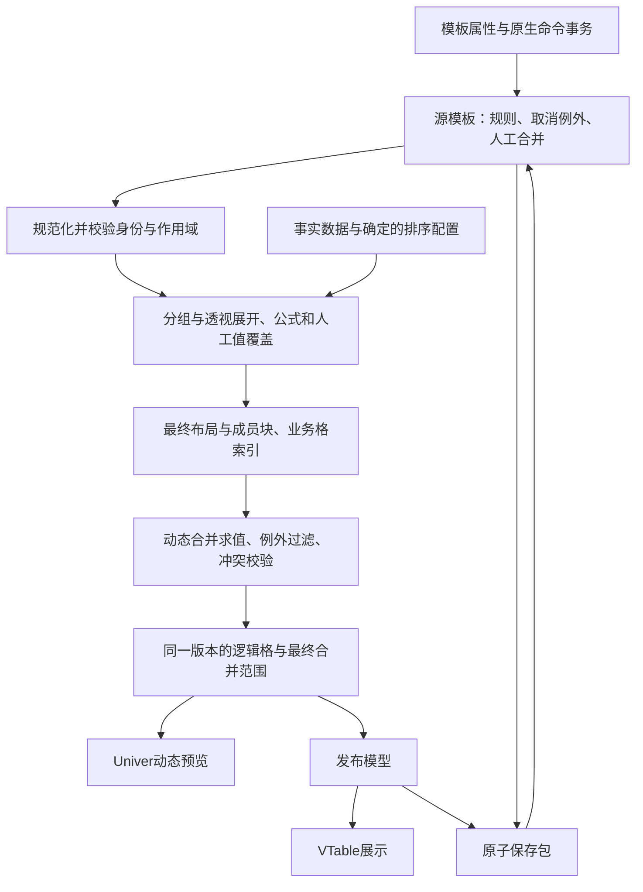

# 模板动态合并规格：分组覆盖与横纵相邻同值

维护日期：2026-10-27。本文保留当前仍使用的源规则、身份、分组边界、取消例外和Univer/VTable一致性约定。新cell模式不配置全局layoutKind/metricDirection；模式三和兼容路径可保留这些内部布局信息。下文历史方向示例及扩展用例按相应入口解释，不能重新要求新cell模式选择全局方向。

分组覆盖、相邻同值及取消例外的核心协议已在源码和测试中使用；更广的用例矩阵为持续回归规格，不表示全部组合均做过浏览器验收。范围跟随见[实施验收](static-span-implementation-and-acceptance-2026-10-26.md)，多级轴与数据变化见[多轴实施](hybrid-multiaxis-implementation-and-acceptance-2026-10-23.md)，条件样式与跨行合并边界见[条件规则实施](conditional-rules-implementation-and-acceptance-2026-10-26.md)。

关联：[单元格展开规格](cell-driven-expansion-engine-design.md)、[当前架构](README.md#当前架构)、[整改总表](univer-implementation-issues-and-remediation.md)、[React18运行约定](react18-implementation-and-acceptance.md)。

## 1. 目标、决策与验收范围

用户在模板设计态选择一个字段格，即可配置该格将来所有实例的合并行为；不必先用静态数据展开，再逐个框选合并。数据、排序、指标数量和排列方向变化后，规则重新求值，预览与VTable保持一致。

| 决策 | 明确要求 |
| --- | --- |
| 分组覆盖 | 维度标签覆盖所属成员/父组的展开块；实际跨度来自布局，不保存固定“三行/三列” |
| 横向相邻同值 | 最终同一行中物理连续、值和身份约束一致的实例格合并 |
| 纵向相邻同值 | 最终同一列中物理连续、值和身份约束一致的实例格合并 |
| 固定合并 | 标题、说明等自由区域继续采用Excel/Univer原生选区合并 |
| 配置入口 | 模板格单击配置基础规则，双击配置边界、例外和高级选项 |
| 保存源 | 模板规则、人工意图和取消例外是权威源；生成范围及工作簿快照是派生结果 |
| 展示态 | VTable消费编译后的范围，不新增独立的相邻同值判断 |
| 取消合并 | 明确“整条模板规则关闭”与“当前成员/实例例外”，保存后数据变化仍保留 |
| 数值与公式 | 只改变呈现，不删除底层值、公式、业务绑定或改变汇总口径 |
| 兼容历史 | 旧报表不自动开启动态规则，不复活用户已取消的合并 |

本期不提供任意二维连通区域合并，不把不同指标碰巧相同的数字自动合并，不重做完整自由父子格排版引擎，也不增加服务器导出/分页排版系统。

本方案与整改清单第16节的关系：**用户显式配置的动态合并规则，也属于Excel配置态保存的合并意图。** 所有合并仍由配置源决定；展示端和数据刷新不得自行补造默认规则。第16节关于取消意图、保留原值和展示一致性的约束继续有效。

## 2. 截图示例的具体效果

新模式对应两种模板原型：指标格放在不同的行，块按真实高度展开；指标格放在相邻列，块按真实宽度展开。表中的metricDirection只说明现有兼容引擎如何得到同类结果，不再作为新cell模板必填配置。

模板中的主要格：A5为`{承制车间}`，C4为`{计划投产日}`，C5/C6/C7分别为交付、缺陷和加权缺陷率，标题为A1:H1。模板坐标与结果坐标不要求一一对应。

| 对象 | 模板配置 | 指标纵向排列 `metricDirection=rows` | 指标横向排列 `metricDirection=columns` |
| --- | --- | --- | --- |
| A5车间 | 分组覆盖、方向自动 | 首个车间A5:A7，第二个A8:A10，以各成员实际位置为准 | 每个车间仅1行，无需生成纵向合并 |
| C4投产日 | 分组覆盖、方向自动 | 每天仅1列，通常无需横向合并 | 日期覆盖其3个指标列，例如B4:D4、E4:G4 |
| 总计标签 | 独立启用总计标签覆盖 | 总计标签可覆盖自身3个指标行 | 列总计标签可覆盖自身3个指标列 |
| A1:H1标题 | 固定区域合并 | 保持 | 保持；是否随报表变宽另属标题布局规则 |

增加第4个指标后，各成员覆盖相应4行/4列，不要求重新编辑合并范围。只有1个指标时，覆盖范围退化为单格，保留规则但不生成无意义的单格merge。

两个需求必须分开实现：

1. 车间名称与其下两格空白是一个成员块的布局结果，不能用“车间名称和空白相等”判断。应使用成员块元数据。
2. 明细列出现`A、A、B、A`时，相邻同值仅合并前两个A；不会将最后的A移到前面，也不改变分组、排序或数据行数量。

## 3. 设计起点与扩展背景（非当前缺陷清单）

本节是本次读码事实，不表示新增规格已经实现。

| 现有位置 | 已有能力 | 本次需补充 |
| --- | --- | --- |
| `src/report-template/types.ts` | 单元格、行列维度、指标、固定LayoutRule、有限成员selector | 动态策略、身份版本、取消例外及运行时来源 |
| `src/cell-designer/CellInspector.tsx` | 字段角色、操作、时间周期、扩展方向 | 基础动态合并属性与规则摘要 |
| `src/cell-designer/CellAdvancedSettings.tsx` | 父格、数值格式、样式 | 边界、值比较、总计标签和取消例外管理 |
| `src/report-template/normalizeCellTemplate.ts` | 模板规约为行维度、列维度、指标等执行计划 | 按目标身份解析策略，携带到执行计划 |
| `src/report/groupedProjector.ts`、`pivotProjector.ts` | 已生成一部分结构表头/分组合并 | 给候选范围附加所属模板、成员块、父组及角色来源 |
| `src/report-template/expandTemplate.ts` | 业务展开、覆盖、样式以及现有手动合并处理 | 合并规则求值阶段；不能直接恢复全部baseGrid.merges |
| `src/cell-designer/syncWorkbookToTemplate.ts` | 从mergeData重建固定规则，已加入原selector保留 | 区分生成范围和人工操作，不将预览结果烘焙为固定范围 |
| `src/cell-designer/univerEvents.ts` | 选区、双击、原生编辑事件桥接 | 带完整范围的合并/取消命令事务与origin标记 |
| `src/report/buildBiGrid.ts`、`UniverPreview.tsx` | grid转工作簿、数据增量写入和合并同步 | 同版本原子应用范围、保留逻辑格、命令重放隔离 |
| `src/report-template/compileCellReport.ts` | 发布PublishedReport及合并 | 发布同一份已校验范围和匹配的版本戳 |
| `src/ui/presentation/report/gridAdapter.ts` | sheet.merges转customMergeCell | 核对主格值/格式、范围边界及覆盖格原值保留 |
| 宿主 `CellReportEditModal.tsx`、`App.tsx`、`DashboardCard.tsx` | 保存包、数据变化重编译、VTable卡片 | 新schema校验、事务一致性、失效诊断与重开恢复 |

当前layoutRules主要表示具体范围和已经选择的一组成员。它不能表达“将来新增的所有车间实例也按各自指标块合并”。源模板没有动态策略时，VTable或投影器不得擅自代替用户开启。

## 4. 配置交互设计

### 4.1 单击：基础属性

在现有内容、字段和扩展属性之后增加“动态合并”分区：

| 控件 | 选项 / 默认 | 行为 |
| --- | --- | --- |
| 合并方式 | 不合并 / 按分组覆盖 / 相邻同值 | 旧模板默认为不合并；新示例由预设显式配置 |
| 合并方向 | 分组覆盖默认自动；同值必须选横向或纵向 | 同值模式不提供含糊的双向同时扫描 |
| 生效状态 | 开启 / 关闭 | 关闭保留规则ID、参数及例外，不等于删除配置 |
| 范围摘要 | 当前模板格生成的全部实例 | 显示sheet、region、字段/指标，避免误认为只影响当前坐标 |
| 规则来源 | 用户 / 示例预设 | 生成预览不是第三种可保存来源 |
| 应用配置 | 使用现有应用按钮 | 一次事务提交草稿，支持撤销/重做 |

分组覆盖的“自动”按目标角色确定：行维度沿最终行方向覆盖，列维度沿最终列方向覆盖；指标方向只改变块跨度，不改变规则归属。高级界面可显式锁定横向/纵向，不匹配目标角色时在配置阶段拒绝，不静默猜测。

### 4.2 双击：高级设置

| 设置 | 默认与约束 |
| --- | --- |
| 合并边界 | 同父组；可选择同数据区域，但仍不能越过小计/总计/分隔带或其他规则占用 |
| 比较方式 | 类型化实际值；首期不提供仅按格式化文本比较 |
| 空值 | null、undefined、空串各自识别，默认均不合并；可显式允许连续同类空值，仍不跨边界 |
| 文本规范化 | 首期原样比较，不自动trim、忽略大小写或转数值 |
| 数值指标 | 默认关闭；主动启用并提示仅影响显示；必须为相同metricId及模板格 |
| 总计标签 | 独立开关，生成独立的区域标签策略；不能将总计数值作为普通维度实例 |
| 小计标签 | 独立开关，仍按每个小计上下文隔离，不跨小计行 |
| 标签显示 | 保持投影器既有首格显示；若要拆分后重复标签，另设明确的标签重复展示选项 |
| 例外清单 | 列出当前组/实例的取消记录、暂不匹配原因；支持逐条恢复和明确的清除全部例外 |

同一目标的同一角色一次只启用一种动态方式，避免分组覆盖和同值规则争抢同一格。不同模板格可分别配置横向和纵向规则。

分组覆盖仅对行/列成员标签及独立总计/小计标签开放；普通明细值、指标值不能借此跨不同数值覆盖。指标值使用相邻同值时还须明确开启allowMeasures。literal自由格保持固定合并，不显示会误导其产生数据实例的动态选项。

### 4.3 设计态与预览态的可见反馈

设计态显示规则图标及说明，例如“A5：随车间覆盖指标块，纵向，当前3个指标”。不为了显示合并把多个有业务绑定的模板格真正删除或覆盖。必要的辅助阴影、虚线和示意跨度属于编辑装饰，不进入工作簿源数据。

预览态选中合并区域后，显示“规则：车间覆盖；成员：工厂F1/车间W1；范围：A5:A7”。完整选区和主格通过运行时索引反查模板目标，不能只用左上角坐标推断业务身份。基础规则编辑跳回对应模板格；预览允许对当前成员设置例外及既有人工值覆盖。

混合选区命中多个规则时先展示涉及对象及作用范围，不以一条不明确的取消操作影响整张报表。

### 4.4 原生工具栏与取消范围

| 操作位置 | 命中对象 | 提交到源模型的动作 |
| --- | --- | --- |
| 设计态自由区 | 标题/说明等固定范围 | 保留原生固定合并/取消，更新对应固定LayoutRule |
| 设计态业务模板格 | 有动态策略的字段 | 取消默认关闭此策略；显式再次开启使用原ID，保留已有实例例外 |
| 预览态分组覆盖 | 当前成员块 | 默认“仅此成员不合并”；另提供“关闭此模板规则，影响全部成员” |
| 预览态相邻同值 | 当前合并的实例格 | 默认“这些实例不参与合并”；另提供“关闭此模板规则” |
| 预览态人工固定成员合并 | 手动规则 | 移除对应人工规则，不修改其他动态策略；如同时需禁止其下动态规则，生成明确取消事务 |
| 全部取消 | 当前工作表 | 关闭该表所有动态策略并移除该表人工合并；策略与例外仍可查看，其他表不变 |

“全部取消”以后新增成员不会产生新策略；关闭的策略仍为关闭。新增字段也不自动从投影器恢复默认合并；用户明确给新字段开启规则属于新的配置意图。

### 4.5 实施后的示例配置路径

1. 从原主应用附加菜单创建“车间交付与质量”单元格示例，进入模板设计态，确认是同一个真实保存弹窗。
2. 单击A5车间格，设置“按分组覆盖、自动、开启”，应用；单击C4日期格作同样设置。
3. 若需要总计标签也跨指标块，在高级设置中分别开启行/列总计标签策略；不要框选总计数字批量合并。
4. 动态预览先选指标纵向排列，检查车间3行覆盖；再选横向排列，检查每天3列覆盖。切换前提交草稿，两个规则ID保持不变。
5. 保存报表，在原VTable卡片核对；重新打开，增加第4指标并预览，确认跨度随布局改变。
6. 对首车间选择“仅此成员取消”，往返模式、保存重开，再新增更早日期；该车间仍取消，其他车间按规则合并。
7. 配置FV时选择flag明细格，设置“相邻同值、纵向、同父组”，应用；配置FH时选择qty指标格，设置“相邻同值、横向”，明确开启数值指标合并。
8. 将横向/纵向规则分别保存至原卡片，在数据插入、排序后核对连续段；仅取消一段时，界面明确显示被排除实例数量。

这些步骤是新能力实现后的验收路径，不表示当前界面已有上述控件。

## 5. 源模型、身份与版本

以下接口和字段均为**拟新增协议，不是现有可调用API**。名称可在实现时统一，但语义和迁移要求不能省略。

### 5.1 版本与权威源

建议模板schema升级为`1.1`，新增`mergeConfig`及能力标识`template-merge-v1`。保存包同步升级为能声明所需能力的1.1；PublishedReport仍可使用现有1.0单元格/范围结构，不能把发布格式版本误当模板能力版本。

```ts
type MergeTarget =
  | {
      kind: 'template-cell';
      templateCellId: string;
      subject: 'row-member-label' | 'column-member-label'
        | 'detail-value' | 'metric-value';
    }
  | {
      kind: 'region-label';
      subject: 'row-total-label' | 'column-total-label'
        | 'row-subtotal-label' | 'column-subtotal-label';
    };

interface MergePolicyBase {
  id: string;
  sheetId: string;
  regionId: string;
  target: MergeTarget;
  expectedAxisSchema: string;
  enabled: boolean;
  boundary: 'parent-group' | 'region';
  source: 'user' | 'preset';
  sequence: number;
}

type DynamicMergePolicy = MergePolicyBase & (
  | { kind: 'group-span'; direction: 'auto' | 'horizontal' | 'vertical' }
  | {
      kind: 'adjacent-equal';
      direction: 'horizontal' | 'vertical';
      compareBy: 'typed-value';
      mergeNulls: boolean;
      mergeUndefined: boolean;
      mergeEmptyStrings: boolean;
      allowMeasures: boolean;
    }
);

interface MergeConfigV1 {
  capability: 'template-merge-v1';
  identityVersion: 1;
  legacyFallback: 'explicit-only';
  policies: DynamicMergePolicy[];
  suppressions: MergeSuppression[];
}
```

策略仅在`mergeConfig.policies`保存一份。模板侧栏通过target查询并编辑草稿，不再把同一规则复制到cell.content、LayoutRule和快照三处。固定LayoutRule及既有人工有限成员合并保留，但要明确其origin与稳定ID。

`expectedAxisSchema`由数据集契约、稳定字段/轴ID、字段类型、时间粒度、时区、周起始和分桶定义计算；不包含当前成员列表、指标数量、坐标或指标排列方向。字段替换/粒度变化需要诊断或显式迁移，不能按相同显示名继承；字段改显示名称不改变身份。

### 5.2 取消例外

```ts
// GroupContextKey / BusinessCellKey是下节结构化身份经公共codec生成的键。
type MergeSuppression = {
  id: string;
  policyId: string;
  policyKind: 'group-span' | 'adjacent-equal';
  expectedAxisSchema: string;
  sequence: number;
  source: 'user';
} & (
  | { scope: 'group-context'; groupContextKey: string }
  | { scope: 'instance-cells'; cellKeys: string[] }
);
```

分组覆盖的取消针对整个语义成员块，新增指标或子记录仍属于该块，因此继续取消。相邻同值的局部取消针对选中的稳定业务格：这些格不再参与该策略；后来插入的新格仍执行策略，但不能通过被排除的旧格串成更大合并。不能只保存旧范围或两个旧格间的一条坐标边，新插入格会让这种记录失效。

没有稳定明细主键时，禁用明细实例级取消入口并要求配置主键；仍允许整条策略关闭。不能使用行号作为实例所有权。

### 5.3 公共身份codec

业务格身份至少包含sheetId、regionId、数据集契约、templateCellId/区域标签角色、subject、metricId（适用时）、完整行列路径及明细主键（适用时）。路径每项包含稳定字段/轴ID、值类型、原始成员值及分桶定义；父组身份使用完整祖先路径。

新增合并协议用显式identityVersion及无歧义结构化编码。复用并完善公共identity模块，不在合并模块另造一套“field=value”字符串猜测规则，也不根据成员是否含等号判断版本。数字1与字符串"1"、null与空串必须不同；跨区域、不同工厂同名车间、不同年份同显示月份也必须不同。

取消例外不包含metricDirection，所以切方向后暂时没有可合并范围，例外仍保留；切回后继续生效。策略改种类或轴schema不一致时，旧例外标为暂不匹配并保留，不错误套用，也不静默删除。

GroupContextKey与业务格键使用不同结构：行标签的组键包含本轴截至目标层级的完整祖先/成员路径，列标签同理；它不包含当前指标集合、相对坐标或另一轴所有成员的枚举。区域总计/小计使用独立带区角色及相应父上下文。这样一个车间的取消才覆盖新增指标和多个片段，而不会因日期列新增被当作另一组。

### 5.4 示例规则

```json
{
  "id": "merge-workshop-block",
  "sheetId": "sheet-1",
  "regionId": "delivery-region",
  "target": {
    "kind": "template-cell",
    "templateCellId": "workshop",
    "subject": "row-member-label"
  },
  "expectedAxisSchema": "<由公共codec根据真实轴定义生成>",
  "enabled": true,
  "boundary": "parent-group",
  "source": "user",
  "sequence": 1,
  "kind": "group-span",
  "direction": "auto"
}
```

日期规则target为`plan-date`对应的真实模板格ID、subject为`column-member-label`。总计开关生成独立`region-label`策略，不复用普通成员键。示例中的schema占位符仅说明结构，不能直接复制为有效配置。

### 5.5 横向、纵向相邻同值配置示例

下面分别对应FV与FH两个合成夹具，schema仍为说明占位符；源策略没有任何本次展开行列号。

```json
[
  {
    "id": "merge-flag-equal-vertical",
    "sheetId": "sheet-1",
    "regionId": "detail-region",
    "target": { "kind": "template-cell", "templateCellId": "flag-cell", "subject": "detail-value" },
    "expectedAxisSchema": "<FV真实schema签名>",
    "enabled": true,
    "boundary": "parent-group",
    "source": "user",
    "sequence": 2,
    "kind": "adjacent-equal",
    "direction": "vertical",
    "compareBy": "typed-value",
    "mergeNulls": false,
    "mergeUndefined": false,
    "mergeEmptyStrings": false,
    "allowMeasures": false
  },
  {
    "id": "merge-qty-equal-horizontal",
    "sheetId": "sheet-1",
    "regionId": "pivot-region",
    "target": { "kind": "template-cell", "templateCellId": "quantity", "subject": "metric-value" },
    "expectedAxisSchema": "<FH真实schema签名>",
    "enabled": true,
    "boundary": "parent-group",
    "source": "user",
    "sequence": 3,
    "kind": "adjacent-equal",
    "direction": "horizontal",
    "compareBy": "typed-value",
    "mergeNulls": false,
    "mergeUndefined": false,
    "mergeEmptyStrings": false,
    "allowMeasures": true
  }
]
```

## 6. 运行模型与完整链路



运行时增加`ExpansionFootprint`：owner目标、完整成员上下文、父组上下文、带区角色、最终范围/片段及主格身份。新增`ResolvedMerge`：稳定ruleId、实例上下文、origin、主格、最终范围和版本戳。范围只在当前布局有效，不作为动态策略写回源模板。

投影器已有范围可以作为候选，但需要补齐来源；不要求先新增一套自由排版引擎。多级分组通过祖先路径生成不同层级footprint，双向透视通过行成员树、列成员树和指标排列生成footprint。首期能力按这三种现有布局实现，不宣称现有parents设置已经等同完整帆软扩展引擎。

保留三类数据：逻辑格/业务值、用于规则的成员块索引、最终显示合并。被覆盖的指标值和公式不因视觉合并删除；维度占位空白不冒充相邻重复值。首格显示或重复标签是独立投影设置，不能在取消合并时暗中复制主格值。

## 7. 按分组覆盖算法

最新新引擎要求：覆盖来源是所属重复组及其后代块的实际跨度，可以包含指标、嵌套明细和静态跟随内容；不再用全局指标方向与指标个数推导。下述候选/边界/取消算法仍适用，原布局分类用于旧协议回归。

### 7.1 候选生成

1. 根据策略target查找对应的模板格或区域标签，校验sheet、region、轴schema、角色及方向。不存在或身份变化时保留策略并诊断，不能转为按原坐标合并。
2. 在完成行列排序和指标排列的布局中查询footprint。行维度对应所属成员/祖先节点的行范围，列维度对应所属列节点的列范围；空白、表头和总计带均有明确角色。
3. 从footprint提取该标签应覆盖的范围；受小计、总计、分隔带、隐藏边界切分时，生成多个连续矩形片段，不跨越这些边界凑大包围盒。
4. 每个片段的主格显示所属成员的标签。所需片段标签由投影器明确产生或由显示投影提供，不能把任意空白格当作同值格，也不能覆盖业务指标格的值。
5. 应用对应完整成员上下文的取消例外。被取消的成员整体不生成merge；新增指标仍属于该成员，继续受例外约束。
6. 单格范围不输出merge；其规则仍保留。其余范围进入统一冲突与边界校验。

分组覆盖的parent-group是硬约束；界面不允许通过region选项将不同父组的同名标签合为一个成员块。新实现可复用projector的层级跨度计算，但要以有来源的候选形式输出，不直接把全部旧merges无条件放回结果。

### 7.2 分组报表与双向透视

| 布局 | 分组覆盖的范围来源 |
| --- | --- |
| 明细 | 本期不把普通明细字段推断成分组块；使用相邻同值，或先明确配置分组上下文 |
| 单层分组 | 当前成员对应的明细/指标布局范围 |
| 多层分组 | 每层目标维度自己的祖先节点footprint；同名子成员按完整祖先路径隔离 |
| 透视指标横排 | 行成员通常1行；每个日期/列成员覆盖其指标列；多级列头覆盖其连续后代列 |
| 透视指标竖排 | 每个行成员覆盖指标行；日期通常1列；多级行头覆盖其连续后代行 |
| 总计/小计标签 | 独立标签策略，仅覆盖自身带区，不跨入普通数据；数值总计仍是不同角色 |

当分组中插入小计导致外层成员范围被切成多个片段时，片段数可以增加，源规则仍为同一条；实例取消按成员上下文同时抑制这些片段。含孔洞或L形的覆盖不能直接作为一个Excel合并区。

## 8. 横向、纵向相邻同值算法

### 8.1 比较与边界

比较候选只能来自目标模板生成的有效逻辑格，至少同时满足：

- 同一工作表、区域、目标模板格/区域标签角色和允许的轴schema。
- 同一相应行或列，物理坐标连续；不能跳过中间的空格、其他指标、隐藏行列或不同作用域。
- parent-group模式下父组一致；region模式仅扩大允许搜索范围，不绕过数据带、角色、metricId和另一轴上下文检查。
- 指标格具有相同metricId；横向时另一轴的行上下文一致，纵向时另一轴的列上下文一致。
- 类型化实际值相等，并满足空值选项；比较使用人工覆盖后的当前显示实例实际值，格式化文本只用于显示。
- 不经过总计、小计、分隔带、被取消实例、固定合并或更高优先级占用。

region范围只对无父组的明细，或满足上述身份限制的其他目标开放；层级维度标签保持父组隔离。不同指标的数值5与5，不会因allowMeasures=true变成同一候选。

有限数值按数值相等比较，0与-0视为相等；NaN、Infinity等错误结果不参加合并并按公式/数值诊断处理。日期使用所属字段的类型化分桶成员比较；字符串原样比较，"1"不等于1，null不等于空串。

### 8.2 连续段扫描

```text
按策略、行/列和必要的上下文分区，依最终物理坐标顺序遍历候选：
  首格 -> 建立run
  下一格若相邻、上下文匹配、值相等且不被排除 -> 延长run
  否则 -> 输出长度>=2的run，重新开始
遇到边界/取消格/占用格 -> 结束run，不越过该位置连接两边
遍历结束 -> 输出最后的run
```

横向run输出同一行的列范围；纵向run输出同一列的行范围。不执行为了合并而重新排序，不把A、B、A变成A、A、B，也不跨不同metric列“跳着合并”。

给排除格重新赋相同值，不会自动移除取消记录。修改值打断run时规则保留，值再次相同时按仍有效的例外求值。跨格手动赋值仍由现有instanceOverrides负责，合并模块不新建第二套人工值覆盖。

### 8.3 执行顺序与指标方向

新cell引擎通过移动原模板格、调整局部重复块跨度改变排布，不设置全局指标方向。以下metricDirection规则用于旧兼容引擎；新引擎要求同值的物理横/纵方向在局部重排时同样保持，取消记录按语义身份保留。

事实过滤、分组和聚合/公式先形成语义数据；排序确定行列顺序，布局确定位置；按业务键应用展示实例覆盖；根据当前值求条件样式/格式，再计算动态合并，最后形成主格及外边框显示。这样样式边界可参与同值分段。若修改某个覆盖值使三个同值格变成A、B、A，合并应立即拆开，但源事实和统计汇总不改变。

相邻同值的显式方向不随metricDirection旋转。切换方向后，仍沿用户选择的物理轴求连续段；可能不再产生合并，规则及取消例外仍保留。没有可靠目标映射时给出诊断，不能猜一个新模板格继续合并。

### 8.4 排序必须进入报表源模型

当前CellRegionConfig没有完整的用户排序规格。本功能需要把已有排序入口统一为源配置；缺少入口的布局补充最小规则：按稳定fieldId/metricId指定升降序、行轴/列轴、空值位置及稳定业务键tie-break。明细可对记录排序，分组/透视只在同一父节点的兄弟成员间排序，不能把父组打散。

本期指标排序基于事实聚合值；人工展示覆盖不改变事实排序，避免循环。若未来允许按覆盖后数值排序，需新增显式口径及相应事务测试，不在本期隐含启用。

Univer业务区域的排序命令转为上述源配置并重编译；无法表达的任意选区重排应阻止并引导使用报表排序。VTable保持关闭独立records重排，启用排序交互时回调源模型后重新编译；不能仅调整显示行而留下旧合并坐标。自由区域的原生排序与业务区域分开处理。

### 8.5 成本控制

建立按目标/上下文组织的索引，不为每条规则反复遍历全表。已排序候选的同值扫描为O(K)，需要排序时为O(K log K)；分组覆盖使用已有成员树和块跨度。取消例外以语义键集合查询；矩形冲突使用按行区间或空间索引检查，避免遍历每个矩形面积。

保存包大小随源规则和用户例外增长，不随全部生成实例范围增长；新增一万个成员不应向源模板写入一万条固定LayoutRule。

## 9. 人工合并、冲突和取消意图

### 9.1 合并来源

运行时至少标记`static-layout`、`manual-instance`、`group-span`、`adjacent-equal`，另保留source=user/preset。origin放在运行索引和必要的编辑自定义元数据中；不要假定Univer原生mergeData能原样保存自定义来源字段。

固定标题与业务区域不得交叉；不同区域、不同工作表不允许拼接合并。相邻同值首期采用兼容的字体/格式/填充签名作为额外边界，避免把条件颜色不同的格合并后掩盖差异；边框可按统一外框规则归一化。分组覆盖由同一目标标签样式生成，继承主格样式。

### 9.2 统一决议顺序

1. 校验全部源意图，先移除已经取消的人工规则、关闭的动态策略。
2. 对动态候选执行成员/实例取消过滤；保留过滤原因供界面查看。
3. 有效人工明确合并优先于动态候选；动态候选若与其相交，整个候选暂停，不裁成不确定残片，并显示来源说明。
4. 分组覆盖优先于相邻同值；相同矩形去重，最终每个合并区有确定owner。
5. 两个人工范围重叠、两个同级策略争抢、越界或跨身份产生配置错误，拒绝本次无效操作，不按数组顺序静默选胜者。
6. 校验每个输出范围为连续矩形、主格存在、在工作表容量内且互不重叠。方向自动的单格结果不是错误。

保留所有候选来源索引，包括因优先级暂停的来源。取消当前结果时，除了移除当前人工owner，还需要对该处被遮盖的动态候选记录相应例外，否则取消后会马上被下层规则合回。

sequence用于事务顺序、审计与撤销重做，不表示一次“开启策略”可以覆盖所有历史取消例外。明确的新人工合并属于新意图，可以覆盖该处原动态取消，但原动态例外仍保留；再次取消人工合并后不自动复活动态合并。

### 9.3 取消状态转换

| 原状态 | 用户动作 | 源模型变化 | 数据/方向变化后 |
| --- | --- | --- | --- |
| 动态规则开启 | 关闭整条规则 | enabled=false，保留ID/配置/例外 | 所有原成员和新成员都不合并 |
| 规则关闭 | 再次开启 | enabled=true，原例外不删除 | 未被例外排除的范围恢复 |
| 分组覆盖开启 | 仅此成员取消 | 增加group-context抑制 | 指标增减、排序、切方向都保留 |
| 同值开启 | 仅这些实例取消 | 增加instance-cells抑制 | 原实例不再参与；插入新实例不把原实例带回合并 |
| 成员暂时消失 | 数据删除/过滤 | 例外标记暂不匹配，原键保留 | 同身份成员回归仍取消，不转移给同名其他成员 |
| 策略schema变化 | 换字段/分桶 | 例外暂不匹配并诊断 | 不跨schema继承，显式迁移后才恢复 |
| 已有例外 | 明确恢复当前例外 | 移除指定抑制 | 下一次求值按规则合并 |
| 任意编辑 | 撤销/重做 | 源意图原子恢复/重放 | 与Univer当前投影同版本，不双重执行 |

仅保留`merges: []`无法表示以上状态。设计态没有运行时bindings也不应影响它们：规则与例外始终来自源模型，不从当前坐标重猜。

### 9.4 人工有限范围的兼容边界

历史semanticSelector仍表示固定的一组业务格，不自动扩大为全部未来成员。数据变化后按原身份重定位；缺失成员保留原规则并诊断。指标方向改变使原人工区域无法保持合法矩形时，沿用已有冲突/阻断策略，禁止改绑新成员。

自动刷新编译失败时，宿主不得把旧publication标成新数据结果；保留最后成功版本并明确显示“当前结果尚未更新”及诊断。是否将某些手动冲突放宽为仅暂停该条合并需要另行决策，本方案不借动态规则悄悄放宽旧阻断标准。

## 10. 原生命令、模板草稿与动态预览

### 10.1 合并/取消事务

在univerEvents扩展完整范围、命令ID、实例generation、renderStamp和事务ID。普通鼠标/键盘选区也要能获得完整矩形，不能只保留startRow/startColumn。识别所安装SDK真正的合并、取消及撤销命令契约，以集成测试固定；本文不臆造已经存在的事件名。

通过Facade命令执行前接口或自有命令适配器，把业务区域的原生合并/取消归一为一条源意图事务，先保存原业务映射和逻辑值，再执行显示变更。跨多个业务绑定的设计态物理合并不能删除模板格；应进入规则配置或明确拒绝，普通标题操作保持原生体验。

预览中人工合并可以显示主格，但不能把SDK清空覆盖格产生的null写成批量人工覆盖。主格人工编辑只修改明确选中的主格实例，不能自动给整个合并区写同一个值。取消时从逻辑格及人工覆盖恢复各格原值；自由区则保留原生工作簿实际内容，不额外填充。

### 10.2 快照同步职责收敛

`syncDocumentFromWorkbookSnapshot`接收本次renderStamp、origin索引和已提交命令事务。生成的mergeData不转成新的固定LayoutRule；设计态空bindings不能清空mergeConfig；仅在有确切人工操作证据时修改对应固定/实例规则。

没有发生合并编辑时，预览保存前后policy、suppression及人工规则集合应深相等。导入裸工作簿若缺少来源元数据，只能作为静态导入或经过明确映射向导，不能根据最新数据坐标推断动态规则。

### 10.3 刷新与模式切换

切模式、切布局、切指标方向、刷新和保存共用提交入口。先使用操作产生时的grid和身份索引提交尚未完成的命令，再以新数据/配置编译。数据版本已经变化时重放语义操作；只剩旧坐标则暂停该操作并诊断，不拿新grid解释旧坐标。

程序写入采用按实例的重入计数与finally复位，SDK刷新产生的事件不得回流为用户规则。Univer更新逻辑值及最终merge集合应作为一个投影事务，先移除过期合并，再更新格值/容量/新范围；不得积累旧范围或短暂把覆盖格空白写回源。

React18的重复render/effect和旧异步结果不能改写源规则。编译器保持纯函数，即使输入没有freeze也不能写selector或归档；源变更只能通过可撤销的显式事务执行。

## 11. 保存、恢复与VTable展示

### 11.1 保存原子性

保存事务固定`templateRevision、dataRevisions、layoutRevision、compilerVersion、mergeCapability、transactionId`。提交模板草稿、原生命令和未完成编辑；等待支持的公式稳定；在同一版本捕获语义源并编译；通过校验后，一次写入源模板、publication和stamp。

等待过程中发生数据更新、换方向、切工作表、关闭弹窗或新保存事务时，旧事务不能提交。可以明确重试最新版本或提示重试，不允许模板是新规则而publication仍为旧范围。保存失败不关闭弹窗，不清除取消例外，原卡片保留最后有效保存包。

### 11.2 保存包与重开顺序

- template保存mergeConfig、固定/人工合并及用户例外；不保存所有生成范围作为未来规则。
- publication保存当前数据版本的最终合并范围、主格文本/样式及单元格逻辑值；可保存为显示缓存。
- editorSnapshot作为光标、滚动和编辑恢复辅助缓存，带来源stamp；不能覆盖更新的源策略。
- 重开先校验schema/能力并迁移，再读取最新数据重新编译；只有stamp匹配时才使用快照/发布缓存。
- disabled策略、暂不匹配例外以及新方向下退化为单格的规则都要JSON往返保留。

### 11.3 VTable与其他消费路径

`compileCellReport`输出的grid.merges经统一转换生成PublishedSheet.merges；`gridAdapter`只将它映射到customMergeCell，不访问Univer、不按相邻记录再合并，也不受旧table.mergeCells开关覆盖。

核对Univer与VTable均使用实际主格的显示文本、数字格式、字体、背景、边框和对齐。可选merge.text必须与主格显示投影一致，不能一个端读text、另一个端读空records而展示空白。

动态数据更新从同一template重新编译替换整个publication合并集合；VTable不得原地追加范围。排序同样走源配置，不能只重排records。

逻辑复制/导出保留所有业务值；格式化导出如现有路径支持合并，则消费同一范围。二维表合并并不改变公式引用和汇总。现有CSV/TSV不支持单元格合并时，按逻辑网格输出，不为了视觉效果清空指标值；复制模式需要在产品中保持明确一致的口径。

## 12. 数据变化行为表

| 变化 | 分组覆盖 | 相邻同值 | 取消意图 |
| --- | --- | --- | --- |
| 新增车间/日期 | 新成员按自身块生成，旧成员按新位置重算 | 按最终顺序重扫连续段 | 关闭规则仍关闭；新成员不继承其他成员例外 |
| 原成员增加明细/指标 | 按真实footprint扩大 | 新值参与比较，不跨排除格 | group-context取消覆盖新增子格；instance-cells仅排除原明确实例 |
| 删除成员/透视列 | 删除过期范围，不残留空合并 | 剩余候选重新分段，可能出现新相邻段 | 例外保留为暂不匹配，不转移到顶替坐标的成员 |
| 成员回归 | 正常规则恢复求值 | 重新比较 | 同完整身份的取消继续生效 |
| 全部数据清空 | 业务合并清空，静态标题保留 | 无候选 | 策略、关闭状态及例外全部保留 |
| 改事实值/人工展示值 | 所属块不因数值改变 | 同值段可能拆分/形成 | 不因值相同自动清除取消记录 |
| 明细/行列成员排序 | 依据新顺序重算块/片段 | 严格按新物理邻接求值 | 按身份定位，不按旧行列号 |
| 3指标变4指标 | 覆盖4行/列 | 按目标metric及物理邻接计算 | 已取消整个成员仍取消，不能只记旧3格 |
| rows切columns再切回 | 自动跨度自适应，可能暂为单格 | 横/纵显式方向保持 | 规则及例外均保留，切回不复活被取消块 |
| 替换分组字段/时间粒度 | 校验schema，需明确迁移 | 同样校验schema | 不凭同名成员继承例外或规则所有权 |
| 隐藏/过滤 | 按源过滤重算；隐藏位置不压缩为假邻接 | 隐藏/分隔位置是扫描边界 | 暂不匹配记录保留 |

## 13. 历史迁移与失败诊断

### 13.1 旧模板迁移

1. 1.0模板打开时保持旧合并结果；在内存适配为等价空策略视图，legacyFallback为explicit-only，不从投影器补默认策略。未使用新能力时仍可保持1.0保存，不能向1.0包悄悄塞入需要1.1解释的属性。
2. 已有静态规则和有限semanticSelector按原意保留，不推断为对所有未来成员生效的group-span。
3. 没有稳定身份的旧业务范围保留原记录并标待确认，提供按原schema映射的迁移，不根据变化后数据捕获新成员。
4. 用户主动配置动态规则后才保存为1.1；新示例可以直接使用显式规则的1.1模板。迁移幂等，备份原包，取消/关闭状态不得丢失。
5. 老reader遇到不支持的能力明确拒绝编辑/发布，不静默忽略mergeConfig再保存成丢规则的1.0。纯VTable可以显示已有兼容publication，但必须区分缓存与实时结果。

### 13.2 建议诊断集合

下列为拟新增诊断，不表示当前代码已有。目标缺失/schema错误对开启的策略作为配置错误处理；关闭的策略可以保留为待修复记录。数据中暂时没有成员不等于模板目标丢失，不应因此阻断空数据展示。

| 代码 | 场景 | 处理 |
| --- | --- | --- |
| MERGE_TARGET_MISSING | 目标模板格/区域标签不存在 | 保留规则并提示修正，不改绑坐标 |
| MERGE_SCHEMA_MISMATCH | 字段、类型或分桶身份变化 | 暂不应用，要求显式迁移 |
| MERGE_INSTANCE_ID_REQUIRED | 明细实例无稳定主键 | 禁用局部例外，允许关闭整条策略 |
| MERGE_SUPPRESSION_DORMANT | 取消记录当前无对应成员/种类 | 保留原记录，显示暂不匹配 |
| MERGE_RANGE_CONFLICT | 相交、跨区域或非法范围 | 新配置拒绝提交；人工历史冲突按既有阻断处理 |
| MERGE_DIRECTION_INVALID | 固定方向与目标角色不符 | 配置阶段拒绝；不悄悄旋转 |
| MERGE_STAMP_STALE | 命令/保存引用过期布局版本 | 中止旧事务，重试或提示 |
| MERGE_LEGACY_MAPPING_REQUIRED | 旧范围缺少可证明的语义 | 保留记录，迁移确认后启用 |
| MERGE_CAPABILITY_UNSUPPORTED | 模板能力版本不支持 | 拒绝编辑/重编译，防降级覆盖 |

错误不允许保存一份“valid=true但规则已静默丢失”的模板。预览中应定位到规则/模板格，显示具体修正原因，不能只弹出底层SDK异常。

## 14. 具体实施步骤与文件落点

以下是建议按顺序交付的任务，不是本次已执行的代码修改。新文件使用“新增”标记，现有模块就地适配。

| 阶段 | 具体修改 | 完成标准 |
| --- | --- | --- |
| DM-01 协议与迁移 | 修改`report-template/types.ts`、`validator.ts`、`identity.ts`；新增`mergeMigration.ts`；同步宿主保存包类型及能力检查 | 1.0保持原行为，1.1能完整序列化/恢复策略与取消记录；未知能力拒绝降级；迁移幂等 |
| DM-02 事务与草稿 | 修改`designerReducer.ts`，增加规则草稿、应用/关闭/恢复/取消/清除例外动作；保存规则stableId与editSequence；所有源变更进入统一history | 单次动作只生成一个撤销节点，关闭再开启不换ID，不丢暂不匹配例外 |
| DM-03 设计入口 | 修改`CellInspector.tsx`、`CellAdvancedSettings.tsx`、`CellReportDesigner.tsx`；必要时新增`MergeRuleEditor.tsx` | 单击/双击在真实配置弹窗可配置；预览选择能定位来源模板格和取消范围；不做独立演示入口替代 |
| DM-04 计划与排序 | 修改`normalizeCellTemplate.ts`及CellRegionConfig排序字段；策略按region/target编入计划；布局排序接收稳定配置 | 分组/透视按兄弟节点排序，固定tie-break，身份不依赖位置；切metricDirection不改策略所属目标 |
| DM-05 展开元数据 | 修改`groupedProjector.ts`、`pivotProjector.ts`及明细投影；在`report/types.ts`或内部模块定义footprint/owner | 标签、总计、小计、指标、父组及块范围可准确区分；不必给所有被覆盖空白制造业务值 |
| DM-06 分组覆盖 | 新增内部`mergeResolver.ts`实现group-span；在`expandTemplate.ts`布局完成后调用 | 先完成截图的车间行块与日期列块，支持指标3→4及多级父组，生成来源完整 |
| DM-07 相邻同值 | 在同一resolver增加横/纵连续段扫描、类型化比较、空值设置及排除集合 | 两方向均通过；无跨指标/父组/总计或格式化伪相等，不跳格合并 |
| DM-08 命令与来源 | 修改`univerEvents.ts`、`syncWorkbookToTemplate.ts`、`UniverPreview.tsx`；引入完整范围、实例origin、generation和事务戳 | 原生取消正确落源；程序刷新不新建人工合并/覆盖；设计态空bindings不清策略 |
| DM-09 冲突与发布 | 在resolver和validator完成范围/优先级校验；修改`compileCellReport.ts`、`buildBiGrid.ts`、`gridAdapter.ts` | 单一最终范围驱动Univer和VTable；所有覆盖格逻辑值保留，主格格式一致，无静默空白 |
| DM-10 主应用保存 | 修改宿主`CellReportEditModal.tsx`、`App.tsx`、`DashboardCard.tsx`及必要的`types/dashboard.ts` | 同版本原子保存、数据更新重编译、过期诊断、刷新重开都走原卡片；原面板行为不变 |
| DM-11 示例与回归 | 新增带显式策略的示例、纯函数测试及主界面验收记录；将下节用例落成测试 | 72项按实际执行层报告；历史用例保持，用户数据按原始hash恢复，不覆盖早期证据 |

建议分两批验收：第一批DM-01～06并接通DM-08～10，交付分组覆盖完整主流程；第二批DM-07及全部例外/交互边界，交付横纵同值。第一批不能只交付编译函数而不接保存/VTable；第二批未通过前不宣称本方案全部完成。

### 14.1 原配置面板的兼容

原字段面板入口及authoringMode=panel的保存协议继续保留。本期新策略首先用于cell模板，不强制给panel旧报表新增默认合并；共用projector的新增metadata为可选内部数据，旧调用者输出不变。

如果后续在原面板开放相同能力，应映射为同一个合并协议/编译器，不另写一套VTable自动合并逻辑。该开放入口不是本次完整cell流程验收的替代品。

### 14.2 编译与事件的实现约束

- resolver是纯函数，输入模板/计划/逻辑网格/footprint，返回范围、来源索引与诊断，不写入传入对象。
- 不在useMemo、state updater或SDK投影回调中自动迁移并写模板；迁移结果和取消操作由明确事务提交。
- 同一实例的命令echo按transactionId去重；卸载后的旧事件、旧公式等待和旧数据请求不得提交。
- 规则求值、来源标记、保存和展示必须使用同一版本的布局；捕获不到完整语义时返回明确诊断。
- 比较/连续段逻辑只实现一次，供预览与发布复用，禁止两端各写一套相似判断。

## 15. 测试夹具与证据要求

下节为**72项待实施验收用例，当前执行状态均为未执行**。纯函数、适配器和浏览器结果分开报告，不能把一个断言在多个脚本重复运行的次数当作独立覆盖数量。

### 15.1 固定夹具

| 夹具 | 数据与配置 | 用途 |
| --- | --- | --- |
| F0车间交付 | 当前`examples/cell-reports/workshop-delivery-quality.json`及13条工单；3车间、5日期、3指标；显式增加车间/日期分组覆盖策略 | 对应截图，事实交付10,850、缺陷237、总缺陷率2.18%；坐标以当前anchor与布局生成 |
| FV明细同值 | 稳定id r1～r6；factory依次F1/F1/F1/F1/F2/F2；flag依次A/A/B/A/A/A；配置factory父上下文、flag纵向同值 | r1/r2一段，r5/r6一段；r4与r5不能跨父组合并 |
| FH横向指标 | 同一车间5个连续日期，qty依次8/8/9/8/8；指标竖排，qty横向同值，allowMeasures=true | 同一qty行前2列和后2列分别合并，9分隔；其他指标保持 |
| FG多级分组 | 工厂→车间→产线，其中不同工厂各有名为“加工车间”的成员；开启小计/总计并加入分隔带 | 祖先路径、分片、总计标签与越界校验 |
| FL历史 | 1.0模板：标题固定合并、有限成员selector、明确空layoutRules三种；另含关闭规则/无主键明细反例 | 迁移、取消不复活、reader能力与身份保护 |

F0分别执行rows/columns两种排列；FV/FH使用合成数据，不能把它们的数值断言混作原13条工单的统计口径。需要插入更早日期时，使用新增0号车间/2026-07-01/50件/5缺陷，事实合计为10,900和242；测试后恢复。

### 15.2 公共断言

每个正向用例至少断言：源策略/例外内容与数量、目标业务身份、范围/主格、所有非目标格逻辑值、诊断、预览与publication的一致性。需要保存的用例经过JSON往返，不只保留内存引用。

每个浏览器用例从原应用真实入口操作，保存到原卡片，复制VTable二维数据并核对目标位置；不能只断言任意位置出现1000、任意一个merge存在或某个按钮点击成功。记录template/data/layout版本戳、策略ID、目标成员身份、截图及最终范围集合。

解除业务合并后用底层逻辑值验证，不用SDK合并后已清空的快照作为唯一事实。编译前后源模板深相等、无目标格外溢、范围无重叠/越界为所有算法用例的公共断言。

## 16. 完整测试用例

### 16.1 配置、身份与迁移：CFG-01～10（10项）

| ID | 操作 | 预期 |
| --- | --- | --- |
| CFG-01 | 直接从新建菜单打开设计器，单击A5设置分组覆盖并应用 | 草稿落为一条明确target的策略；真实侧栏可见，不依赖独立测试页 |
| CFG-02 | 双击A5，改边界/方向/生效状态，取消后再打开 | 取消不修改源；应用后保存参数；不误改内容、父格或样式 |
| CFG-03 | 分别给FV/FH设置纵向/横向同值 | 策略模式、方向、空值和数值开关准确；无法选择含糊的同时双向 |
| CFG-04 | 给行维度锁定不兼容方向，或对普通明细/指标请求分组覆盖 | 配置阶段明确诊断，不猜范围，不产生valid=true的错误规则 |
| CFG-05 | 同一目标尝试同时开启分组覆盖与同值 | 作为替换/互斥配置处理，无两条同级抢占 |
| CFG-06 | 配置总计标签覆盖，再编辑同名普通成员 | 两个target角色独立，数值总计和表头不被误合并 |
| CFG-07 | 1.1策略与取消记录JSON保存重开，再次保存 | ID、enabled、schema、来源和例外不变，未编辑不增记录 |
| CFG-08 | 迁移FL三类1.0模板，执行两次迁移 | 旧结果不变，无默认动态规则，迁移幂等，原空合并不复活 |
| CFG-09 | 替换字段/时间粒度但保留显示名；仅修改显示名称作对照 | 语义变化诊断，显示名变化保持；无同名跨字段继承 |
| CFG-10 | 老reader读取1.1能力；新reader读取损坏或未知版本键 | 拒绝降级写回/非法通配，保留原包和可读诊断 |

### 16.2 分组覆盖：GSP-01～12（12项）

| ID | 操作 | 预期 |
| --- | --- | --- |
| GSP-01 | F0指标竖排，开启车间覆盖 | 每个车间覆盖自身3指标行，例如A5:A7；日期单列不造merge |
| GSP-02 | F0指标横排，开启日期覆盖 | 日期各覆盖自身3指标列，例如B4:D4；车间单行不造merge |
| GSP-03 | 分别增第4指标、删至2指标 | 覆盖范围变4/2，源策略ID不变，无旧范围残留 |
| GSP-04 | 只保留1指标 | 不生成单格merge，规则仍保存；恢复3指标后重新生效 |
| GSP-05 | FG多级分组开启外层/内层覆盖 | 各层按自己的完整节点跨度合并；同名不同工厂保持分离 |
| GSP-06 | FG插入小计、总计和分隔带 | 成员候选按边界分片，无跨带区大矩形或L形合并 |
| GSP-07 | 开启独立行总计标签覆盖 | 只覆盖总计标签自身指标块，不改变交付/缺陷/比例数字 |
| GSP-08 | 开启独立列总计/小计标签覆盖 | 各标签按各自上下文覆盖，不与同名数据成员相连 |
| GSP-09 | 将region anchor平移到非零行列 | 全部范围与主格正确平移，策略身份及非目标自由区保持 |
| GSP-10 | 数据为空，再恢复 | 业务范围清空、标题保持，规则数量不变；恢复后按新布局生成 |
| GSP-11 | 隐藏/过滤掉中间成员或列 | 隐藏不形成假邻接，过滤后重新布局；不越界，无幽灵范围 |
| GSP-12 | 标题固定范围或另一条人工合并占用候选部分 | 固定/人工规则与动态来源按约定决议；动态候选不截成错误残片 |

### 16.3 相邻同值：EQ-01～14（14项）

| ID | 操作 | 预期 |
| --- | --- | --- |
| EQ-01 | FV原顺序纵向同值 | r1/r2及r5/r6各一段，r4/r5不跨F1/F2 |
| EQ-02 | FH原顺序横向qty同值 | 8/8与末尾8/8各合并，9隔开，非qty行不变 |
| EQ-03 | 输入A/B/A，保持原序 | 不跨B合并，不为追求同值改变顺序 |
| EQ-04 | 相同值之间夹空白、其他模板格或其他指标 | 中间位置是边界，禁止跳格；即使另一个指标值也相同仍不合并 |
| EQ-05 | 数字1、字符串"1"、布尔true相邻 | 类型不同不合并，字段身份不被String化 |
| EQ-06 | null、undefined、空串连续且默认空值选项关闭 | 均不合并，不把大面积空白变成合并区 |
| EQ-07 | 分别开启三类空值合并开关 | 只合并同类连续空值；null/空串不混合，区域/角色边界仍有效 |
| EQ-08 | 实际值1.001/1.004均显示1.00；不同年份日期显示同月 | 实际值或分桶身份不同，不因显示相同合并 |
| EQ-09 | "A"、" A"、"a"及中文/等号/分隔符成员 | 原样区分，编码不歧义，不通过数据字符猜协议 |
| EQ-10 | NaN、Infinity或公式错误参与候选 | 错误值不参加合并，诊断符合公式规则，无错误字符串连片 |
| EQ-11 | 未开启allowMeasures时指标数值相同；再明确开启 | 默认不合并；开启后仅同模板/metric的连续数值格可合并 |
| EQ-12 | 相同值跨父组、region、sheet或总计带 | 不越界；region设置不绕过角色和metric约束 |
| EQ-13 | 连续同值格条件背景/数字格式不同 | 在样式边界分段，避免合并掩盖不同条件格式 |
| EQ-14 | 目标连续段中给一格人工8→9，再恢复8 | 展示覆盖打断/恢复连续段；事实汇总不变，有效取消例外仍受尊重 |

### 16.4 数据、排序与方向变化：DYN-01～12（12项）

| ID | 操作 | 预期 |
| --- | --- | --- |
| DYN-01 | F0前插0号车间及2026-07-01的50件/5缺陷 | 原成员按新位置重算，新成员按规则生成；合计10,900/242，旧坐标不认领新成员 |
| DYN-02 | 删除首个成员/透视日期，后续成员顶替其坐标 | 已删除范围移除；规则与例外不转移给顶替者 |
| DYN-03 | 删去被例外排除成员，再用同一完整身份恢复 | 取消记录先暂不匹配，回归仍取消；相同名字不同父组不继承 |
| DYN-04 | 清空全部数据后恢复不同成员集合 | 空态无业务merge，新集合重算，源规则/例外不被空态清空 |
| DYN-05 | 同一原始记录乱序但源排序配置不变 | 最终成员顺序与范围确定，输入数组顺序不成为身份 |
| DYN-06 | FV切换明细升/降序及稳定tie-break | 同值段按新顺序变化，例外仍属于原id，未按旧范围搬移 |
| DYN-07 | F0按事实指标排序兄弟车间，另给一格人工1000 | 父组完整且排序口径为事实值，展示覆盖不改变事实排序 |
| DYN-08 | 透视日期列升降序/新增更早列/删中间列 | 日期覆盖与同值段依新物理布局重算，不追加过期范围 |
| DYN-09 | 3指标变4再回3并重排指标顺序 | 分组跨度正确，相邻同值不跨不同metric，被取消成员持续取消 |
| DYN-10 | rows→columns→rows，期间JSON保存重开 | 自动覆盖自适应，同值方向不旋转，关闭状态与例外完整保留 |
| DYN-11 | 保持设计窗口打开，事实更新后切预览，再切回保存 | 提交使用正确版本绑定，源selector/规则不丢，不按旧range认领新数据 |
| DYN-12 | 新模板下合法生成规则与旧人工范围方向冲突 | 人工非法范围按已有策略诊断/阻断，源意图保留；宿主不把旧发布标成新结果 |

### 16.5 取消合并与规则保留：CAN-01～14（14项）

| ID | 操作 | 预期 |
| --- | --- | --- |
| CAN-01 | 设计态关闭车间规则，保存重开，再新增成员 | enabled=false保留，原成员与新成员均不合并，日期规则不受影响 |
| CAN-02 | 预览只取消首车间覆盖，再新增该车间子记录/第4指标 | 同一group-context全部保持取消，其他车间继续覆盖 |
| CAN-03 | 只取消当前车间后切设计→预览，再保存重开 | 例外不丢失，不因设计bindings为空重建默认合并 |
| CAN-04 | 已取消成员在排序后换位置 | 例外随语义成员，不取消原坐标的新成员 |
| CAN-05 | 已取消成员rows→columns变单行，再切回 | 例外在无实际merge时仍存在，切回3指标仍不合并 |
| CAN-06 | 对FV当前r1/r2合并执行实例取消，保存后改值再改回 | 这两个id持续不参加规则；同值恢复也不清取消 |
| CAN-07 | FV在已取消r1/r2之间插入新同值记录 | 旧id不被新格连接重合并；新增实例按规则独立求值 |
| CAN-08 | 相邻段删除一部分取消格并排序，随后恢复 | 剩余/回归的原业务键仍排除，不按短期数组位置丢记录 |
| CAN-09 | 关闭规则，再开启但不清除例外 | 使用同一ruleId；仅未被排除的成员/实例恢复合并 |
| CAN-10 | 明确恢复一个取消成员；另有两个例外 | 只移除指定记录，其他例外及关闭状态不受影响 |
| CAN-11 | 当前工作表全部取消，再新增数据并切方向；另一表有规则 | 本表规则保持关闭、人工合并移除；另一表不变，无未来成员复活 |
| CAN-12 | 用户在取消处手动重新合并，再取消该人工合并 | 新人工意图可显示；取消后底层动态例外仍在，不回落成自动合并 |
| CAN-13 | 人工合并含600/750或1000/750业务格再取消 | 各业务值恢复，750不丢、不被1000填充；自由标题取消保持原生内容 |
| CAN-14 | 连续执行取消、关闭、开启、恢复例外，逐步撤销/重做 | 每次一个源事务，UI和源数组一致，不重复触发SDK echo，不出现幽灵规则 |

### 16.6 主流程、事务与消费一致性：FLOW-01～10（10项）

| ID | 操作 | 预期 |
| --- | --- | --- |
| FLOW-01 | 冷打开原应用单元格设计器，配置两类规则并保存到卡片 | 样式正常，真实入口可用，VTable最终范围/文本与预览一致 |
| FLOW-02 | 未编辑预览连续保存/重开3次 | 不增加policy、人工LayoutRule、suppression或instanceOverride；无结果范围烘焙 |
| FLOW-03 | F2改标题、修改规则后立即保存 | 本次草稿与规则都保存，4行加权缺陷率及非目标值完整 |
| FLOW-04 | 等公式期间换数据/方向，或关闭再打开另一份报表 | 旧事务不提交，template/publication/stamp匹配；其他报表不被旧回调影响 |
| FLOW-05 | 保存失败/无效冲突后修改并重试 | 弹窗保留源意图和例外，未写坏卡片；成功时只提交最新一份 |
| FLOW-06 | 两编辑器并存，反复刷新/关闭其中一个，StrictMode重放 | 程序标记和来源不串实例，清理不删除另一份规则，命令不重复落源 |
| FLOW-07 | 同输入重复编译、不同数据顺序交错编译，并深冻结输入 | 模板深相等，无编译回写selector/归档，结果确定 |
| FLOW-08 | 比较Univer mergeData、publication.merges、VTable customMergeCell | 坐标转换一致，主格文本/格式一致，无空白覆盖、重叠、越界或旧table开关二次合并 |
| FLOW-09 | 逻辑复制/CSV/TSV及现有格式化导出，随后取消合并 | 指标/公式值未被清空；支持合并的导出消费同一范围，不支持者输出完整逻辑数据 |
| FLOW-10 | 用发布包无源码alias宿主运行原面板与cell两入口，扩充到约定大数据集 | 旧面板无新增默认合并；VTable不初始化Univer；记录规则成本/包大小，源模板不按成员数膨胀 |

## 17. 测试落地、分阶段门槛与交付证据

### 17.1 建议新增测试文件

| 新增文件（尚不存在） | 覆盖 |
| --- | --- |
| `test/template-merge-policy.test.mjs` | 协议、迁移、身份、关闭/取消状态机 |
| `test/template-merge-resolver.test.mjs` | 分组footprint、两方向连续段、冲突与编译纯度 |
| `scripts/verify-template-dynamic-merge.mjs` | 真实展开器→JSON保存→重新编译→Univer/VTable适配的专项断言 |
| 主应用浏览器验收脚本/记录 | CFG的真实属性交互、DYN/CAN往返和FLOW真实保存展示 |

按实际测试层调用已安装的SDK及真实生产适配器；fake SDK只能用于隔离异常/竞态，不能替代合并和取消的浏览器证据。运行时不修改React内部state、localStorage中的模板来冒充用户已完成配置。

### 17.2 验证顺序

1. 先为历史专项脚本补充可选证据输出目录（如尚不支持），避免默认路径覆盖既有R3/R4记录。
2. 顺序构建库，运行`npm test`；保持原单元测试及现有FR、RC、AC/CX、DT、RX、R4持久化回归，结果按实际版本记录，不沿用历史通过数。
3. 执行新增resolver/协议专项，重点断言业务身份和非目标格；源对象只读测试必须通过。
4. 库构建完成后再构建宿主，核对JS/CSS懒加载与新能力入口；不要与清理dist并行导致假入口失败。
5. 在原主应用创建全新`[动态合并验收]`卡片，按截图两种方向执行配置、预览、保存、重开、数据热更新、取消及再次保存。
6. 以实际分组和双向透视分别执行，不仅测试明细；数据变化应在保持页面/设计弹窗打开时覆盖，不能每次重建页面掩盖版本问题。
7. 受hash保护地临时修改测试事实，结束后按原始字节恢复；保留干净示例，失败草稿应明确是否保存，禁止混淆临时测试与用户配置。

### 17.3 证据目录与报告格式

建议每轮独立使用`doc/verification/template-dynamic-merge-YYYY-MM-DD-rN/`，保存：

- 受测源码/依赖版本与hash、构建和单测日志、各用例ID与实际passed/failed/not-run。
- 保存前后模板JSON、正常/关闭/局部取消的规则及例外差异、每阶段renderStamp。
- 逻辑格关键值、footprint、最终范围、主格和来源索引，以及Univer/VTable对应范围与复制数据。
- 两种指标方向、分组/透视、数据增删/排序、取消后重开的截图。
- 失败复现、恢复状态与数据hash；不能只提供“全部通过”汇总而无对应断言。

目录名和文件均为实施要求，本次未创建模拟的执行结果。

### 17.4 完成门槛

新cell能力除本文件原72项及旧引擎兼容回归，还须执行[新展开引擎CE-T01～22](cell-driven-expansion-engine-design.md)；“方向往返”要有局部模板格/块重排的真实测试，不能仅测试全局toggle。其验收状态均按实际执行分别记录。

分组覆盖阶段必须从模板侧栏配置开始，经过动态预览、保存到原卡片、VTable显示和重开，且数据变更/取消后保持；只在projector返回一个merge不算完成。

完整方案需72项按适用测试层全部执行并通过，两方向相邻同值均有真实主流程证据，原回归无新增失败；历史缺陷独立列明。非法配置、版本冲突、取消例外失配按本文明确诊断，不能以删除规则或关闭校验换取通过。

性能门槛先记录同机同数据的无动态规则基线，再约定规模和增量预算；报告编译/合并求值耗时、峰值内存、首次预览时间、规则/保存包大小。建议至少1万和10万逻辑格各测；若大集合由Worker处理，要验证旧请求不覆盖新版本。不得在没有实测时预先写入“百万格无性能影响”。

隐藏行列测试使用现有发布模型/SDK已支持的能力或明确的测试夹具，不要求为本需求另建一套隐藏配置UI；消费路径不支持该能力时应明确诊断，不能压缩坐标后误合并。

## 18. 实施交付物与行业参考

持续维护合并协议、设计器入口、纯合并求值器、命令/快照隔离、保存重编译和VTable回归。具体实现与测试数量以相应实施验收记录为准，本文不单独重复声明本轮执行结果。

FineReport官方说明区分普通分组与相邻连续分组，后者处理连续相同成员；可作为本方案把分组与同值模式分开配置的参考。[相邻连续分组](https://help.fanruan.com/finereport/doc-view-319.html)

FastReport公开MergeMode提供Horizontal、Vertical、None，说明方向/关闭可以作为源对象属性；本方案的父组边界、身份例外及Univer/VTable链路是结合本项目提出的设计，不宣称照搬其内部实现。[MergeMode官方API](https://www.fast-report.com/public_download/docs/FRNet/online/en/api/FastReport.MergeMode.html)
