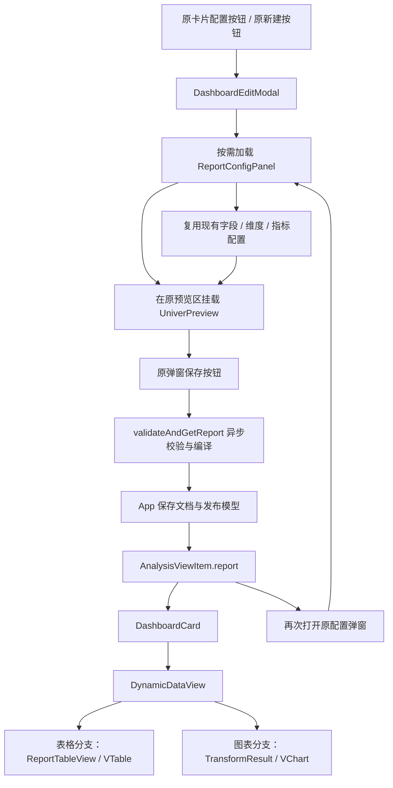
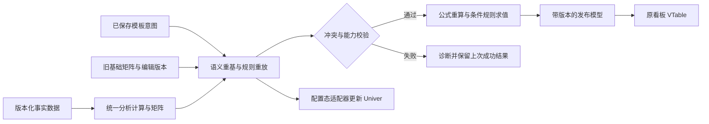

# MicroBI Univer 集成问题清单与整改方案

整理日期：2026-10-16。主流程接入问题补充日期：2026-10-16。当前版本复验、动态报表模板及测试用例补充日期：2026-10-16。

适用范围：`micro-bi` 工作区中的报表矩阵、Univer 配置编辑、发布编译与 VTable 展示实现，以及 `dynamic-data-test` 中现有看板配置弹窗、保存与卡片展示主流程。

本文保留原 MBI-01～18 的登记原因与整改要求，并追加当前版本复验及 DYN-01～08 动态模板整改项。**最新结论以第 9～13 节为准**：原配置弹窗已经出现 Univer，基础加粗可以保存到原卡片 VTable 并在重开时恢复；但人工数值保存、动态行列重建和编辑随成员迁移仍未通过。不能再沿用“主弹窗尚未接入”的历史结论，也不能据此将完整保存、刷新流程标为完成。

本轮实际执行库 `npm test`（139 项通过）、宿主构建、20 项动态专项诊断（8 项通过、12 项失败）及原看板主入口浏览器回归。新增了诊断脚本和 `doc/verification/` 证据，未修改业务源码。本文的模板类型、编译流程和实现步骤是待实施设计，不能当作当前已有 API。

**本次明确的交付要求：Univer 必须接入现有看板“配置／新建”弹窗，替换其中的 HTML 预览，保留现有字段、维度与指标配置区域；保存后在同一看板的表格视图中由 VTable 展示用户编辑结果。独立报表工作区或验收页只能用于辅助测试，不能替代这条主流程。**

设计依据：[配置态 Univer 编辑与 VTable 报表展示集成方案](C:/Users/And19/Desktop/web/micro-bi/doc/univer-preview-vtable-report-design.md)。

## 1. 历史检查结论与证据范围（最新复验见第 9 节）

原检查时，新增模块已经覆盖报表类型、矩阵生成、编辑容器、绑定管理、编译器和展示适配器，但“加载数据 → 编辑 → 保存 → 正式展示 → 重新编辑”的完整流程仍有阻断问题。以下描述保留当时证据，部分代码已经更新。

首轮验证记录（历史基线，不代表本次已经重新运行全部检查）：

| 检查项 | 结果 | 能够说明的范围 |
| --- | --- | --- |
| 库 `npm test` | 构建通过，134 项测试通过 | 已覆盖的计算、导出与基础模型行为 |
| 演示项目 `npm run build` | 在库构建完成后通过 | 当前本地环境下的类型检查和生产打包 |
| 真实 Univer Facade 命令事件 | 绑定不更新，已复现 | 事件参数契约存在错误 |
| 引擎与新矩阵对照 | 出现明细丢行、公式结果差异，已复现 | 两套计算路径尚未一致 |
| 快照编译与展示适配 | 合并区域尺寸不足，已复现 | 发布布局边界计算存在遗漏 |
| React 静态渲染 | 隐藏工作表名称出现在页签，已复现 | 展示组件没有过滤隐藏工作表 |
| 真实浏览器完整交互 | 首轮未完成；本次补充入口与显示检查 | 完整编辑、保存与重开仍需主流程验收 |

演示项目最早一次入口解析失败发生在与库清理、构建 `dist` 并行执行期间；顺序复跑已经通过，不将该临时错误作为整改问题。

上一轮主流程检查在浏览器中确认（历史状态，本轮已重新检查）：

- 从现有看板“配置”按钮打开的弹窗，预览仍为原 HTML 表格。
- Univer 入口位于独立“报表工作区”，没有接入上述弹窗。
- 独立入口显示“未检测到可用数据集、已探查 0 个字段”；现有主页面则显示已注册 4 个数据源。
- 独立编辑器工具栏短暂出现后画布为空白，检查时未发现 canvas；控制台出现 React 同步卸载 root 警告。样式加载、实例初始化和销毁需要联合整改，不能仅凭该警告认定全部空白原因已经定位完毕。

原清单登记 **18 项问题：14 项 P1，4 项 P2**。本轮追加 **8 项 P1 动态模板整改项**，当前共 **26 项：22 项 P1、4 项 P2**。原 18 项的阶段性复验状态见 9.3，新增项见 10.1；关联编号表示依赖，不将同一测试失败重复统计成多个新问题。

- P1：影响数据正确性、编辑内容保存、配置生效或可重复安装，需要在功能验收前修复。
- P2：影响已承诺的透视、布局、可见性或维度身份行为，需要在本轮完整交付前修复。
- “代码确认”与“运行复现”分别标记；未做过的浏览器或干净安装验证不记为已完成。

## 2. 原问题登记清单

下表保留最初登记状态以追踪整改来源，不能作为当前版本是否修复的判断；当前状态见 9.3。动态模板的 8 项追加清单见 10.1。

| 编号 | 级别 | 问题 | 主要影响 | 原登记证据 | 原登记状态 |
| --- | --- | --- | --- | --- | --- |
| MBI-01 | P1 | 已保存工作簿快照没有回填 | 重新编辑丢失公式、样式和手工布局 | 历史代码检查 | 待复验 |
| MBI-02 | P1 | 工作簿只在首次挂载时初始化 | 修改配置、刷新数据或切换文档不生效 | 历史代码检查 | 待复验 |
| MBI-03 | P1 | 异步数据集被当成空数组 | loader 成功后报表仍为空 | 历史代码检查 | 待复验 |
| MBI-04 | P1 | 绑定监听读取错误的事件结构 | 行列变动和人工覆盖处理全部失效 | 历史真实 Facade 事件复现 | 待复验 |
| MBI-05 | P1 | 初始矩阵绑定没有进入管理器 | 新文档没有可用的刷新、覆盖绑定 | 历史代码检查 | 待复验 |
| MBI-06 | P1 | 指标使用显示名称作为 ID | 同名指标互相覆盖，改名导致身份变化 | 历史纯计算复现 | 待复验 |
| MBI-07 | P1 | 无维度明细被当成单行汇总 | 明细记录丢失 | 历史引擎与矩阵对照 | 待复验 |
| MBI-08 | P1 | 行级计算列依赖未传递 | 后续计算列错误得到 0 | 历史引擎与矩阵对照 | 待复验 |
| MBI-09 | P1 | 通过固定延迟判断公式稳定 | 可能发布旧值或尚未计算的值 | 历史代码检查，需按当前版本复验 | 待复验 |
| MBI-10 | P1 | Univer 运行依赖没有声明 | 干净环境无法可靠构建和加载 | 历史 manifest 与安装状态检查 | 待复验 |
| MBI-11 | P2 | 发布尺寸未包含合并区域 | 标题、空白合并区被裁切 | 历史快照编译复现 | 待复验 |
| MBI-12 | P2 | 隐藏工作表仍出现在展示端 | 默认展示和页签违反可见性设置 | 历史代码与静态渲染检查 | 待复验 |
| MBI-13 | P2 | 分隔符拼接造成维度路径碰撞 | 不同交叉透视成员被合并 | 历史纯计算复现 | 待复验 |
| MBI-14 | P2 | 交叉透视小计开关未被消费 | 横纵指标模式下小计设置均不生效 | 历史两种指标方向对照 | 待复验 |
| MBI-15 | P1 | Univer 未接入现有配置弹窗 | 主配置面板仍显示 HTML 预览 | 当前代码与浏览器确认 | 待整改 |
| MBI-16 | P1 | 主流程未保存报表文档并消费发布模型 | 预览编辑无法进入保存、重开和正式表格展示 | 当前保存与卡片代码确认 | 待整改 |
| MBI-17 | P1 | 源码／构建入口混用且数据集未绑定 | 独立编辑器无法获得正确数据源 | 当前模块解析与浏览器确认 | 待整改 |
| MBI-18 | P1 | CSS 与实例生命周期未形成稳定显示流程 | 工具栏短暂出现后画布空白 | 当前代码、DOM、画面与控制台确认 | 待整改 |

## 3. 逐项整改方案

本节的“现象与原因”保留原缺陷描述；用户已修改部分实现，当前仍需完成的内容以第 9 节复验和第 10～13 节动态专项为准。

### MBI-01：已保存快照没有回填

**位置**：[ReportConfigPanel.tsx](C:/Users/And19/Desktop/web/micro-bi/src/univer/ReportConfigPanel.tsx:220)。

**现象与原因**：保存结果包含 `workbookSnapshot`，但编辑器只接收 `initialGrid`。`UniverPreview` 虽然支持 `initialSnapshot`，报表配置组件却没有传入该值。重新打开时按基础矩阵创建工作簿，无法恢复用户原有编辑。

**触发方式**：编辑报表，新增公式列和合并标题，保存并卸载编辑组件；再用保存的 `ReportDocument` 打开编辑器。

**整改任务**：

- [ ] 明确初始化优先级：同一文档存在合法快照时优先恢复快照；只有新建文档才从基础矩阵初始化。
- [ ] 将 `workbookSnapshot` 经版本和结构校验后传给编辑适配器，同时恢复绑定、人工覆盖及工作表状态。
- [ ] 恢复快照后不自动用基础矩阵覆盖内容；最新数据通过显式刷新流程应用。
- [ ] 快照损坏或版本不支持时返回定位清楚的诊断，不静默退回空工作簿。
- [ ] 区分文档切换、重新打开与宿主自身状态回显，防止保存回显再次重建实例。

**验收标准**：公式、多个工作表、样式、合并区域和手工行列在“编辑 → 保存 → 卸载 → 重开”后均保留，再次保存不覆盖原内容。

**关联测试**：新增真实编辑器恢复测试；使用有手工内容的快照，不只测试从矩阵生成空白工作簿。

### MBI-02：配置与数据变化没有应用到工作簿

**位置**：[UniverPreview.tsx](C:/Users/And19/Desktop/web/micro-bi/src/univer/UniverPreview.tsx:73)。

**现象与原因**：初始化 effect 依赖为空数组，`effectiveSnapshot` 重新计算也不会更新已创建的工作簿。修改分组、指标、数据或外部文档后，画布仍保留首次挂载内容。

**整改任务**：

- [ ] 分离实例挂载、文档装载、分析区域刷新三个生命周期。
- [ ] 为文档、分析结构和数据分别维护可比较的修订标识；使用 session token 隔离旧异步任务。
- [ ] 对相同文档的分析变化执行语义增量更新，保留手工布局、公式和人工覆盖。
- [ ] 外部切换文档时按文档身份装载对应快照；切换期间等待或结束已有编辑事务。
- [ ] 回调通过最新 ref 或显式更新机制读取当前文档，避免初始化闭包回写旧草稿。
- [ ] 将现有 `refreshAnalysisRegion` 接到实际工作簿更新流程；只返回新对象不能视为已经刷新画布。

**禁止的简化修复**：不能只把 `initialGrid` 放进初始化 effect 依赖，然后每次重建整个实例。该做法会让一次配置修改清空用户刚完成的编辑。

**验收标准**：静态数据更新、异步加载完成、切换维度、增删指标、切换数据集和切换文档后，画布与发布结果更新；手工内容保留，旧请求不覆盖新文档。

**前置依赖**：MBI-01、MBI-03、MBI-05；绑定身份调整后还需联合验证 MBI-06、MBI-13。

### MBI-03：异步数据集被当成空数组

**位置**：[ReportConfigPanel.tsx](C:/Users/And19/Desktop/web/micro-bi/src/univer/ReportConfigPanel.tsx:203)。

**现象与原因**：`ctx.dataset.data` 对异步源是 loader 函数。代码只接受数组，否则使用 `[]`，没有消费配置面板已解析的数据或 `ctx.result`。

**整改任务**：

- [ ] 扩充预览上下文，显式提供当前解析完成的 `records`、有效 `headers`、加载状态、错误和数据版本，或提供可直接投影的计算结果。
- [ ] 报表预览只消费这份已解析输入，不再通过注册对象的 `data` 猜测数据是否就绪。
- [ ] 统一异步结果中的表头、数据集默认表头和配置表头的取值规则。
- [ ] 加载期间显示明确状态，并阻止以“尚未加载完成”替代“合法空数据”发布。
- [ ] loader 失败时保留可恢复的草稿与诊断，重试成功后更新对应区域。
- [ ] 继续复用注册表的缓存和请求去重，不为预览额外发起同一请求。

**验收标准**：静态数组、同步 loader、异步数组 loader、异步 `{ data, headers }` loader 均生成相同矩阵；延迟加载、失败重试与快速切换不会出现空发布或旧数据回写。

### MBI-04：绑定事件契约错误

**位置**：[BiBindingPlugin.ts](C:/Users/And19/Desktop/web/micro-bi/src/univer/BiBindingPlugin.ts:66)。

**已复现证据**：实际 Facade 事件结构为：

```json
{
  "id": "sheet.command.insert-row",
  "type": 0,
  "params": {
    "subUnitId": "s",
    "range": { "startRow": 0, "endRow": 0 }
  },
  "options": {}
}
```

当前代码要求 `event.commandInfo`，因此直接返回。插入一行后，原第 5 行绑定仍为 5，期望应为 6。

**整改任务**：

- [ ] 按已安装 SDK 的真实事件类型读取顶层 `id/type/params/options`，去除掩盖参数错误的 `any`。
- [ ] 使用明确的命令或 mutation 白名单，避免 `includes` 同时匹配外层命令和内层 mutation 导致重复平移。
- [ ] 按工作簿与工作表 ID 过滤，不能把一个工作表的插入操作应用到所有绑定。
- [ ] 将绑定变化作为可撤销状态变更加入相同事务，补充删除、移动、排序、剪切与撤销重做处理。
- [ ] 以不可变方式产生下一份绑定，避免浅拷贝数组后直接修改宿主的对象。
- [ ] 区分用户编辑、程序数据回填和公式计算结果写入，避免自动更新被误记为人工覆盖。

**验收标准**：使用真实命令系统验证一次插入只移动一次；其他工作表不受影响；撤销和重做后，内容、绑定和覆盖状态保持一致。

### MBI-05：初始绑定没有进入管理器

**位置**：[ReportConfigPanel.tsx](C:/Users/And19/Desktop/web/micro-bi/src/univer/ReportConfigPanel.tsx:222)。

**现象与原因**：新文档通常没有 `activeAnalysis.bindings`，但 `initialGrid.bindings` 没有传入或保存。管理器使用空数组初始化，即使事件修好也找不到业务单元格。

**整改任务**：

- [ ] 新文档从首次有效矩阵创建绑定，已保存文档从其快照配套绑定恢复。
- [ ] 应用分析区域的真实 `sheetId` 和 anchor 偏移，不能统一使用硬编码 `sheet-1`。
- [ ] 初始化、坐标映射和写回文档组成一个事务，建立明确的绑定版本。
- [ ] 有效数据尚未加载时不把空矩阵绑定写成最终绑定。
- [ ] 刷新过程中迁移已有绑定及人工覆盖，不能每次简单回退为 `grid.bindings`。
- [ ] 绑定校验失败时阻止静默刷新对应区域，输出 `BINDING_INVALID`。

**验收标准**：新建分组和交叉透视报表后，无需二次打开即可识别人工覆盖、增删行列和刷新；自定义工作表及非零锚点的坐标正确。

### MBI-06：指标显示名称被用作 ID

**位置**：[normalizeAxes.ts](C:/Users/And19/Desktop/web/micro-bi/src/report/normalizeAxes.ts:112)。

**最小复现**：

```ts
const records = [
  { g: 'A', qty: 10, cost: 2 },
  { g: 'A', qty: 20, cost: 4 },
];

const columns = [
  { type: 'aggregated', field: 'qty', agg: 'sum', label: 'same' },
  { type: 'aggregated', field: 'cost', agg: 'sum', label: 'same' },
];
```

期望两列分别为 30 和 6，当前结果均为 6。`Map` 以 `label` 作为键，后一指标覆盖前一指标。

**整改任务**：

- [ ] 将指标身份与标题分离，聚合指标至少由字段和聚合方式确定，computed 使用稳定的 `name`。
- [ ] 身份编码采用可无歧义序列化的结构，例如带版本标记的 JSON 元组，不能重新引入字符串分隔符碰撞。
- [ ] 表头重命名或语言变化不得修改指标 ID。
- [ ] 同字段的 SUM、AVG、COUNT 保持独立，公式上下文按稳定键读取。
- [ ] 若允许相同业务指标重复展示，另设展示实例身份，不通过修改业务指标 ID 区分。
- [ ] 迁移旧的 label 型绑定；存在多个候选指标时返回歧义诊断，不按标题猜测后自动覆盖。

**验收标准**：同名指标数值互不污染；改标题和换语言不丢失绑定或覆盖；横纵指标方向切换后身份不变。

### MBI-07：无维度明细被折叠

**位置**：[groupedProjector.ts](C:/Users/And19/Desktop/web/micro-bi/src/report/groupedProjector.ts:106)。

**最小复现**：两条记录 `qty=10`、`qty=20`，配置为无维度的 `fixed(qty)`。现有 `transformData` 返回两条明细，新矩阵仅保留第一条 10。

**原因**：没有行轴时直接输出单行汇总，未沿用引擎的三态判定。

**整改任务**：

- [ ] 统一使用引擎的 `detail/pivot/summary` 判定，不以有无行维度代替执行形态。
- [ ] 为明细模式增加独立投影：输出全部记录、fixed 原值及逐行计算结果。
- [ ] 无维度但包含 fixed 与 aggregated 的混合配置保持现有明细语义。
- [ ] 只有聚合指标且没有维度或 fixed 的配置才进入全局汇总。
- [ ] 明细绑定使用稳定记录键；缺少稳定键时明确限制其跨数据版本匹配能力。
- [ ] 空数据保留结构，不能因为无维度而制造一条没有事实依据的记录。

**验收标准**：明细行数与引擎输出一致；纯聚合仍生成单行汇总；computed-only、混合列和空数据情况均与引擎语义一致。

### MBI-08：行级计算列依赖未传递

**位置**：[calculateMetrics.ts](C:/Users/And19/Desktop/web/micro-bi/src/report/calculateMetrics.ts:148)。

**最小复现**：输入 `qty=10`、`qty=20`；依次定义行级 `twice=[qty]*2`、`four=[twice]*2`。引擎得到总计 `twice=60`、`four=120`，新矩阵得到 `four=0`。

**原因**：每个计算列重新针对原始行求值，没有沿用前一计算列增强后的行上下文。

**整改任务**：

- [ ] 将行级增强统一到引擎路径，按配置顺序生成完整增强行，再建立分组和聚合统计。
- [ ] 后续计算列能够引用前序计算列的结果；不要通过把整个聚合结果重新当成明细求值来补救。
- [ ] 行级 computed 的汇总使用各行结果累计；汇总后 computed 使用合并后的指标上下文重算。
- [ ] 保留 `scope`、`precision`、`nullAsZero`、字段别名和所选聚合值的现有行为。
- [ ] 对矩阵新计算器与 `transformData` 做差分测试，避免修好一个公式又产生另一种语义差异。

**关联回归**：上一轮还发现配置 `AVG(qty)` 后，公式 `[qty]*2` 在引擎为 30、新矩阵为 60；`precision: 4` 的结果也被新路径默认舍入为两位。这些属于同一计算一致性整改包。

**验收标准**：上述依赖结果为 120；所选聚合引用、显式精度、中文别名、隐藏基础指标和空值选项均与引擎一致；分组和两种透视排列共同通过。

### MBI-09：固定等待 150ms 不能保证计算完成

**位置**：[adapter.ts](C:/Users/And19/Desktop/web/micro-bi/src/univer/adapter.ts:79)。

**代码证据**：当前 `waitForFormulaSettled` 只执行 `setTimeout(resolve, 150)`，没有检查公式状态。上一轮没有以复杂公式的真实浏览器运行验证其失败时点，因此本项属于已确认的实现缺口，具体慢场景需补验。

**整改任务**：

- [ ] 先通过编辑适配器提交仍处于输入状态的单元格和未完成的粘贴事务。
- [ ] 使用锁定版本的公开公式结果应用接口，例如 `getFormula().onCalculationResultApplied()`，并按 API 语义确认其等待的是当前轮结果。
- [ ] 按需求触发计算，等待依赖、跨表公式和结果写入完成，而不是固定延迟。
- [ ] 处理超时、循环引用、失效外部引用和计算错误，返回明确的发布诊断。
- [ ] 保存前后比较文档修订、session 和数据版本，避免等待期间切换文档后保存旧上下文。
- [ ] 以同一份一致快照生成文档与发布结果，避免分别采集两次而产生版本差异。

**验收标准**：即使公式计算超过 150ms，保存仍得到最新结果；编辑焦点中的最后输入不丢失；计算未就绪不能返回成功发布；期间切换文档不会串用结果。

### MBI-10：Univer 依赖没有正式声明

**位置**：[adapter.ts](C:/Users/And19/Desktop/web/micro-bi/src/univer/adapter.ts:9)、[package.json](C:/Users/And19/Desktop/web/micro-bi/package.json:126)。

**证据**：编辑入口导入 `@univerjs/core`、`@univerjs/presets` 和 `@univerjs/preset-sheets-core`，manifest 未声明对应依赖。`npm ls` 将本地 1.0.4 包标为 `extraneous`。上一轮没有删除用户依赖目录或执行破坏性的清理验证。

**整改任务**：

- [ ] 确定编辑入口的依赖策略：若采用可选 peer，补齐 optional peer 声明及开发验证依赖；若直接依赖，明确安装体积和版本要求。
- [ ] 统一 Univer 系列版本并同步 lockfile，声明 RxJS 等实际所需依赖。
- [ ] 完成 CSS 的显式加载与副作用声明核验；不把可解析 JS 入口等同于编辑器已经具备正常布局。
- [ ] 继续隔离 `micro-bi/univer`，纯报表和展示入口不能静态引入编辑器代码。
- [ ] 使用隔离目录或 CI 干净环境执行安装和构建，不在用户现有目录中删除 extraneous 包验证。
- [ ] 验证 React 17/18、ESM/CJS 与无 DOM 环境的入口行为，形成对应接入说明。

**验收标准**：干净检出后能按文档安装、构建和运行编辑器；纯展示宿主无需加载 Univer；所有新增声明文件和导出路径在隔离安装后可用。

### MBI-11：合并区域超出发布尺寸

**位置**：[compileReport.ts](C:/Users/And19/Desktop/web/micro-bi/src/univer/compileReport.ts:222)。

**复现方式**：仅 A1 有标题，合并 A1:E6。编译器根据有值单元格计算范围，生成的尺寸不足以容纳 6 行 5 列的合并区域，且未给出诊断。

**整改任务**：

- [ ] 将内容、有效样式、合并区域、明确的行列布局及受支持对象锚点合并计算有效范围。
- [ ] 校验所有合并的坐标为合法整数、范围不倒置，且位于最终发布尺寸内。
- [ ] 保留合并主单元格的内容、显示文本和样式，校验其 VTable 坐标映射。
- [ ] 处理只有样式、只有合并、只有备注或布局的工作表。
- [ ] 保持稀疏表示；整列样式等操作不能直接扩展成数百万个实体单元格。

**验收标准**：A1:E6 的合并能完整发布和显示；合并边界、空白样式与布局边界均有测试；非法范围被诊断，不能仅验证起止顺序。

### MBI-12：隐藏工作表仍然展示

**位置**：[ReportTableView.tsx](C:/Users/And19/Desktop/web/micro-bi/src/ui/presentation/report/ReportTableView.tsx:37)、[页签生成](C:/Users/And19/Desktop/web/micro-bi/src/ui/presentation/report/ReportTableView.tsx:154)。

**已复现证据**：发布模型包含隐藏表 `Hidden source` 和可见表 `Report`，React 静态渲染仍输出隐藏表页签。默认选择也从全部工作表的首项获取。

**整改任务**：

- [ ] 从发布模型派生 `visibleSheets`，默认选表、回退选表和页签生成统一使用该列表。
- [ ] 外部 `activeSheetId` 指向隐藏、删除或不存在工作表时，定义可见回退和回调规则。
- [ ] 工作表可见性变化后校正内部选择，不保留失效的当前页。
- [ ] 没有可见工作表时显示明确空状态，不回退到隐藏表。
- [ ] 编辑快照保留隐藏表供公式计算；正式展示是否裁剪隐藏表内容由发布载荷策略决定。

**验收标准**：隐藏表不出现在页签或默认画面中；受控和非受控模式都符合规则；全部隐藏、当前表被隐藏或删除时没有错误回退。

### MBI-13：维度路径碰撞导致透视成员合并

**位置**：[bindings.ts](C:/Users/And19/Desktop/web/micro-bi/src/report/bindings.ts:15)、[pivotProjector.ts](C:/Users/And19/Desktop/web/micro-bi/src/report/pivotProjector.ts:63)。

**最小复现**：

| 记录 | a | b | c | q |
| --- | --- | --- | --- | ---: |
| 1 | `x/b:y` | `z` | `ok` | 1 |
| 2 | `x` | `y/b:z` | `ok` | 2 |

行维度为 `[a, b]`，列维度为 `[c]`。当前两条行路径都编码为 `a:x/b:y/b:z`，新透视只剩一个行成员，数值被合并为 3；正确结果应为两个成员，分别为 1、2。

**整改任务**：

- [ ] 将完整轴路径编码为结构化 JSON 元组，包含轴 ID、字段和规范化成员键。
- [ ] 行列交叉索引同样使用无歧义结构，不再以 `:::` 连接可含任意字符的键。
- [ ] 绑定键、成员去重键、桶索引键和刷新匹配键使用同一版本化协议。
- [ ] 显示标签与身份分离，成员标签相同不能导致路径合并。
- [ ] 对旧路径键做兼容迁移；无法无歧义恢复时给出诊断，不能直接将人工覆盖迁移到某个候选成员。
- [ ] 空值及时间桶语义继续与业务引擎一致，不在身份修复中静默改变分组规则。

**验收标准**：上述两条记录保留为两个成员；冒号、斜杠、括号、分隔符样式文本和重复标签均不会造成碰撞；横纵指标方向结果相同。

### MBI-14：双向透视小计开关不生效

**位置**：[pivotProjector.ts](C:/Users/And19/Desktop/web/micro-bi/src/report/pivotProjector.ts:95)。

**已复现证据**：多级行轴、多级列轴下，将 `rowTotals.showSubTotals` 和 `columnTotals.showSubTotals` 从 false 改为 true，两种指标排列的单元格与合并结果均未变化。

当前代码给部分边缘总计格标注了 `subtotal`，因此不能仅统计 `role === 'subtotal'` 的数量就认定层级小计已经实现。

**整改任务**：

- [ ] 使用行、列成员树，为配置要求的父级路径生成真正的小计成员。
- [ ] 分别消费行轴和列轴的小计开关，保持底部与右侧总计的既有位置含义。
- [ ] 小计只合并对应父级范围的叶子统计，SUM、COUNT、AVG、MIN/MAX 和 computed 使用统一口径。
- [ ] 为普通值、层级小计和全局总计使用正确角色，避免刷新和样式定位混淆。
- [ ] 指标横向和纵向共用同一份小计统计，分别投影布局。
- [ ] 处理单子成员、多级父路径、重名成员、空交叉格与小计标签。

**验收标准**：开关变化确实改变对应轴的小计布局；小计位置、父路径、标签、合并和数值均正确；关闭一轴的小计不影响另一轴；底部、右侧与角落总计不重复累计小计。

### MBI-15：Univer 未接入现有看板配置弹窗

**位置**：[DashboardEditModal.tsx](C:/Users/And19/Desktop/web/dynamic-data-test/src/components/DashboardEditModal.tsx:267)、[原面板预览分支](C:/Users/And19/Desktop/web/micro-bi/src/ui/DynamicDataConfigPanel.tsx:1138)、[独立报表入口](C:/Users/And19/Desktop/web/dynamic-data-test/src/App.tsx:254)。

**当前证据**：从主看板卡片点击“配置”，弹窗显示“转换结果实时预览（前 10 行）”和 HTML 表格。宿主仍挂载 `DynamicDataConfigPanel`，没有提供 `renderPreview`；该组件因此进入默认 `LivePreviewTable` 分支。Univer 仅存在于另一个“报表工作区”。

**确定的接入方案**：在原 `DashboardEditModal` 中使用 `ReportConfigPanel` 作为组合控制器；其内部继续复用 `DynamicDataConfigPanel` 的字段、维度、时间、指标与公式配置区域，通过 `renderPreview` 将原预览区替换为 `UniverPreview`。保留原有“配置”和“新建分析看板”入口，不要求用户跳转到另一页才能编辑报表。

**整改任务**：

- [ ] 将原弹窗主体接到组合控制器，删除该主入口对旧 HTML 预览的直接使用。
- [ ] 为组合控制器补齐原宿主需要的 theme、locale、数据集选择回调与显示选项，透传到现有分析配置区域。
- [ ] 新建看板时由默认分析配置创建文档；编辑已有看板时恢复该看板保存的文档，不能每次创建新的独立示例文档。
- [ ] 保留全局注册、局部多数据集和单数据集锁定三种调用方式；这三种模式均显示 Univer 预览。
- [ ] 只在弹窗打开时按需加载编辑器代码和 CSS，给出加载、初始化失败和重试状态。
- [ ] 按现有弹窗空间调整网格高度与内部滚动，确保工具栏、公式栏、数据区和页签可以实际操作。
- [ ] 对外保留 `DynamicDataConfigPanel` 的旧默认行为兼容其他宿主；当前看板应用的主配置入口必须显式走新的 Univer 分支。

**禁止的替代交付**：只增加一个“Univer 配置”按钮、独立 Tab、独立验收 HTML，或者在原预览旁放一个不可编辑的截图，都不满足本项。

**验收标准**：从原看板卡片“配置”按钮和原“新建分析看板”按钮进入，用户在同一弹窗内直接看到并操作 Univer；字段与维度配置仍可用。验收全过程无需进入独立报表工作区。

### MBI-16：主流程没有保存完整报表并交给 VTable 消费

**位置**：[原保存方法](C:/Users/And19/Desktop/web/dynamic-data-test/src/components/DashboardEditModal.tsx:96)、[App 保存逻辑](C:/Users/And19/Desktop/web/dynamic-data-test/src/App.tsx:164)、[看板数据类型](C:/Users/And19/Desktop/web/dynamic-data-test/src/types/dashboard.ts:7)、[卡片展示](C:/Users/And19/Desktop/web/dynamic-data-test/src/components/DashboardCard.tsx:36)。

**当前证据**：保存按钮仅调用 `validateAndGetConfig()` 并把 `DynamicTransformConfig` 写回 `views`。`AnalysisViewItem` 没有报表文档与发布模型字段，卡片也只向 `DynamicDataView` 提供 `TransformResult`。即使单独显示编辑器，手工布局和工作表公式仍没有主流程保存与消费路径。

**整改任务**：

- [ ] 为宿主看板条目新增原子保存的报表包，包含 `ReportDocument` 与 `PublishedReport`，同时保留原分析配置的兼容投影。
- [ ] 将弹窗保存改为异步调用 `ReportConfigPanelRef.validateAndGetReport()`；先提交当前输入、同步绑定并等待公式结果应用，再取得完整结果。
- [ ] 初始化未完成、数据未就绪、编译失败或出现阻断诊断时，不得回退成“只保存旧 DSL”并提示成功。
- [ ] `App.handleSaveModal` 接收完整报表包，与标题、视图类型、数据集 ID 一并保存；成功后才更新正式卡片并关闭弹窗。
- [ ] 打开编辑时从条目回填同一份 `ReportDocument`；取消时丢弃草稿，已发布模型保持不变。
- [ ] 为 `DynamicDataView` 增加可选的发布报表输入；仅表格分支消费 `ReportTableView`，图表分支继续使用分析结果和 VChart。
- [ ] `DashboardCard` 透传当前条目的发布模型。用户切换到表格视图时必须看到保存的手工行列、合并、格式和公式结果。
- [ ] 新报表表格分支不得再追加旧组件的自动总计、自动表头或第二次透视展开。
- [ ] 旧条目首次编辑时由其现有配置迁移；首次成功保存前继续使用原展示路径，不能把原配置或旧发布版本清空。
- [ ] 宿主有持久化适配器时保存同一个完整包；演示应用至少实现可验证的保存恢复方式，浏览器重载后的恢复要求要有实际验收。

**数据一致性要求**：文档、发布结果和派生分析配置必须来自同一轮保存。不能保存新配置但保留旧发布模型，也不能保存新发布模型却仍回填旧工作簿快照。

**验收标准**：在原配置弹窗内添加合并标题、手工备注和局部公式列，点击原“保存并实时应用配置”后，原卡片的表格视图准确显示这些内容；再次点击同一卡片“配置”可以继续编辑。分组与两种指标方向的交叉透视均走这条路径。

### MBI-17：源码与构建入口混用，编辑器数据集未正确接通

**位置**：[Vite 解析配置](C:/Users/And19/Desktop/web/dynamic-data-test/vite.config.ts:30)、[注册调用](C:/Users/And19/Desktop/web/dynamic-data-test/src/constants/presets.ts:72)、[独立入口参数](C:/Users/And19/Desktop/web/dynamic-data-test/src/univerAcceptance.tsx:136)。

**当前证据**：Vite 将 `micro-bi`、`core`、`engine`、`ui`、`locale` 指向源码，`report/univer` 却仍通过包导出读取 `dist`。源码注册的数据集与构建版配置组件的相对导入会进入不同模块实例。浏览器中主页面显示 4 个已注册数据源，报表编辑器显示没有数据集。独立验收页中的五条记录只用于计算统计标签，没有作为 `datasets` 传给编辑组件。

**整改任务**：

- [ ] 开发模式将所有 `micro-bi` 入口统一解析到同一份源码，补齐 `micro-bi/report` 和 `micro-bi/univer` 的精确别名。
- [ ] 同步 TypeScript 路径、依赖预构建和模块去重配置；正式包消费测试则统一读取构建产物，不混搭两种来源。
- [ ] 主弹窗的组合控制器复用原 `panelDatasets` 与当前数据集 ID，不能另建一份无关的全局注册中心。
- [ ] 把已经解析的数据、有效表头、加载和错误状态继续传到 Univer 矩阵生成层，保证异步源同样可用。
- [ ] 为显式数组、全局注册、局部多源、单源锁定及异步 loader 建立主弹窗回归用例。
- [ ] 保留独立验收页时，显式传入其示例数据集并绑定正确 ID；不能用页面顶部的矩阵统计证明编辑器已经获得数据。
- [ ] 初始发布结果必须由真实工作簿或正确的矩阵快照编译，不能把业务 `ReportDocument` 直接当作 Univer 工作簿快照传入编译器。

**验收标准**：主页面、主配置弹窗和编辑器读取同一个数据源；字段数量、行数、表头和指标均一致。主流程加载异步数据后出现真实表格，而不是“未检测到可用数据集”或空发布模型。

**边界说明**：显式传入 `datasets` 可以用于局部作用域，但不能代替开发模式模块来源统一；全局注册模式仍需通过。

### MBI-18：缺少稳定的样式加载与实例初始化流程

**位置**：[adapter.ts](C:/Users/And19/Desktop/web/micro-bi/src/univer/adapter.ts:9)、[实例清理](C:/Users/And19/Desktop/web/micro-bi/src/univer/UniverPreview.tsx:120)、[React StrictMode 入口](C:/Users/And19/Desktop/web/dynamic-data-test/src/main.tsx:5)。

**当前证据**：独立编辑入口曾短暂显示工具栏，随后编辑区变为空白；检查时没有 canvas。代码未显式引入 Univer core preset 的 CSS，控制台同时出现 React 正在渲染期间同步卸载嵌套 root 的警告。

缺少 CSS 与实例生命周期是需要分别验证的两部分。不能把所有空白都归因于样式，也不能以关闭 StrictMode 掩盖销毁竞争。

**整改任务**：

- [ ] 在配置端的懒加载边界显式加载锁定版本的 `@univerjs/preset-sheets-core/lib/index.css`，与必要的语言和插件注册共同准备就绪。
- [ ] 明确编辑专用 CSS 的副作用保留方式，不从纯展示入口全局引入；Node 编译器或测试入口也不能被浏览器 CSS 导入破坏。
- [ ] 每次挂载为该实例创建独立子容器，避免多个实例或 StrictMode 重挂载共用、清空同一 DOM 容器。
- [ ] effect 清理捕获该次挂载的本地实例、绑定管理器和容器；失效 session 立即停止回调，再按 SDK 与 React 的安全时序完成实例销毁，例如延迟到 microtask。
- [ ] 延迟清理只能释放旧实例及其容器，不能通过已指向新实例的共享 ref 删除新画布。
- [ ] 取消 `container.innerHTML = ''` 这类可能干扰其他挂载代次的清理方式；普通配置更新继续走增量应用。
- [ ] 为弹窗打开、关闭和尺寸变化建立正确的可见初始化与 resize 流程，确保初始化时宽高有效。
- [ ] 初始化失败时展示可重试的错误状态，并向宿主返回未就绪诊断；不能只写控制台后留下空白框。
- [ ] 在 StrictMode 保持启用的环境中重复打开和关闭原配置弹窗，验证画布、事件与公式计算始终可用。

**验收标准**：在原主弹窗内，工具栏、公式栏、工作表页签和 canvas 持续存在且可以操作；连续重开、快速切换看板和容器缩放后不消失。没有同步卸载警告，没有旧实例清理新容器的竞争；表格展示页面没有加载编辑专用 CSS 或 Univer 运行时。

## 4. 共用整改设计

### 4.1 统一计算输入，保留现有公开入口

当前 `buildBiGrid(config, records, options)` 已经通过新入口导出，不宜在修复中直接改成不兼容的参数形式。

建议保留该入口作为兼容包装，在内部调用现有分析引擎，再将结果交给纯矩阵投影器。也可以增加接收已计算结果的新入口，供配置预览复用，避免重复计算。

```text
数据解析结果
  → 统一的分析执行与行级增强
  → 叶子结果与聚合统计
  → detail / summary / grouped / cross-tab 投影
  → 表头、小计、总计、合并和绑定
```

投影器只改变布局，不自行重写一套业务公式语义。处理同时间字段双轴不同粒度时，可先生成独立的执行字段别名，再进入统一计算；业务绑定仍记录原轴与原字段身份。

计算依赖始终独立于展示投影。隐藏某个指标、只展示前几行、切换指标方向和滚动窗口，都不能改变业务总计。

### 4.2 区分初始化、编辑与刷新

| 状态变化 | 预期动作 | 不允许的行为 |
| --- | --- | --- |
| 新建且无快照 | 从有效基础矩阵创建工作簿与绑定 | 在数据未就绪时永久固定空矩阵 |
| 打开已有文档 | 恢复快照、绑定和编辑状态 | 先恢复后立即被基础矩阵覆盖 |
| 宿主回显自身 onChange | 确认修订，保持当前实例 | 重建工作簿并丢失选区和编辑 |
| 业务配置或数据更新 | 以稳定身份刷新对应分析区域 | 覆盖整张工作表 |
| 切换文档 | 结束旧事务，装载新文档，废弃旧异步回调 | 将旧结果写入新文档 |
| 修改普通样式 | 更新编辑状态 | 重新请求数据并全量重算 |
| 取消编辑 | 丢弃草稿，保留已发布版本 | 将取消前的临时状态写入正式展示 |

该状态划分是 MBI-01、02、03、05 的共同实现基础。应先固定行为，再调整 React effect，而不是依次给 effect 增加更多依赖。

### 4.3 身份协议与旧文档迁移

MBI-06 与 MBI-13 应一起确定规范化身份协议，并在刷新、绑定和投影器中共同使用。

建议协议至少包含：版本、分析区域 ID、轴身份、字段、规范化成员键、指标身份与单元格角色。结构化编码示意：

```ts
const key = JSON.stringify([
  'binding-v2',
  analysisId,
  rowPath.map((m) => [m.axisId, m.field, m.memberKey]),
  columnPath.map((m) => [m.axisId, m.field, m.memberKey]),
  metricId,
  role,
]);
```

这只是身份编码示意，最终字段应与公共协议一致。不能把示意中的协议版本与报表文档版本混为一谈。

迁移步骤：

1. 在重新投影前识别旧文档与旧绑定协议。
2. 利用保存的字段、聚合方式、轴路径和区域信息建立唯一匹配。
3. 同时迁移绑定、人工覆盖字典及其引用，不能只改绑定 ID。
4. 完全匹配的对象保留原编辑意图；多候选或已经碰撞的对象给出诊断。
5. 迁移在草稿上执行，成功保存前保留原文档。
6. 同一文档重复迁移应得到相同结果，不能每次打开继续改写键。

如果历史数据已经因键碰撞丢失某个覆盖，系统不能凭现有值猜出用户原意。应保留可恢复内容并要求明确处理歧义。

### 4.4 一致的保存事务

建议把当前保存中的多个步骤收敛到单一事务：

```text
固定 documentId / revision / session / datasetRevision
  → 提交单元格编辑与待处理命令
  → 等待解析数据、分析计算与公式结果应用
  → 校验当前版本仍与事务开始时一致
  → 采集一次工作簿快照和对应显示结果
  → 校验绑定与区域
  → 编译发布模型
  → 再次校验文档与发布版本对应关系
  → 交给宿主原子保存
```

`flush()` 应覆盖编辑提交、命令同步和必要的状态写回，不能只是等待公式。发布模型应能追溯对应的文档修订和数据版本；如果当前类型缺少这些元信息，应补充可兼容字段与相应校验。

数据未就绪、绑定无效、计算未完成、区域冲突或保存期间版本变化时，返回具体诊断并保留草稿。不能返回一个内容尚未稳定但 `valid: true` 的发布结果。

### 4.5 发布端可见性与布局

编译器负责确定逻辑网格范围，VTable 适配器负责从逻辑网格生成可见布局。两者不能各自按不同的坐标解释单元格和合并。

整改需共同验证：

- 合并、尺寸、冻结、隐藏工作表的解释一致。
- 逻辑坐标不因展示隐藏而重新定义业务身份。
- 用户排版后的报表不追加第二套表头、总计或透视展开。
- 发布端消费确定的值和显示结果，不隐式重新求值 Excel 公式。
- 新入口继续满足正式展示不加载 Univer 的约束。

### 4.6 现有主配置面板到 VTable 的实施规格

本节是 MBI-15～18 的统一实施约束。功能入口固定为当前主应用，不另建一条用于代替正式流程的配置路径。

#### 4.6.1 必须打通的调用关系



原看板的标题、扩展按钮、配置按钮、默认视图和视图切换继续存在。不能把整个卡片直接替换为一个失去原有图表切换能力的独立展示组件。

#### 4.6.2 宿主数据结构

建议增加如下内部结构；这是宿主数据结构草案，不是当前已经存在的 API。

```ts
interface SavedReportBundle {
  document: Omit<ReportDocument, 'published'>;
  publication: PublishedReport;
}

interface DashboardSavePayload {
  title: string;
  defaultViewType: ViewType;
  datasetId: string;
  report: SavedReportBundle;
}

interface AnalysisViewItem {
  // 保留已有 id、title、tag、color、defaultViewType 等字段。
  config: DynamicTransformConfig;
  datasetId?: string;
  report?: SavedReportBundle;
}
```

存储规则：

- `report.document` 用于下次编辑；`report.publication` 用于 VTable 展示，两者在同一保存事务中产生。
- 当前 `ReportDocument.published` 可以作为兼容输入读取，但保存时归一化到报表包，避免序列化两份可独立变化的发布数据。
- `config` 在保存时由当前分析区域配置派生，供现有计算和图表流程继续使用；不能再作为另一份与文档分离的编辑状态。
- 看板 ID 与报表文档 ID 保持稳定映射，重开时不能生成新 ID 后丢失原工作簿。
- 保存时记录或校验文档修订、发布来源修订与数据版本。若现有发布类型缺少必要字段，应做兼容扩展。
- 保存一个看板不能更新其他看板的文档、数据源或发布结果。

#### 4.6.3 弹窗打开、新建与取消

1. **编辑有报表包的条目**：将保存的文档作为草稿初值，恢复原快照和绑定，传递当前数据集作用域。
2. **编辑旧条目**：由其现有 `config`、数据集 ID、标题生成首份报表文档，保留原显示配置；首次保存成功后写入报表包。
3. **新建条目**：使用原“新建分析看板”逻辑的默认配置创建临时文档，初始化数据与 Univer 预览；完成保存后关联新的看板 ID。
4. **修改标题或数据集**：同步到同一草稿；更换数据源后按配置适配与刷新规则更新，不把原快照当成可直接套用的新数据快照。
5. **取消或关闭**：只销毁临时编辑状态，原卡片继续使用旧发布版本；再次打开仍以已保存文档为准。

组合控制器在原弹窗内保留现有配置区域，不增加第二套维度和指标配置，也不要求用户在不同页面分别保存“分析规则”和“Excel 编辑”。

#### 4.6.4 原保存按钮的异步事务

`DashboardEditModal.handleModalOk` 需要改为异步保存，顺序固定为：

1. 检查编辑器和数据源已就绪，锁定当前草稿和保存目标。
2. 显示保存中状态并防止重复提交。
3. 调用报表 Ref 的 `validateAndGetReport()`，由其完成编辑提交、绑定同步、公式等待和发布编译。
4. 若 `valid: false` 或抛出错误，显示可理解的诊断，保留弹窗与草稿，不调用成功回调。
5. 将文档、发布模型及派生配置交给 `App` 的统一保存方法。
6. 宿主完成持久化或所选保存适配后，整体更新目标条目；失败时保留原发布模型。
7. 仅在保存成功后关闭弹窗并刷新当前卡片。

当 Ref 尚未就绪时，不能继续使用旧 `currentConfig` 作为成功保存的回退。用户看到“保存成功”必须意味着工作簿编辑已经进入发布模型。

宿主应选定并说明持久化方式。使用本地存储验证时，需处理容量或写入错误；接入业务接口时沿用宿主现有保存适配。保存失败都不得提前更新正式展示。

#### 4.6.5 原卡片的正式展示

建议给 `DynamicDataViewProps` 增加可选 `publishedReport?: PublishedReport`，保留原 `result` 参数及现有调用方式。

其消费规则为：

| 当前视图 | 有已保存发布模型 | 没有已保存发布模型 |
| --- | --- | --- |
| 表格 | `ReportTableView` 消费当前条目的发布模型 | 保持原 VTable 分析展示路径 |
| 柱状、折线、饼图 | 继续由 VChart 消费分析结果 | 保持原图表路径 |

具体落点：

- `DashboardCard` 把 `viewItem.report?.publication` 传给 `DynamicDataView`。
- `DynamicDataView` 仅在表格分支选择发布报表展示，不重新生成一份丢失用户编辑的基础矩阵。
- 发布报表分支不追加旧分析表的表头、合并和总计规则。
- 标题、配置按钮、视图切换和基本容器继续由原卡片外层管理；主题对用户明确设置的单元格样式只提供缺省值。
- 交叉透视维持表格视图规则；分组报表可以继续切换业务图表，切回表格后仍显示同一份发布结果。
- 业务数据变化后，遵循手动刷新再发布的既定策略。不能用最新裸数据覆盖已发布布局；同版本展示要求通过数据版本标识校验。

#### 4.6.6 文件改造与交付对应

| 文件 | 必须完成的改造 | 对应问题 |
| --- | --- | --- |
| `dynamic-data-test/src/components/DashboardEditModal.tsx` | 主体接入组合控制器、回填文档、异步保存、取消隔离 | MBI-15、16、18 |
| `dynamic-data-test/src/types/dashboard.ts` | 增加报表包类型，保留原字段兼容 | MBI-16 |
| `dynamic-data-test/src/App.tsx` | 打开、创建、保存、恢复完整条目，主入口按需加载 | MBI-15、16 |
| `dynamic-data-test/src/components/DashboardCard.tsx` | 透传发布报表，保留现有卡片操作 | MBI-16 |
| `micro-bi/src/ui/presentation/types.ts` | 增加可选发布报表输入 | MBI-16 |
| `micro-bi/src/ui/presentation/DynamicDataView.tsx` | 在原表格分支消费发布模型，图表继续走原路径 | MBI-16 |
| `micro-bi/src/univer/ReportConfigPanel.tsx` | 复用原分析面板、透传数据集和显示属性、管理完整草稿 | MBI-15、16、17 |
| `dynamic-data-test/vite.config.ts` 与 `tsconfig.json` | 统一所有子入口的模块和类型来源 | MBI-17 |
| `micro-bi/src/univer/UniverPreview.tsx` 与适配器 | 独立挂载容器、安全销毁、状态与错误反馈 | MBI-18 |
| 编辑端懒加载与 CSS 边界 | 只在原配置弹窗需要时加载编辑依赖及样式 | MBI-15、18 |

以上文件列表用于实施定位，具体新增的持久化适配、类型模块和测试文件应在提交说明中补充。独立验收页不列为主流程完成条件。

## 5. 推荐实施顺序

### 5.1 工作包

| 工作包 | 覆盖问题 | 主要交付 | 进入下一阶段的条件 |
| --- | --- | --- | --- |
| A：安装、解析与显示基线 | MBI-10、17、18 | 依赖声明、lockfile、统一模块来源、CSS 与实例生命周期 | 同一数据集可读取，真实编辑器持续显示 |
| B：计算与身份 | MBI-06、07、08、13 | 统一计算、明细投影、稳定 ID、旧键迁移 | 与引擎差分测试通过，身份无碰撞 |
| C：数据与编辑状态 | MBI-01、02、03、05、15 | 原弹窗预览接入、快照恢复、解析上下文、绑定与刷新 | 从原配置按钮可编辑当前看板数据 |
| D：命令事务 | MBI-04，联合验证 MBI-05 | 真实事件适配、工作表隔离、撤销事务 | 插入、删除、移动和覆盖不发生错位 |
| E：发布与展示 | MBI-09、11、12 | 可靠保存等待、完整布局范围、可见页签 | 发布结果与稳定编辑状态一致 |
| F：透视小计 | MBI-14，复用 B | 双轴成员树与两种指标排列的小计 | 小计、总计和层级布局全部通过 |
| G：主应用保存消费贯通 | MBI-15、16、17、18 | 原弹窗、条目报表包、App 保存、原卡片 VTable 消费 | 同一看板完成编辑、保存、展示和再次编辑 |
| H：联合验收 | 全部 26 项 | 原项复验、动态模板整改、主流程浏览器验收、隔离消费样例 | 问题关闭证据齐全 |

B 的身份协议应在 C、D 的绑定整改前稳定下来；E 的最终发布验收应使用 C、D 完成后的真实编辑流程。F 依赖 B 的公共计算，但其矩阵算法可与其他独立工作包分别推进。G 的入口和数据结构需尽早与 C 对接，最终保存展示验收依赖 E；不能先把独立演示页做完，再把主应用接入无限期后置。

上述划分描述代码依赖和提交边界，不指定执行人员，也不作为未经评估的工期承诺。

### 5.2 每个工作包的提交要求

1. 先补能够失败的回归用例，保留期望值和触发条件。
2. 实现对应修复，避免顺手扩大到无关重构。
3. 跑相关用例和必要构建，再继续后续工作包。
4. 涉及身份、快照或 API 时，同步更新迁移说明与接入文档。
5. 不能以删除断言、改成当前错误结果或只增加模拟算法测试来关闭问题。

## 6. 回归测试矩阵

### 6.1 每个问题的必测场景

| 对应问题 | 测试输入或操作 | 必须得到的结果 | 验证层次 |
| --- | --- | --- | --- |
| MBI-01 | 保存含公式、样式、合并、多表内容的文档并重开 | 编辑内容完整保留，再保存不覆盖 | 真实浏览器 |
| MBI-02 | 修改分组、指标、数据和文档 | 画布更新，手工内容保留，旧任务不回写 | 真实浏览器 |
| MBI-03 | 静态、同步 loader、延迟异步、失败重试 | 同一事实数据得到相同矩阵 | 数据集集成 + 浏览器 |
| MBI-04 | 真实命令插入、删除、移动、撤销和重做 | 绑定变化一次且仅作用目标工作表 | 真实 Facade + 浏览器 |
| MBI-05 | 无 bindings 的新文档、非默认 sheetId、非零 anchor | 初始绑定有效且坐标正确 | 组件集成 + 浏览器 |
| MBI-06 | 不同指标同名、指标改名、同字段不同聚合 | 不串值、不丢覆盖、不改变业务身份 | 纯计算 + 迁移 |
| MBI-07 | fixed-only、computed-only、fixed+aggregated、纯聚合 | 明细保留行数，纯汇总仍为单行 | 与引擎差分 |
| MBI-08 | 前序行级计算依赖、所选聚合引用、精度和空值选项 | 与现有引擎逐项一致 | 与引擎差分 |
| MBI-09 | 计算超过 150ms、焦点中保存、计算中切换文档 | 最新稳定值或明确失败，不发布旧值 | 真实浏览器 |
| MBI-10 | 隔离检出、干净安装、打包和安装产物 | 构建与加载可靠，无残留依赖要求 | CI / 隔离安装 |
| MBI-11 | A1:E6 空白合并区、纯样式布局、非法范围 | 发布尺寸完整，非法范围有诊断 | 编译器 + VTable |
| MBI-12 | 首表隐藏、受控隐藏 ID、全部隐藏、当前表删除 | 只展示可见表，回退行为明确 | 组件 + 浏览器 |
| MBI-13 | 斜杠、冒号、括号、重复标签和双轴路径 | 成员不合并，覆盖不串用 | 纯计算 + 迁移 |
| MBI-14 | 多级双轴、小计开关组合、横纵指标 | 开关、位置、数值和角色均正确 | 纯矩阵 + 浏览器 |
| MBI-15 | 点击原卡片配置及原新建按钮 | 同一弹窗内出现可编辑 Univer，原字段配置保留 | 主应用真实浏览器 |
| MBI-16 | 原弹窗编辑后保存，原卡片切到表格，再次打开配置 | 文档和发布结果完整保存，VTable 显示编辑结果，重开保留 | 主应用端到端 |
| MBI-17 | 全局、局部多源、单源、异步源及源码／构建模式 | 字段、记录和注册表一致，不出现错误空数据源 | 解析检查 + 主应用浏览器 |
| MBI-18 | StrictMode 下重复打开关闭原配置弹窗并缩放 | 工具栏、公式栏、页签和画布稳定，无实例销毁竞争 | 主应用真实浏览器 |

### 6.2 固定数值验收

沿用原设计文档的五条记录：

| id | date | workshop | qty | defect |
| --- | --- | --- | ---: | ---: |
| a1 | 2026-10-01 | A | 10 | 1 |
| a2 | 2026-10-02 | A | 20 | 2 |
| a3 | 2026-11-01 | A | 30 | 3 |
| b1 | 2026-10-03 | B | 100 | 30 |
| b2 | 2026-11-02 | B | 40 | 4 |

| 统计范围 | SUM(qty) | COUNT(id) | AVG(qty) | SUM(defect) | 不良率 |
| --- | ---: | ---: | ---: | ---: | ---: |
| A 车间 | 60 | 3 | 20 | 6 | 10.00% |
| B 车间 | 140 | 2 | 70 | 34 | 24.29% |
| 十月 | 130 | 3 | 43.333… | 33 | 25.38% |
| 十一月 | 70 | 2 | 35 | 7 | 10.00% |
| 全局 | 200 | 5 | 40 | 40 | 20.00% |

分组、交叉透视横向指标和交叉透视纵向指标必须得到同样的业务结果。数值精度与显示格式分别验证，不能把显示为两位小数当作底层数值必须提前舍入。

对小计增加不等大小的子组，确保 AVG 不是平均桶均值、COUNT 不是桶数量、比率不是相加各格百分比。

### 6.3 完整用户流程

1. 打开当前主应用，从原看板卡片点击“配置”；确认在原弹窗内出现 Univer，不能进入独立报表工作区代替测试。
2. 用该看板真实数据或其异步 loader 生成多级分组报表，验证原字段、维度与指标区域仍可使用。
3. 在原预览区添加合并标题、手工备注、条件样式及依赖多个单元格的公式。
4. 插入、删除、移动行列，并验证撤销重做和正确的业务绑定。
5. 在单元格仍处于编辑焦点时点击原“保存并实时应用配置”，等待真实保存完成。
6. 回到同一卡片，切换其原有表格视图，确认由 VTable 显示刚才保存的标题、备注、公式结果和布局。
7. 再次点击同一卡片“配置”，确认编辑状态完整恢复；修改后取消，验证正式卡片仍使用上一次保存结果。
8. 通过原“新建分析看板”入口创建报表，验证创建、保存和回到原看板列表的流程。
9. 在同一主配置弹窗中改为双向交叉透视，分别使用横向与纵向指标；在具体列组旁插入一次局部公式列，确认不会扩散到所有切片。
10. 刷新数据并增删成员，核对覆盖、公式、标题和绑定；在全局、局部多源和单源锁定模式下重复关键步骤。
11. 刷新浏览器或重新加载宿主保存记录，验证文档与发布模型可恢复；旧条目首次编辑迁移后仍可继续使用。
12. 在保存、刷新或公式计算期间关闭弹窗、快速切换看板，并保持 StrictMode，确认没有空画布、旧结果回写或新实例被旧清理销毁。

以上流程需要主应用中的真实编辑器和真实 VTable。已有快照转换测试及独立验收页可继续辅助调试，但均不能替代上述主入口流程或作为其完成证据。

### 6.4 构建与包消费

在隔离环境中按顺序验证库构建和宿主构建，避免一方清理 `dist` 时另一方解析其声明文件。

库现有检查命令：

```powershell
npm run typecheck
npm test
```

库构建完成后，再在演示项目执行：

```powershell
npm run build
```

另需建立浏览器验收脚本，直接驱动主应用中现有的配置、新建、保存和表格切换入口，记录可复现的启动方式。独立页面只作辅助定位。新增脚本属于待建设验收设施，不能以不存在的脚本名写成已经执行成功。

包消费验证至少包括：

- 干净安装后导入 `micro-bi/engine`、`micro-bi/report`、`micro-bi/ui`。
- 安装编辑依赖后导入 `micro-bi/univer` 并创建编辑器。
- 对 ESM、CJS、React 17/18 和类型声明分别验证。
- 纯 VTable 展示样例的构建依赖图和网络加载不包含 Univer 运行时代码及其 CSS。
- 完整编辑样例加载所需 CSS、语言与插件，页面可操作而不只是 JS 导入成功。
- 主应用源码模式下所有 `micro-bi/*` 入口来自同一份源码；发布消费模式下统一使用构建产物。
- 首次只浏览正式看板时不加载 Univer；打开原配置弹窗后才加载编辑器和相应 CSS。

## 7. 问题关闭标准

每个问题从“待整改”变为“已关闭”前，应提供：

| 项目 | 要求 |
| --- | --- |
| 修复位置 | 对应提交和主要变更模块 |
| 失败用例 | 修复前可失败，能够说明原始触发条件 |
| 修复后结果 | 与本文期望一致的实际输出或画面 |
| 回归范围 | 对相关旧配置和关联问题的检查结果 |
| 兼容处理 | 涉及身份或快照时，附迁移与回退说明 |
| 验证方式 | 明确是纯函数、真实 Facade、静态渲染还是浏览器操作 |

“构建通过”“139 项既有测试通过”“组件已经导出”都不能单独作为关闭本清单的依据。

本轮功能完成条件：

- [ ] 累计 22 项 P1（原 14 项及新增 DYN-01～08）全部经复验或整改关闭，不能仅按用户已修改代码判定通过。
- [ ] 4 项 P2 全部关闭。
- [ ] 新增 MBI-15～18 在原看板主流程中全部关闭；独立演示页可用不能代替该条件。
- [ ] 原“配置”与“新建分析看板”弹窗中的预览已接入 Univer，原有分析配置区域仍可用。
- [ ] 原保存按钮写入完整文档与发布模型，同一卡片表格视图通过 VTable 展示，重开可继续编辑。
- [ ] 分组报表与双向交叉透视的两种指标排列共同通过数值和布局验收。
- [ ] 编辑、保存、展示、重开和刷新完整流程通过真实浏览器验证。
- [ ] 旧绑定与旧快照迁移有可重复验证的样例。
- [ ] 干净安装、宿主构建与纯展示依赖隔离通过。
- [ ] 实际 API、文档和导出内容保持一致，未实现的扩展能力明确标记。
- [ ] 第 13 节动态场景全部通过，数据增删、排序、分组与透视列变化后，原编辑正确保留且 VTable 自动显示新结果。

## 8. 整改交付边界

本清单的整改目标是让现有主应用形成可靠的可用流程：从原看板配置按钮进入原弹窗，Univer 承担该面板预览区的编辑，分析引擎承担业务计算，原保存按钮调用编译发布，原卡片的 VTable 表格分支消费保存结果。

新增一个独立报表页、只替换组件名称、只让工具栏出现，或者只保存 `DynamicTransformConfig`，均不满足本轮接入要求。必须连同数据加载、工作簿保存、发布模型消费、取消隔离、重开恢复和旧条目迁移一起交付。

本轮优先修复已确认的身份、数据、状态和发布一致性问题。更多 Excel 插件、文件互通和自动编译服务按原集成方案作为后续扩展，不以新增功能数量替代本清单的关闭证据。

本轮未执行业务代码整改。已经执行的测试、阶段性通过项和仍未通过项记录在下文，不以少量样式保存成功代替完整功能验收。

## 9. 当前版本功能复验记录（2026-10-16）

### 9.1 执行环境、命令与证据边界

测试对象是当前工作区，包括用户尚未提交的修改；不是对历史 Git 提交的单独验收。Node.js 为 `v22.22.0`，本地 Univer 为 `1.0.4`。诊断 JSON 记录执行时间及被测 `UniverPreview.tsx` 的 SHA-256，便于识别后续代码变更。

| 检查 | 本轮结果 | 说明 |
| --- | --- | --- |
| 库 `npm test` | 通过：139 项，0 失败、0 跳过 | 包含 ESM/CJS 构建和现有测试，不代表动态模板验收通过 |
| 宿主 `npm run build` | 通过 | 在库构建完成后顺序运行；主包约 11.88 MB、gzip 3.29 MB，有 chunk 大小提示，编辑依赖隔离尚未验收 |
| 动态专项诊断 | 20 项，8 通过、12 失败，退出码 1 | 失败表示目标行为尚未实现，不将失败改成当前错误结果 |
| 原看板浏览器回归 | 已执行，发现保存与结构刷新失败 | 直接操作 `http://localhost:5174/` 的原配置、新建、保存入口，没有用独立工作区代替 |

动态专项脚本：[verify-dynamic-report-template.mjs](C:/Users/And19/Desktop/web/micro-bi/scripts/verify-dynamic-report-template.mjs)。结果：[动态专项 JSON](C:/Users/And19/Desktop/web/micro-bi/doc/verification/dynamic-report-template-2026-10-16.json)、[主流程浏览器记录](C:/Users/And19/Desktop/web/micro-bi/doc/verification/main-modal-browser-2026-10-16.json)。

复跑顺序：

```powershell
# 在 micro-bi 目录执行
npm test
node scripts/verify-dynamic-report-template.mjs
# 当前专项有失败，退出码 1 是预期的缺口报告；不得据此宣称验收完成。

# 库构建完成后，在 dynamic-data-test 目录执行
npm run build
```

脚本调用真实 `buildBiGrid`、`refreshAnalysisRegion`、已安装的 Univer Sheets/Facade、`compileReport` 和 VTable 数据适配器。为直接验证现有刷新逻辑，使用 TypeScript AST 提取 `UniverPreview.tsx` 的刷新 effect，在真实无 UI 工作簿上执行；没有复制一套刷新算法代替生产代码。effect 位置变化时脚本会报错，届时需维护测试入口。

**边界**：该脚本不挂载 React、不计算任意 Excel 公式，也不进行 VTable 像素验证。浏览器记录补充主弹窗真实行为；数据增删、重排由脚本构造事实记录完成。尚未完成异步 loader 故障重试、全部 Excel 操作、浏览器刷新持久化、干净安装和纯展示包隔离测试，不能记为通过。

### 9.2 动态专项实际结果

| 编号 | 场景 | 实际结果 | 证据层次 |
| --- | --- | --- | --- |
| DT-01 | 事实值翻倍后重新生成分组矩阵 | 通过，A=120、B=280 | 纯报表计算 |
| DT-02 | 事实记录逆序导致分组成员换位 | 通过，A 的语义 ID 不变，行坐标改变 | 纯绑定生成 |
| DT-03 | 横向指标透视新增十二月 | 通过，新月份值为 50，原十月身份不变 | 纯矩阵 |
| DT-04 | 纵向指标透视新增十二月 | 通过，新列生成、原业务身份不变 | 纯矩阵 |
| DT-05 | 指标从横向改成纵向 | 通过，同一行成员×月份×指标的 ID 不变，坐标变化 | 纯矩阵 |
| DT-06 | 分组换位时迁移人工覆盖元数据 | 通过，999 的记录和新坐标均可找到；只验证元数据 | `refreshAnalysisRegion` |
| DT-07 | 明细行按 id 重排 | 失败，身份用 `rIdx`，同一 a1 从 `__row__=0` 变成 4 | 纯矩阵 |
| DT-08 | 配置 `SUM(qty)` 降序 | 失败，应 B 在首行，实际仍为 A | 纯矩阵 |
| DT-09 | 删除 A 后再恢复 A | 失败，覆盖 999 被丢弃，未真正归档 | 刷新元数据 |
| DT-10 | 覆盖格的源值变化 | 失败，继续保留覆盖但没有基线变更冲突诊断 | 刷新元数据 |
| DT-11 | 行列结构不变，仅数值变化 | 通过，真实工作簿和 VTable 输入均为新值 120 | 实际 effect + SDK + 编译/适配 |
| DT-12 | A 加粗后分组换位 | 失败，加粗留在旧行，没有跟随 A | 实际 effect + SDK |
| DT-13 | B=999，前面新增 A=10 | 失败，实际 A=999、B=50；期望 A=10、B=999 | 实际 effect + SDK |
| DT-14 | 删除分组成员 | 失败，期望发布 3 行，实际保留 4 行 | 实际 effect + 编译 |
| DT-15 | 单层分组改为车间×产线并开启小计 | 失败，新矩阵有 3 个合并区，工作簿仍无对应合并 | 实际 effect + SDK |
| DT-16 | 透视新增前置月份 | 失败，原总计列的加粗没有跟随总计新位置 | 实际 effect + SDK |
| DT-17 | 纵向指标透视删除一个月份 | 失败，期望 4 列，发布仍有 5 列 | 实际 effect + 编译 |
| DT-18 | 捕获真实编辑，再验证程序写回隔离 | 失败，正向控制的真实 Facade 编辑没有触发覆盖回调 | 真实 Facade + 绑定管理器 |
| DT-19 | 活跃工作簿修改后直接编译 | 通过，VTable 输入显示 999 | SDK + 编译/适配；不含 React 保存事务 |
| DT-20 | 同一修改改用快照离线编译 | 失败，新值为 999，旧 `custom.displayText` 仍使展示为 60 | 快照 + 编译/适配 |

DT-02、05、06 的通过只说明基础语义身份与部分元数据迁移有基础；DT-12～17 说明该基础尚未落实为正确的工作簿刷新。DT-18 必须先有“人工修改确实被监听”的正向控制，不能因程序写入也没有回调就认定已经实现来源隔离。

### 9.3 原 MBI 问题的当前阶段性状态

| 原编号 | 本轮状态 | 依据与仍需验收的内容 |
| --- | --- | --- |
| MBI-01 | 基础样式恢复通过，完整恢复待验 | 主弹窗 C2 加粗保存、重开保留；多表、公式和手工布局未完整复验 |
| MBI-02 | 未通过 | DT-12～17；主弹窗指标方向改变后结构混杂 |
| MBI-03 | 已有代码调整，异步场景待验 | 已消费面板 records；空数组与未加载仍需区分，未做异步故障回归 |
| MBI-04 | 未通过 | 当前根 `FUniver` 没有 `onCommandExecuted`；可选调用静默跳过，DT-18 失败 |
| MBI-05 | 基础绑定传递已补，完整验收待做 | `initialGrid.bindings` 已传入；非默认工作表、非零 anchor、后续重建仍需验证 |
| MBI-06 | 基础指标身份已有单测，动态身份仍需补 | 已不直接使用显示标题；重复指标、持久化 metricId 及迁移见 DYN-01 |
| MBI-07 | 明细行数已有单测通过 | 139 项中包含对应回归；明细主键身份另由 DT-07 暴露问题 |
| MBI-08 | 已有计算回归，完整引擎差分待验 | 不据少量行级计算用例推断全部 scope、null、排序及精度选项一致 |
| MBI-09 | 未通过 | 浏览器保存出现 `Calculation end timeout`；API Promise 被当成回调订阅使用 |
| MBI-10 | 依赖声明已补，隔离安装待验 | 当前构建通过；未执行干净安装及编辑/展示分包验收 |
| MBI-11 | 合并区尺寸单测通过 | 当前计算包含 merge 范围；VTable 合并内容消费仍见 DYN-08 |
| MBI-12 | 隐藏表过滤代码已补，浏览器待验 | 未覆盖全部隐藏、受控页签、当前表移除的完整交互 |
| MBI-13 | 路径序列化回归通过 | 现有 JSON 元组修复分隔符碰撞；类型化空值/成员及 schema 身份见 DYN-01 |
| MBI-14 | 两种指标方向的小计矩阵回归通过 | 不代表已挂载工作簿的动态结构刷新通过 |
| MBI-15 | 原配置与新建入口接入已验证 | 两个原弹窗均出现工具栏、页签和非零画布；完整流程仍受 16、18 影响 |
| MBI-16 | 部分贯通，数值保存未通过 | 样式可进入原卡片 VTable；987654 提交后，保存展示仍回到 1250 |
| MBI-17 | 源码别名及主静态数据可用，完整模式待验 | 主弹窗识别 12 条/10 字段；局部多源、单源、异步和构建消费仍需复验 |
| MBI-18 | 空白问题改善，稳定性未通过 | 多次打开画布可见，但捕获 `SheetsScrollRenderController2` 依赖缺失异常 |

这些是阶段性结果，未把原 18 项整批关闭。

### 9.4 主配置 → 保存 → VTable 的实际失败证据

1. 从原“设备台账”卡片点配置，选中 C2 加粗，保存后原卡片对应数值加粗；重开保持，证明主入口及基础样式链路已经接通。
2. C2 原值 1250。双击输入 987654，按 Enter 后画布仍显示 987654；点击原保存按钮并返回原卡片后，VTable 显示 1250。不能将这次保存判为人工值生效。结合 DT-18，应先修复真实编辑事件和覆盖状态，再排查保存时草稿回写；本次没有读取隐藏 React 状态，不能据画面断言是哪一次状态回调覆盖了值。
3. 分组预览可见所属车间合并标签，发布后 VTable 对应合并区域标签为空，需要补合并主格文本/样式消费。
4. 从原“双向交叉透视”卡片打开配置，横向指标可见；同一弹窗切换“纵向行展开”后，新值与旧表头、旧合并区混在一起。已取消该草稿，没有保存错误透视配置。
5. 多次保存/重开捕获公式等待超时及滚动渲染控制器依赖异常。超时后保存仍结束，应按失败阻断发布，不能吞掉异常继续成功。

截图证据：

- [主弹窗提交 987654 后、保存前](C:/Users/And19/Desktop/web/micro-bi/doc/verification/main-modal-before-save-2026-10-16.jpg)。
- [保存后原卡片 VTable 仍显示 1250](C:/Users/And19/Desktop/web/micro-bi/doc/verification/main-vtable-after-save-2026-10-16.jpg)。
- [原弹窗横向透视预览](C:/Users/And19/Desktop/web/micro-bi/doc/verification/main-pivot-horizontal-2026-10-16.jpg)。
- [切换纵向后出现结构混杂](C:/Users/And19/Desktop/web/micro-bi/doc/verification/main-pivot-direction-change-2026-10-16.jpg)。

## 10. 动态报表模板追加整改清单

目标是让用户在现有 Univer 预览完成的编辑，能够根据新数据重新定位、继承和计算，并由现有 VTable 展示最新结果。**保存的对象必须包含可重放的模板意图；工作簿快照用于恢复编辑，PublishedReport 用于展示和缓存。** 单独保存快照或固定坐标的覆盖不足以实现动态报表。

### 10.1 DYN-01～08（新增 8 项 P1，均待整改）

| 编号 | 问题及当前证据 | 具体整改要求 | 关联原问题 / 用例 |
| --- | --- | --- | --- |
| DYN-01 | 身份与排序协议不足：明细用行号；报表未消费排序；字段与重复指标缺少持久化身份 | 数据集主键、稳定 fieldId/axisId/metricId；类型化成员键；完整排序协议；旧绑定可显式迁移 | MBI-06、07、13；DT-07、08 |
| DYN-02 | 编辑没有可靠转换为模板：真实事件监听未生效；未形成规则/操作来源模型 | 用当前 SDK 类型化事件捕获提交、格式和结构编辑，写入可重放模板；刷新/恢复/计算写回与人工编辑隔离 | MBI-04、05、16；DT-18；UI-03 |
| DYN-03 | 数据结构变动仍逐坐标写值，样式与覆盖错位，旧区域不清理 | 语义重基、受管区域重建、旧范围差集清理、合并与布局再生成，编辑重放后再提交 | MBI-02、14；DT-12～17；UI-06 |
| DYN-04 | 成员消失时实际丢弃编辑，数值覆盖没有源值前提 | 孤立编辑归档与恢复、基础值/版本前提、人工数值冲突和用户决策；普通样式不因数据值变化冲突 | DT-09、10 |
| DYN-05 | 样式、条件格式、局部公式和手工行列仍依赖坐标快照 | 保存作用域选择器、继承规则、语义公式 AST、手工内容锚点和能力清单，覆盖分组与双轴透视 | MBI-01、02；DT-12、16；第 11 节 |
| DYN-06 | 正式表格直接消费旧 publication，没有新数据自动重编译链路 | 数据订阅 → 模板编译 → 带版本发布缓存 → 原卡片 VTable；不得要求用户重新打开配置保存才能更新 | MBI-16、17；代码确认，端到端用例 E-17、18 |
| DYN-07 | 缺少数据/结构版本与异步竞态控制；保存等待契约错误 | 分离配置、数据、schema、编辑序号；提交计算屏障；旧任务丢弃；发布原子提交；实例生命周期隔离 | MBI-02、09、18；UI-07、08；E-19～23 |
| DYN-08 | 发布模型与 VTable 消费存在差异：快照旧文本、合并标签丢失 | 规范化当前值/格式文本/合并主格/行列状态；在 VTable 对照实际发布，不静默忽略支持范围内能力 | MBI-11、12、16；DT-20；UI-04；E-24～27 |

### 10.2 当前实现的直接证据

- `src/univer/UniverPreview.tsx`：刷新 effect 只遍历新 `cells`，通过旧绑定的 `row/column` 查找覆盖并调用 `setValue`；没有按语义迁移样式，也没有清理旧行列及更新合并区域。`revision` 属性尚未承担版本控制。
- `src/report/refresh.ts`：可以重建矩阵和匹配覆盖 ID，但没有接入实际编辑器；缺失成员的覆盖只产生“归档”诊断，没有保存到任何归档容器；返回的新矩阵不等于已经应用人工覆盖的最终工作簿。
- `src/report/groupedProjector.ts`：明细身份使用 `String(rIdx)`。`normalizeAxes.ts` 及投影器没有将 `config.options.sort` 落实到最终矩阵。
- `src/univer/BiBindingPlugin.ts`：对根 API 可选调用 `onCommandExecuted`。当前 SDK 的根 Facade 类型提供 `addEvent(Event.CommandExecuted, handler)`；工作簿 Facade 的相似方法不能当作根 API 方法调用。
- `src/univer/adapter.ts`：`onCalculationResultApplied` 的签名是 `(timeout?: number) => Promise<void>`，当前传入回调且未等待返回 Promise；定时器仍直接成功。持续订阅 API 则是 `calculationResultApplied(callback)`，二者不能混用。
- `src/univer/compileReport.ts`：活跃实例可读最新显示值；离线快照回退时优先采用历史 `custom.displayText`，与更新后的 `v` 不一致。当前类型中也没有完整模板规则与编译版本戳。
- 宿主 `DashboardCard.tsx` 直接传 `viewItem.report?.publication`；`App.tsx` 虽会重新生成分析结果，但不会据新数据重新生成该 publication。表格进入报表分支后，普通分析结果更新不会自动替换旧发布内容。

本轮依据已安装 SDK 的类型与运行行为核对 API，不使用 `any` 或可选链把关键事件缺失处理成“正常降级”。后续升级依赖时必须重新跑事件契约测试。

## 11. 动态模板的具体设计

### 11.1 三份数据各自负责什么

| 对象 | 持久化内容 | 数据改变后的职责 |
| --- | --- | --- |
| ReportTemplate v2 | 分析配置、业务身份、样式/条件/公式/布局规则、覆盖、孤立编辑、资源 | 作为新数据重新生成报表的事实依据 |
| EditorSnapshot | Univer 快照及其对应的模板/数据/schema 版本 | 重开恢复编辑环境，再按版本判断是否需要重基；不能覆盖更新后的模板 |
| PublishedReport v2 | 计算稳定的最终值、显示文本、扁平样式、合并/行列/对象及编译版本 | 作为 VTable 的输入；版本过期后重新编译，是派生结果 |

在 4.6 的 `SavedReportBundle` 基础上升级为 `template + editorSnapshot + lastSuccessfulPublication`，迁移期保留旧 `document/publication` 读取。不要保存两份独立修改的分析 config；旧宿主需要的 `DynamicTransformConfig` 应从模板投影生成。

建议核心结构（设计草案，当前未实现）：

```ts
interface RenderStamp {
  templateRevision: number;
  dataRevisions: Record<string, string>; // 多数据源分别记录；不使用数组引用当版本
  schemaRevisions: Record<string, string>;
  compilerVersion: string;
}

interface ReportTemplateV2 {
  schemaVersion: '2.0';
  id: string;
  templateRevision: number;
  analyses: AnalysisTemplate[]; // 稳定 id、datasetId、主键、轴/指标、DSL、区域锚点
  styleRules: StyleRule[];
  conditionalRules: ConditionalRule[];
  layoutRules: LayoutRule[];
  formulaRules: FormulaRule[];
  manualOverrides: ManualOverride[];
  orphanedEdits: OrphanedEdit[];
  resources: TemplateResource[]; // 名称、批注等，按能力协议保存
}

interface EditorSnapshotV2 {
  snapshot: unknown;
  baseStamp: RenderStamp;
  baseGridDigest: string; // 用于重基和检测旧基线
}

interface SavedReportBundleV2 {
  template: ReportTemplateV2;
  editorSnapshot?: EditorSnapshotV2;
  lastSuccessfulPublication?: PublishedReportV2;
}
```

上述规则类型应定义为有版本的判别联合，运行时校验后消费；不能直接用任意 JSON 的坐标对象冒充已实现的语义规则。存储的值和 hash 也要采用规范序列化，不能依赖对象属性枚举顺序或当前语言的标签。

### 11.2 业务身份：坐标只是本次布局结果

| 报表位置 | 稳定身份 | 禁止依赖 |
| --- | --- | --- |
| 明细格 | datasetId + 稳定主键元组 + fieldId/metricId | 当前页行号、记录数组下标 |
| 分组指标格 | analysisId + 完整行维度成员元组 + metricId + role | 仅“产线1”显示名或当前排序位置 |
| 双向透视格 | analysisId + 完整行路径 + 完整列路径 + metricId + role | C5、第三个透视列、月份的显示文案 |
| 分组小计 | 完整父路径 + subtotal 层级 + metricId | 相邻明细行坐标 |
| 行/列/全局总计 | 对应切片路径 + 明确 total role + metricId | 末行/末列数字位置 |
| 表头 | analysisId + fieldId/axisId/metricId + header role + 层级 | 多个维度共用空路径和空指标 ID |
| 手工行列 | 独立 editId + 业务锚点 + before/after | 插入时的行号 |

具体规则：

1. 数据集注册时声明 `primaryKey: ['id']` 或组合主键。主键必须稳定、唯一、非空；没有主键时可做指标/区域规则，明细级覆盖必须提示无法可靠定位，不能静默退回行号。重复键应阻断相关明细覆盖的发布。
2. axisId、fieldId、metricId 持久化生成；改标题不改身份，同一字段同一聚合的两个输出指标也各有 ID。拖动指标顺序不重新编号；改聚合含义或替换字段按新身份处理。
3. 成员键使用带类型的规范元组，如 `['string','1']` 与 `['number',1]` 不相等；null、空串及字面文本“(空白)”分开。标签只影响显示。复合路径包含全部父层级，避免不同车间的同名产线混用。
4. 时间成员包含规范桶起点、时区及周期口径。月改季属于语义变化，不能把原十月覆盖自动塞到第四季度。轴换字段、聚合变更等需要显式迁移或孤立编辑诊断。
5. 先生成业务身份，再应用用户排序、过滤和指标方向生成 `semanticKey → coordinate` 索引。只改变排序或指标横纵方向时身份保持不变；实际维度交换需按迁移策略判断，不能猜测对应关系。

### 11.3 将类 Excel 操作记录为可重放意图

编辑业务区域时提供“当前单元格 / 当前成员切片 / 整个指标 / 当前分析区域”的作用域选择。默认作用于选中的已有业务格，不擅自将一次局部编辑推广到全部指标；批量选中整列并设置格式时，允许明确保存为指标规则，令未来新增成员继承。

| 操作 | 模板记录方式 | 新成员、排序及删除后的行为 |
| --- | --- | --- |
| 字体、颜色、边框、数字格式、对齐、换行 | 带 selector 的 StyleRule，记录属性补丁、优先级及 editId | 同一成员样式跟随身份；指标规则自动覆盖新成员，单格例外不外溢 |
| 条件格式、色阶、数据条、图标 | 保存 predicate、范围 selector、样式/对象规则 | 每次基于当前值重新求值；全量排序/排名/分位数在当前作用域重算 |
| 某成员的人工值或公式 | ManualOverride，包含目标身份、原基础值/hash、原数据版本及输入内容 | 数据值未变可重放；源值变动形成冲突，不能无限期用旧人工数覆盖 |
| 新增局部计算列 | FormulaRule + 锚点 + 切片作用域 + 独立指标/editId | 只在指定月份或列组出现；成员重排后重新定位，不能复制到全部列组 |
| 整个动态指标的公式 | FormulaRule，按 group/member 集合实例化 | 新成员自动获得公式；汇总公式按其定义计算，不能简单相加比率 |
| 手工备注、标题、额外行列 | 独立自由内容块，或 `afterGroup(A)` / `beforeGrandTotal` 等 LayoutRule | 自动区域扩展时按锚点移动；锚点消失进入孤立编辑，不占到其他成员上 |
| 插入/删除/移动、列宽行高、隐藏、冻结 | 受管区保存语义布局规则，自由区保存常规工作表操作 | 业务数据按规则重新排布；冻结范围重新解析并夹在有效边界内 |
| 排序、过滤 | 分析排序/过滤写入模板配置，单次查看状态另存 session | 刷新后先重算全量事实，再排序过滤，再布局；新增成员按相同规则进入 |
| 合并 | 自动分组/透视合并由基础矩阵生成；手工合并保存语义范围或自由区范围 | 重建时重新解析；跨不同受管区、跨受管/自由区的危险合并必须报冲突 |
| 多工作表、命名区域、批注、验证与保护 | 中性资源 + 稳定 sheetId/nameId/target selector | 工作表重命名不破坏引用；不存在的资源进入诊断，展示交互按明确能力实现 |

规则优先级固定为：基础主题 → 分析区域 → 指标/成员集合 → 单格例外；同层按持久化的优先级与 editId 确定顺序，避免刷新顺序影响样式。条件规则按自身优先级及停止条件合成，不反写为丢失 predicate 的静态颜色。

数字格式应同时保存原始值与格式定义，最终输出格式化文本；不要把 `12.50%` 直接覆盖成数据值。人工覆盖默认只影响报表层，不修改底层事实；BI 总计仍由事实重算。若业务需要“人工调整参与总计”，应定义独立调整指标/策略，并在模板和公式依赖中显式体现。

### 11.4 刷新算法：旧基线 + 用户意图 + 新基线



每次刷新执行以下事务，不在组件 render 内随意循环 `setValue`：

1. 固定本次 `RenderStamp`、编辑序号及 sessionId；解析全部需要的数据集，区分 ready-empty、loading、error。合法空数组不能退回旧静态数据。
2. 复用统一业务计算路径得到新基础矩阵，计算组级小计/总计、完整双轴成员集合及语义索引。排序、空值策略、计算 scope 与普通分析结果一致。
3. 对比旧/新语义集合、顺序、区域范围和合并拓扑，分类为仅值改变、成员增删/重排、轴/schema 改变。即使行列数量相同，成员交换也属于拓扑改变。
4. 根据模板重放样式、布局、公式和覆盖。只在新索引上定位；不将旧 binding 坐标当成新目标。重新计算所有手工行列锚点、合并、隐藏和冻结。
5. 计算旧自动区域与新自动区域的范围差集，清除失效的业务值、旧合并、旧格式及插件派生状态。其他手工块先迁移或冲突检测，不能因清理旧矩形而删除自由内容。
6. 保存消失成员的编辑到 `orphanedEdits`，记录原因、旧身份及最后见到的版本。成员回归且身份兼容时重新激活；清理归档是显式操作。
7. 若新自动区域与其他区域/自由块冲突，或手工合并无法保留，返回 error 并保持旧版本，不采用当前仅 warning 后继续写入的方式。
8. 写入配置态时使用适配器事务和程序写入标记，批量替换区域、绑定、合并及布局；用户 undo/redo 对应一个逻辑事务。回调读最新草稿，禁止初始化闭包覆盖新状态。
9. 重算公式、条件规则及显示文本，校验所有引用、边界和能力；仅当版本与编辑序号仍有效时，一次性提交编辑器结果或发布结果。失败回滚，不留下半个新矩阵。

只变值时可走批量补丁优化，但仍需要重新计算依赖、条件格式与显示文本；优化不得改变上述语义。首次实现可选择重建受影响的受管区域，再重放规则，待正确性通过后再做差分性能优化。

### 11.5 成员消失、源值变化与 schema 演进

| 变化 | 自动处理 | 需要诊断/处理的情况 |
| --- | --- | --- |
| 新增明细/组/月份 | 继承适用的指标/区域规则，解析所有锚点，重算汇总 | 唯一键冲突、区域碰撞、预算超限 |
| 删除或暂时过滤成员 | 从当前视图移除，编辑进入孤立集合；以后可恢复 | 永久清理由用户显式操作 |
| 只排序/重排成员 | 身份不变，编辑迁移到新位置 | 不应要求重新确认正常重排 |
| 普通事实值变化 | 样式、备注、布局继续生效，公式及条件格式重算 | 人工数值覆盖的基础值变化需要冲突决策 |
| 字段显示名变化 | fieldId 不变，标签更新 | 不以标题或中文别名匹配身份 |
| 字段删除/改类型、月改季、指标聚合变更 | 保留原编辑及失效原因，不随便绑定到新字段/桶 | 显式映射或移除规则后再发布 |
| 删除全部数据 | 生成合法空态/表头，归档成员编辑，清除旧数据及总计 | 加载失败不能伪装为合法空数据 |

ManualOverride 至少记录 `target、baseValueHash、baseDataRevision、value/formula、status`。原基础值 60 改为 120 时，人工 999 应进入 `BASE_VALUE_CHANGED`，可选择继续覆盖并更新基线、恢复源值，或改成明确的调整指标。默认不把冲突版本标成“已更新”；展示端继续上一次成功结果并显式提示数据版本过期，不能悄悄把覆盖挪到邻居。

### 11.6 公式与“尽可能复刻 Excel”的实现边界

原始 `=C5/D5` 不能作为动态模板唯一依据。编辑时将受管区引用解析为语义 AST，例如“同一车间、十月、SUM(qty)”；编译时再解析到当前坐标。AST 需保留 Excel 引用的绝对/相对意图、跨表和命名区域、范围起止及集合扩展规则；自由区的普通坐标引用仍可保留。

必须明确以下差异：

- “固定十一月”引用成员身份；“当前月/上月”引用日历规则，并固定时区。上月没有数据时按空值/引用缺失策略处理，不能拿左边最近一个非空透视列冒充上月。
- “这个车间的所有产线”是动态成员集合；“当前选中的两条产线”是固定成员集合。SUM、排名、条件规则刷新时按该定义扩展。
- 指标横转纵只改布局，局部公式仍属于同一切片；月份或指标被删除时产生失效引用，不能继续算另一列。
- BI 的 AVG、COUNT、比率总计由当前事实切片重算；用户明确写出的工作表公式按公式定义执行。二者的计算语义不能混为一套简单的表格求和。

展示端严格只运行 VTable。默认新增纯 TypeScript 的模板编译器，使用明确支持且经测试的公式/格式/条件规则实现；当前 `expression` 计算器不是完整 Excel 计算引擎，不能直接声称支持所有工作簿公式。需要更广公式覆盖时，可增加独立编译服务，在服务侧计算并返回中性 PublishedReport；服务可选择已验证的无 UI 工作簿引擎，不能在 VTable 展示组件或其 Worker 中偷偷加载 Univer。

编辑器能力需按“编辑可用、可保存、动态可重放、VTable 可展示”四列登记。条件格式、行列状态等已承诺能力必须完成中性化；图片、图形、嵌入图表等需要 PublishedObject 和 VTable 自定义布局/覆盖层。尚无等价实现的功能应在编辑/发布时明确诊断或禁用，不能让用户编辑成功后保存时静默丢失。原始插件资源可用于重开恢复，但不能代替正式展示的实现。

### 11.7 原保存按钮与 VTable 自动更新的职责

**保存模板**与**数据变动后重编译**是两件事：用户修改模板需要保存；普通数据更新应自动重新消费已保存模板，不要求再次打开配置面板。

原保存流程升级为：

1. 请求当前输入提交，确认单元格输入、编辑事件及模板状态都已落地；若 SDK 缺少直接提交 API，适配器需封装并用焦点中保存用例验证，不能只读快照。
2. 读取最新草稿 ref 与编辑序号，校验当前 data/schema 基线，完成重基和冲突检查。校验失败保持弹窗和草稿。
3. 等待最新计算完成。当前 SDK 应等待 `getFormula().onCalculationResultApplied(timeoutMs)` 返回的 Promise，并处理 reject；需要持续通知时使用独立订阅 API。空闲与没有公式的场景不能无条件等待一个永远不会到来的事件，需实现并测试计算状态屏障。
4. 从同一稳定版本产出模板、编辑快照和 publication，并核对相同 RenderStamp。保存期间又发生编辑则重新获取一致快照或中止此次提交，不能模板与展示各取一个时间点。
5. 宿主原 onSave 一次性替换报表包，成功后关闭弹窗。不要先更新分析 config，再异步覆盖 report；失败不污染旧卡片。

正式展示增加 `useReportPublication(template, datasetSnapshots)` 或等价宿主服务：

- 订阅数据集版本；版本变化时执行 `resolveData → buildBase → rebase/replay → calculate/format → validate → publication`。已有 publication 只作为匹配版本的缓存。
- 缓存键包含 templateRevision、全部 data/schema revisions、compilerVersion；编辑快照的时间戳不代表源数据版本。
- 编译过程携带 requestId/sessionId；新版本开始后旧异步结果不得覆盖它，切换数据源或卸载时取消旧任务。
- 只将当前版本成功结果传给 `DynamicDataView` 的表格分支，再由 `ReportTableView` 消费。VTable 只呈现已经求值的中性模型。
- 编译失败保留 lastSuccessfulPublication，同时展示错误和实际数据版本；没有历史成功结果时显示失败态。恢复后自动重试，不把错误伪装成旧数据仍是最新。
- 图表和表格基于同一版本化事实数据与计算口径，避免图表更新而表格长期停留在保存日。静态快照模式若保留，必须显式标识，不能作为默认动态行为。

配置态建议固定一次编辑数据基线，有新数据到达时显示“存在新数据”，执行受控重基；若支持自动重基，应将正在输入的单元格纳入事务屏障。任一策略都不能用后台无条件 `setValue` 打断用户输入。

## 12. 按代码落点划分的具体实现步骤

以下文件中，标为“新增”的均为拟建设模块，不表示当前已经存在。

### 步骤 0：锁定失败基线

- [ ] 将当前 139 项、20 项专项 JSON 和主入口截图纳入整改基线；保留 DT-13 的 `{A:10,B:999}` 断言。
- [ ] 在正式测试中逐步引入可驱动的适配器接口，取代专项的 AST effect 提取。将专项断言迁入正式测试时只保留一个来源，不能长期复制两份算法。
- [ ] 为下列步骤分别建立前后对照；未执行的 E 类用例标为待执行。

### 步骤 1：实现模板协议、身份和迁移（DYN-01、04）

落点：`src/report/types.ts`、`bindings.ts`、`normalizeAxes.ts`、`groupedProjector.ts`；新增 `template.ts`、`identity.ts`、`migrations.ts`。

- [ ] 定义 v2 模板、规则、孤立编辑、版本戳、schema 映射和 validator；给数据集契约增加主键及版本元数据。
- [ ] 使用持久化字段、轴、指标 ID；明细按主键而非下标生成绑定，表头和 total role 也满足唯一性。
- [ ] 重构为不依赖坐标的 TypedSemanticKey，并在每次布局后生成双向索引，校验重复身份。
- [ ] 将 v1 document/publication 迁移成模板及旧基线快照；能确定身份的样式/覆盖转为规则，无法推断的手工编辑保留并给出定位提示，不猜测迁移。
- [ ] 增加版本不支持、快照损坏、重复键、字段删除的显式诊断。通过 DT-07、09、10 及 E-01～04。

### 步骤 2：统一数据计算、排序与双轴矩阵（DYN-01、03）

落点：`src/engine/`、`src/report/buildBiGrid.ts`、`calculateMetrics.ts`、`groupedProjector.ts`、`pivotProjector.ts`。

- [ ] 抽取现有引擎的事实增强、scope/null 处理、聚合与派生计算公共路径，避免编辑矩阵再次复制不同算法。
- [ ] 对分组成员、透视列成员及明细分别定义稳定排序，消费已有 sort 配置；同值时按稳定身份作为 tie-breaker。
- [ ] 保留原始事实切片用于 AVG、COUNT、比率小计和总计，禁止对可见子桶均值再次求平均。
- [ ] 输出结构指纹、语义索引、全体合并和自动区域范围，覆盖指标横/纵两种布局。通过 DT-01～05、08 及 E-05～11。

### 步骤 3：接通真实编辑事件与草稿事务（DYN-02、07）

落点：`src/univer/adapter.ts`、`BiBindingPlugin.ts`、`ReportConfigPanel.tsx`；新增 `captureEdits.ts`、`editSession.ts`。

- [ ] 依据当前 SDK 的根 Facade 使用 `addEvent(api.Event.CommandExecuted, handler)` 并正确释放；按 `id/type/params/options` 建立类型化事件适配，不再宽泛匹配任意命令名。
- [ ] 区分一次业务命令和内部 mutation，防止插入一行被平移两次。校验 unitId 和 sheetId，支持撤销/重做、复制/粘贴与批量格式。
- [ ] 建立 `user/refresh/restore/calculation` 来源及 transactionId；程序写回不得生成覆盖。来源标记应贯穿异步命令，不能用一个立即复位的全局 boolean。
- [ ] 将输入、样式与布局编辑转换为第 11 节的规则；界面提供必要的作用域选择，局部默认不外溢。
- [ ] 草稿更新使用 reducer/函数式合并和最新 ref，连续多个格的编辑不能只保留最后一个。DT-18 首先必须捕获正向人工编辑，再验程序隔离；E-12～16 验证完整事务。

### 步骤 4：实现纯模板重基与规则重放（DYN-03、04、05）

落点：`src/report/refresh.ts`；新增 `rebase.ts`、`selectors.ts`、`replay.ts`、`conflicts.ts`。

- [ ] 输入为 oldBase、template、newBase、版本戳，输出新基础、解析后的模板、最终网格、布局、冲突及归档；保持无 DOM/Univer 依赖。
- [ ] 建立新增/保留/消失集合，对新索引重新定位全部规则。相同尺寸的成员交换也必须执行迁移。
- [ ] 将 manualOverrides 应用到最终网格，而非只返回元数据；同时实现原值变更冲突与 orphan 恢复。
- [ ] 将手工块锚点迁移、旧范围清理及跨区碰撞纳入计划；有冲突则不返回可发布成功结果。
- [ ] 输出与渲染器无关的 RegionPatch/完整受管区结果；通过 DT-09～17 和 E-05～16。

### 步骤 5：在原 Univer 预览应用重建事务（DYN-03、07）

落点：`src/univer/UniverPreview.tsx`、`ReportConfigPanel.tsx`；新增 `applyRegionPatch.ts`。

- [ ] 删除当前按旧坐标循环 setValue 的刷新路径，将步骤 4 的结果以批量事务写入当前文档的正确 sheet/anchor。
- [ ] 先完成自由块迁移和冲突验证，再清理旧业务范围、旧合并/状态，应用新值与样式、公式、布局和绑定。
- [ ] 区分实例建立、文档装载和数据刷新；相同文档不整本销毁，文档切换需 token 隔离旧清理和异步任务。
- [ ] 修复 StrictMode 下滚动控制器依赖异常并反复开关验证；失败时恢复旧工作簿状态，不吞掉单格写入异常后继续成功。
- [ ] 保证只在原配置面板预览区接入，不增加必须绕行的独立编辑入口。用原弹窗通过 DT-12～17 对应的 E 类场景。

### 步骤 6：公式、条件规则及编译能力（DYN-05、07）

落点：新增 `src/report/formulaAst.ts`、`formulaCompiler.ts`、`conditionalRules.ts`、`capabilities.ts`；调整 `src/univer/adapter.ts`。

- [ ] 解析语义引用及动态集合，保留固定成员、相对时间、跨表、命名区域、绝对/相对引用的差异。
- [ ] 选择并明确默认纯 TS 编译器的函数集合；补循环依赖、删除引用、空值、错误值传播和超时处理。需要更广覆盖时提供独立编译服务协议。
- [ ] 在刷新与发布时重新计算条件规则，不沿用旧颜色；每个已启用编辑能力必须有保存/重放/展示处理或明确诊断。
- [ ] 修正当前公式 Promise 等待契约，建立版本感知计算屏障，超时或引用错误阻断本次发布。通过 E-13～16、20、24～27。

### 步骤 7：编译并完善 VTable 消费（DYN-08）

落点：`src/univer/compileReport.ts`、`src/report/types.ts`、`validator.ts`、`src/ui/presentation/report/gridAdapter.ts`、`styleAdapter.ts`、`ReportTableView.tsx`；新增纯 `compileTemplate.ts`。

- [ ] 从同一稳定版本生成 v、formula、format 和 displayText；离线编译若无法重算不能使用已过期的 custom 文本作为正确结果。空文本也应按格式语义保留。
- [ ] 规范化内联/字典样式，正确映射换行枚举、数字格式、边框、行高列宽、隐藏和冻结；资源未支持时返回能力诊断。
- [ ] 为合并区显式提供主格文本和样式，保留多级表头、分组标签和总计；检查 VTable 的合并坐标与无自动表头模式是否一致。
- [ ] 将动态条件样式扁平化或输出受控中性对象，VTable 不执行 Univer 插件。
- [ ] 将 publication/渲染诊断传给宿主，不仅 `console.error`。通过 DT-19、20 和 E-24～27。

### 步骤 8：接通已保存模板的数据更新（DYN-06、07）

库落点：新增 `src/report/compileTemplate.ts`、`publicationCache.ts`、数据快照协议；宿主落点：`src/App.tsx`、`types/dashboard.ts`、`components/DashboardCard.tsx`。

- [ ] 在现有数据集注册、loader 解析及缓存刷新处提供 ready 状态和递增/服务端版本，schema 变化另有版本；静态源也要能明确触发新版本，不能只凭数组引用。
- [ ] 原卡片保存 v2 模板包，数据更新触发自动编译；不同数据集/配置版本的缓存不得互用。
- [ ] 卡片表格分支消费最新成功 publication，配置模式之外不创建 Univer；新编译失败保留旧结果并显示版本和失败状态。
- [ ] 校验源码/产物模式各入口一致。删除原 VTable 展示分支对编辑入口的静态 import，编辑器及 CSS 在打开原弹窗时按需加载；验证依赖图和网络请求。
- [ ] 在不打开编辑器的情况下，通过 E-17～19、22、23、28。

### 步骤 9：改造原保存、取消与重开（DYN-02、06、07）

落点：`src/univer/ReportConfigPanel.tsx`、宿主 `DashboardEditModal.tsx`、`App.tsx`。

- [ ] 原保存按钮串行执行输入提交、最新草稿读取、重基、计算等待、校验、编译及宿主报表包原子写入。
- [ ] 保存中数据变化/用户继续编辑时，按编辑序号重新校验，不能提前关闭；失败保留草稿与明确错误。
- [ ] 重开按模板及快照版本恢复，源数据已更新则受控重基；取消只丢弃本次草稿，正式模板不变。
- [ ] 旧 config-only 条目首次编辑仍可迁移；旧 v1 报表不能静默推断全部动态意图。通过 UI-03 对应回归及 E-12、19～23。

### 步骤 10：联合验收与交付

- [ ] 将第 13 节自动化接入 CI；现有 139 项继续通过，20 项专项全部通过，不能只增加通过用例稀释失败数量。
- [ ] 用真实浏览器驱动原配置、新建、保存、取消、重开、双方向切换和数据刷新；更新失败前后截图与实际版本信息。
- [ ] 独立验证不打开原编辑弹窗时，展示 bundle、Worker 及网络均无 Univer；编译服务测试与浏览器展示测试分开记录。
- [ ] 每项整改按第 7 节提供证据，再关闭对应 MBI/DYN；如果仍有不支持能力，必须在产品能力清单与发布诊断中一致体现。

## 13. 动态模板回归用例与完成标准

### 13.1 固定数据与统一断言

以 6.2 的五条记录作为 D0：A=60，B=140，总量 200；十月=130、十一月=70；COUNT=5、AVG=40、不良率=20%。为多级组测试增加 line 字段，同名“产线1”同时出现在 A、B。专项脚本采用相同产量与月份分布；尚未覆盖的比率和 UI 流程按下表补齐，不能写成已经执行。

保存一次模板 T0，包含：

- 指标 SUM(qty) 两位小数、浅蓝底规则；A 的 SUM(qty) 单格加粗例外；分组小计和总计分别设样式。
- AVG/COUNT/不良率指标；不良率大于 20% 的条件红色；一条报表级公式及一条只对十一月生效的局部公式。
- 标题、备注、A 组后的一行手工说明、总计前的手工行；隐藏列、列宽、行高、冻结与多级合并。
- B 某业务格人工 999，记录原基础值；保存一份含该覆盖的 T-override，普通数值回归使用无覆盖的 T0，避免把人工数值误算进基础总计。

每个用例同时断言：业务身份对应关系、解析后的规则、当前工作簿或编译结果、PublishedReport 的版本/值/格式/合并、VTable 实际可见内容。只检查“JSON 中还存在配置”不算通过。

### 13.2 待补的端到端与边界用例

除上文明确记录已执行的 DT/UI 外，下表均为**待实现、待执行**的验收要求。

| 编号 | 操作 | 必须得到的结果 |
| --- | --- | --- |
| E-01 | 明细 a1/b1 重排，头部插入新 id；删除后恢复 a1 | 对 a1 的格式/备注/覆盖始终跟随 a1，其他行不继承单格例外；删除后可恢复 |
| E-02 | 主键重复、空主键、组合主键包含分隔符及不同类型值 | 重复/缺失键明确诊断；复合键及类型不碰撞，不回退为行号 |
| E-03 | 仅改字段/指标显示标题，拖动两个同名指标顺序 | ID 不变、编辑不丢；不同输出指标不串用 |
| E-04 | 字段删除/改类型、月改季，重新引入兼容字段 | 失效规则保留并诊断；需要映射时不自动猜测，兼容恢复有迁移证据 |
| E-05 | D0 更新 a1.qty=20，再增加 C=50 | A=70、B=140、C=50，总量260；COUNT=6、AVG=260/6；A 单格例外保留，C 继承指标规则 |
| E-06 | D0 删除 b2，再删除全部数据，之后恢复 D0 | 先 B=100、总量160、COUNT=4、AVG=40；空数据无旧行/旧总计残留，恢复后模板重新生效 |
| E-07 | 按产量降序/升序切换，再随机打乱同一组事实顺序 | 首行 B/A 符合排序；样式、备注和覆盖不跟随行号；相同排序键结果稳定 |
| E-08 | 分组改成 workshop×line，增删同名子组，开启/关闭各层小计 | 父子身份独立，合并不跨父组；小计来自事实切片，行高/手工组后行正确移动 |
| E-09 | D0 透视新增 A 十二月 qty=50 | 总量250；新月份继承指标规则，固定十一月公式只留十一月，原十月样式/覆盖不偏移 |
| E-10 | 删除十一月、前插九月、对月份降序 | 原十一月编辑归档；旧列清除；九月不继承十一月单格编辑，总计列保持其规则 |
| E-11 | E-08～10 分别用 indicatorsAsCol=true/false，再在原弹窗切换方向 | 业务结果、语义身份一致；表头/小计/合并完整重建，不混用旧方向内容 |
| E-12 | 连续修改三个格及格式，格内仍输入时点原保存；保存后重开再取消 | 三个编辑均提交；原卡片 VTable 为同一版本，重开恢复；取消不改变已保存模板 |
| E-13 | 局部十一月公式依赖当前行两项指标，新增月份和成员 | 局部列不扩散到其他月份，新成员按作用域获得公式；坐标变化不串引用 |
| E-14 | 固定十月、当前月、上月、集合 SUM、绝对/相对/跨表/命名引用 | 按各自语义重算；缺失月份不以相邻非空列替代，集合是否扩展符合定义 |
| E-15 | 值越过条件阈值、增加大值改变排名/色阶范围 | 条件格式、数据条/图标按新集合重算；不能保留旧颜色冒充规则 |
| E-16 | T-override 中 B 基础值不变/改变，删除 B 再恢复；覆盖后查看 BI 总计 | 不变时覆盖跟随 B；改变时冲突；消失后归档、恢复可激活；总计默认仍按事实而非人工显示值 |
| E-17 | 保存后关闭配置弹窗，仅更新源数据，不再打开或保存 | 原卡片 VTable 自动显示新值、行列和继承样式；图表同版本，模板 revision 不被数据更新无故修改 |
| E-18 | 分别使用静态、同步 loader、延迟异步 loader 更新同一 D0/D1，包含 ready-empty | 输出一致、空态清除旧内容；loading/error 不当成空结果，也不回退旧静态数组 |
| E-19 | D1 慢请求、D2 快请求；切源、关闭弹窗、切文档期间晚返回 | 最终仅 D2/当前文档可提交；旧任务不回写数据、绑定、样式或报错到新会话 |
| E-20 | 计算超过300ms、公式失败/循环、保存时输入未提交、无公式空闲 | 只发布最新稳定值；超时/错误保留草稿和旧 publication；无公式不误报等待超时 |
| E-21 | 当前编辑未保存时新数据到达，同时执行 undo/redo | 新数据提示/重基遵守编辑基线，用户输入不被打断；一次刷新不制造数百步人工 undo |
| E-22 | 保存期间再次编辑、双击保存、保存服务失败并重试 | 配置/模板/快照/publication 版本一致；不覆盖新输入、不重复创建、不污染旧卡片 |
| E-23 | 浏览器重载、旧 config-only/v1 报表迁移、模板保存后源数据已变 | 可恢复持久化记录，按版本重编译；无法迁移内容保留并提示，不能退回空工作簿 |
| E-24 | 真实编辑字体、边框、百分比/日期/货币格式、换行，活跃与离线编译对照 | v 正确，displayText 与当前值/格式一致；内联和引用样式一致，DT-20 通过 |
| E-25 | 分组及双轴多级合并、纯标题合并、行高/列宽/隐藏/冻结/多表 | VTable 主格文字、样式、布局和可见性正确，无空合并标签、错位或裁剪 |
| E-26 | 手工块被自动区域扩展碰撞、跨区合并、同时刷新多个分析区域 | 重定位成功或明确冲突；不覆盖自由内容、不部分提交；同 sheet 不同区域身份隔离 |
| E-27 | 使用未支持公式/插件/图片等编辑能力，再尝试发布 | 按能力表执行、转换或明确拒绝；编辑快照可恢复，正式展示不能静默少内容 |
| E-28 | 仅打开正式表格，不打开编辑器；检查产物、网络和 Worker | 只有 VTable 展示和中性编译依赖，不加载 Univer 运行时/CSS；首次打开原弹窗才加载编辑依赖 |
| E-29 | StrictMode 反复开关原配置/新建弹窗，快速切两个看板、调整尺寸 | 始终有正确画布；没有滚动控制器依赖缺失、旧清理销毁新实例、悬挂订阅或空白 |
| E-30 | 大量成员/多级双轴、高频刷新，超过行列预算或编译中取消 | 记录耗时和内存、支持合并刷新/取消；超过预算明确提示，不截断后仍标成功；与全量结果对照 |

### 13.3 实际执行顺序与最终门槛

1. 先让 DT-07～10、12～18、20 从失败变为通过，保留原断言；DT-01～06、11、19 继续通过。将 effect 专项迁移到正式适配器集成测试后，再更新脚本与证据。
2. 对无 Univer 的纯模板编译器运行 E-01～11、13～16、24～27 的确定性结果测试；将分组、透视横指标、透视纵指标作为三组参数共同执行。
3. 使用真实 SDK 验证编辑捕获、恢复、重基、输入提交和计算屏障，不以手工构造的事件对象代替事件契约验证。
4. 使用真实浏览器直接驱动原看板主流程，通过 E-12、17～23、25、28～30，记录版本及编辑前后画面。辅助页可复用 fixture，但不能替代原配置入口。
5. 同一模板在编辑器与纯编译路径产出的 publication，按业务身份逐格比较 v、formula 结果、displayText、style、合并、行列状态与对象；忽略 createdAt 等非业务差异。通过后再验证 VTable 实际消费。

**完成标准**：基础测试、全部动态断言、原主流程和展示依赖隔离均通过，才可宣称“数据增删、排序、分组及透视列变化后，Univer 编辑配置能够正确保留并在 VTable 生效”。当前版本尚未达到该标准，本轮交付的是已执行的失败证据、可复跑诊断和可逐步落地的整改设计。


