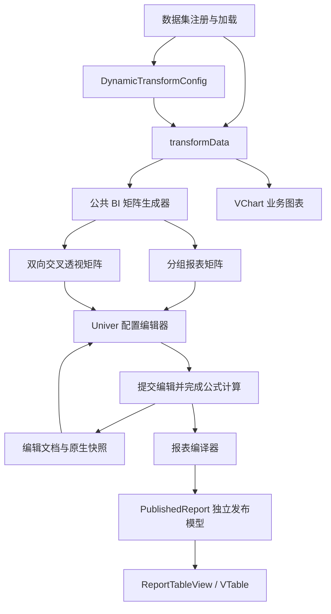

# MicroBI 配置态 Univer 编辑与 VTable 报表展示集成方案

文档日期：2026-10-16。合并策略调整日期：2026-10-19。状态：技术设计，具体实现与验收状态以整改清单为准。适用项目：`micro-bi`。

本文依据当前工作区代码与本次需求编写。文中的新增类型、组件、目录和接口均为拟议设计，不代表当前版本已经实现。

**合并策略统一跟随 Excel/Univer 配置态结果**：是否合并、取消合并、合并范围、主格内容及格式均由工作表决定，正式 VTable 不根据相邻同值数据再次自动合并。实施要求见 8.5 及[整改清单第 16 节](C:/Users/And19/Desktop/web/micro-bi/doc/univer-implementation-issues-and-remediation.md)。

## 1. 目标与约束

在配置态预览中接入 Univer，尽可能提供常用 Excel 编辑操作；保存后，由现有 VTable 技术栈展示编辑结果。BI 数据获取、字段探查、分组、聚合、时间分桶和业务公式继续复用现有引擎。

确定的设计约束：

1. Univer 只进入配置编辑端，正式展示端不加载 Univer UI、公式引擎、插件或样式文件。
2. 正式表格使用 VTable；业务图表继续使用 VChart。
3. 完整支持分组报表和双向交叉透视表，并覆盖指标横向、纵向两种排列。
4. 自定义行列、单元格公式、合并区域和样式可以保存、重新编辑，并在正式表格中消费。
5. 工作表编辑不直接修改注册数据集，不隐式写回业务接口。
6. 既有 `DynamicTransformConfig` 和普通分析视图保持可用，新报表文档采用独立、可版本化的契约。
7. “尽可能复刻 Excel”以能力清单和实际验收为准，不承诺任意 Excel 文件、插件对象或 VBA 的完全兼容。

## 2. 当前代码基础

### 2.1 可以复用的模块

| 当前模块 | 当前职责 | 集成后的职责 |
| --- | --- | --- |
| `src/core/datasetRegistry.ts` | 静态数组、异步 loader、注册、缓存、并发去重 | 继续提供数据集，不参与工作表编辑状态 |
| `src/engine/profiler.ts` | 字段类型探查、名称映射、人工类型覆盖 | 为分析配置和字段选择提供元信息 |
| `src/engine/types.ts` | 转换配置、维度、指标、输出结果类型 | 保留为分析计算协议 |
| `src/engine/pipeline.ts` | 明细、分组透视、全局汇总三种执行形态 | 继续产出基础分析结果和聚合统计 |
| `src/engine/aggregation.ts` | SUM、COUNT、有效数值数量、MIN、MAX 的累加和合并 | 作为公共总计计算基础 |
| `src/ui/presentation/table/summaryCalculator.ts` | 合并聚合统计、计算总计和汇总公式 | 提取纯计算部分供公共矩阵生成器使用 |
| `src/ui/DynamicDataConfigPanel.tsx` | 数据集选择、分析配置、实时试算、同步配置校验 | 增加可替换预览插槽，供报表配置组件组合 |
| `src/ui/components/LivePreviewTable.tsx` | HTML 明细与二维透视预览 | 保留旧接入，逐步复用公共矩阵模型 |
| `src/ui/presentation/table/VTableView.tsx` | 当前分析结果展示、筛选、列管理、导出 | 保留现有分析展示路径 |
| `src/ui/presentation/charts/VChartView.tsx` | 基于分析结果生成图表 | 继续消费 `TransformResult` |

### 2.2 集成前必须明确的差异

- `transformData` 输出的交叉透视结果仍是扁平的“维度组合 + 指标值”记录，尚未形成可自由编辑的二维工作表。
- 现有 `columns` 描述字段、聚合指标和业务计算列，无法独立表达插入空白行、合并标题、跨表公式和任意位置的局部计算列。
- 当前 HTML 二维预览存在再次对桶值取 AVG、对桶数取 COUNT 的逻辑，正式汇总模块则能够合并原始聚合统计；新预览必须统一计算入口。
- 当前公式解释器使用 `[field]` 和聚合引用语法，不能直接承担通用 Excel A1 引用、跨工作表引用及完整函数计算。
- 引擎的部分聚合元信息保存在 WeakMap 中，不能通过 JSON 序列化 `TransformResult` 后直接恢复。刷新时应重新计算基础结果。
- `package.json` 尚未声明 Univer 为正式集成依赖；本地已存在部分 `@univerjs/*` 1.0.4 包，只能作为接入验证基础。
- 当前库使用 React 17 开发依赖；相邻演示应用使用 React 18。需要分别验证，不能只验证其中一个运行环境。

## 3. 总体架构

采用“分析计算、配置编辑、发布编译、正式展示”四层结构。



四层职责如下：

| 层 | 输入 | 输出 | 主要责任 |
| --- | --- | --- | --- |
| 分析计算 | 原始数据与分析配置 | `TransformResult`、聚合统计 | 保证业务统计正确 |
| 配置编辑 | 基础矩阵、编辑快照、绑定规则 | 工作簿草稿 | 提供类 Excel 交互 |
| 发布编译 | 已完成计算的工作簿与绑定规则 | `PublishedReport` | 消除正式展示对 Univer 的依赖 |
| 正式展示 | `PublishedReport` | VTable 画面、复制和导出 | 保持已发布的数值、格式和布局 |

Univer 原生快照是继续编辑的依据，`PublishedReport` 是展示的依据。两者通过同一文档修订号关联；发布模型是可重建产物，不作为第二份可直接编辑的配置。

## 4. 文档与状态模型

### 4.1 三种数据对象

| 对象 | 是否持久化 | 责任 |
| --- | --- | --- |
| `ReportDocument` | 是 | 保存分析规则、工作簿快照、绑定与编辑策略 |
| `BiGridModel` | 默认否 | 在运行时将分析结果组织成一致的基础矩阵 |
| `PublishedReport` | 是 | 保存正式展示需要的计算结果、格式和布局 |

编辑期间只有 `ReportDocument` 草稿及其当前 Univer 实例可修改。宿主保存成功后，再整体切换正式展示版本。

### 4.2 编辑文档建议结构

以下结构为契约草案，省略了具体样式联合类型和完整诊断枚举。

```ts
type ReportId = string;
type AnalysisId = string;
type SheetId = string;
type BindingId = string;

interface ReportDocument {
  kind: 'bi-report';
  schemaVersion: 1;
  id: ReportId;
  title: string;
  revision: number;
  analyses: ReportAnalysis[];
  bindings: ReportBinding[];
  editor: {
    engine: 'univer';
    engineVersion: string;
    snapshot: Record<string, unknown>;
  };
  refresh: {
    mode: 'manual-publish' | 'external-publish';
    preserveManualOverrides: boolean;
  };
}

interface ReportAnalysis {
  id: AnalysisId;
  title: string;
  config: DynamicTransformConfig;
  region: {
    sheetId: SheetId;
    anchor: ReportAnchor;
    layout: 'grouped' | 'cross-tab' | 'detail' | 'summary';
  };
}

type ReportAnchor =
  | { kind: 'cell'; row: number; column: number }
  | {
      kind: 'after-region';
      analysisId: AnalysisId;
      direction: 'below' | 'right';
      gap: number;
    };
```

规则：

- 一张工作表允许包含多个分析区域，也允许包含标题、备注、公式区等普通工作表内容。
- 每个分析区域使用独立 `analysisId`，字段和指标可以相同，但其绑定不能互相覆盖。
- 区域相对定位要校验循环依赖；区域自动扩展时先计算布局，再检查覆盖冲突。
- `editor.snapshot` 的 SDK 类型限制在编辑端适配器中。公共展示类型不引用 `IWorkbookData`。
- 本轮 `schemaVersion: 1` 表示新报表文档协议的首版，不改变旧转换配置的版本含义。

### 4.3 发布模型建议结构

```ts
type ReportValue = string | number | boolean | null;

interface PublishedReport {
  kind: 'published-bi-report';
  schemaVersion: 1;
  documentId: ReportId;
  documentRevision: number;
  compilerVersion: string;
  generatedAt: string;
  datasetRevisions: Record<string, string>;
  sheetOrder: SheetId[];
  sheets: Record<SheetId, PublishedSheet>;
  styles: Record<string, PublishedCellStyle>;
}

interface PublishedSheet {
  id: SheetId;
  title: string;
  hidden: boolean;
  rowCount: number;
  columnCount: number;
  cells: Record<number, Record<number, PublishedCell>>;
  rows: Record<number, { height?: number; hidden?: boolean }>;
  columns: Record<number, { width?: number; hidden?: boolean }>;
  merges: ReportRange[];
  frozen: { rowBoundary: number; columnBoundary: number };
  gridlines: boolean;
  drawings: PublishedDrawing[];
}

interface PublishedCell {
  value: ReportValue;
  displayText: string;
  valueType: 'string' | 'number' | 'boolean' | 'empty' | 'error';
  styleId?: string;
  bindingId?: BindingId;
  hyperlink?: string;
  note?: string;
}

interface ReportRange {
  startRow: number;
  endRow: number;
  startColumn: number;
  endColumn: number;
}
```

`PublishedCellStyle` 与 `PublishedDrawing` 应定义为项目自己的白名单联合类型，分别覆盖字体、颜色、边框、对齐、换行，以及数据条、图标、图片等绘制对象。不能直接保存包含函数的 VTable option，也不能直接暴露任意 SDK 对象。

发布模型要求：

1. 所有字段均可 JSON 序列化，不含 DOM、函数、Map、WeakMap 或 SDK 实例。
2. `value` 保留数值类型，`displayText` 保留配置端确定的显示文本。
3. 工作表、单元格和样式采用稀疏存储，避免为空白网格生成大量对象。
4. `rowCount`、`columnCount` 表示有效内容、样式和布局范围，不直接使用 Excel 最大行列数。
5. 公式文本留在编辑快照中；发布端只需要计算结果。必要的业务诊断另行保存。
6. 隐藏工作表可以保存在完整文档中，公开展示载荷按宿主策略裁剪。

## 5. 统一 BI 矩阵生成

### 5.1 生成流程

公共入口建议为 `buildBiGrid(result, config, context)`，输出 `BiGridModel`。按照以下顺序工作：

1. 解析并规范化行轴、列轴、时间桶及指标。
2. 确定明细、全局汇总、分组或交叉透视布局。
3. 构建有稳定标识的维度成员树。
4. 建立维度组合到分析结果的索引。
5. 从叶子桶的聚合统计生成小计与总计。
6. 生成表头、维度单元格、指标单元格、合并范围和区域边界。
7. 为自动生成的单元格分配业务语义身份和绑定。

矩阵生成器不创建 VTable 或 Univer 实例，不依赖 React，可以单独测试。

### 5.2 统计口径

| 类型 | 明确口径 |
| --- | --- |
| SUM | 合并有效数值的和 |
| COUNT | 统计目标字段的非空值，不能统计已汇总桶数 |
| AVG | 合并 `sum` 与 `numericCount` 后相除，不能平均各桶 AVG |
| MIN / MAX | 合并底层有效数值极值，排除空值和无效数值 |
| 汇总后 computed | 合并基础指标后重新执行原业务公式 |
| 显式 `scope: 'row'` 的数值 computed | 合并各明细行计算结果的和 |

进一步要求：

- 计算依赖与展示列分离。隐藏基础指标不能影响公式或总计。
- 小计和总计从叶子桶统计量产生，不对包含小计的渲染行再次汇总。
- 中间计算保留原始数值精度；显示格式和明确配置的计算精度分别处理。
- `nullAsZero` 等业务选项必须在叶子、总计和公式求值中保持一致。
- 不使用当前渲染窗口、前 10 行或横向可见列作为统计范围。
- `inputRows`、分组数量和渲染行数量是不同概念，分别记录。

建议将现有总计模块的纯计算部分迁移到引擎层，原公开导出保留重导出兼容。

### 5.3 维度与时间身份

- 以字段键和引擎规范化后的维度值建立 JSON 元组标识，不使用 `__`、`###` 等拼接协议。
- 显示名称不作为维度成员、指标或区域的唯一标识。
- 同一物理时间字段同时出现在行轴和列轴、且分桶粒度不同，应在规范化阶段生成独立执行字段别名，避免现有扁平记录发生同名覆盖。
- 别名投影生成新记录，不修改注册数据；用户继续看到原字段名称，绑定记录原字段与执行别名的对应关系。
- 时间桶的排序使用规范化后的时间顺序；自定义显示格式不能作为唯一排序依据。
- 当前时间分桶没有独立的时区配置契约。首批保持现有语义并记录生成环境；固定时区计算作为显式扩展实施和验收，不默认宣称已经支持跨时区一致计算。

## 6. 分组报表设计

### 6.1 定义与布局

分组报表配置一个或多个行维度，没有列维度。每个叶子分组对应一条聚合结果，多级行维度可以生成小计和按父级保护的合并范围。

基本排布：

```text
报表标题 / 说明 / 自定义公式区
┌──────────┬──────────┬──────────┬──────────┐
│ 一级分组 │ 二级分组 │ 指标一   │ 指标二   │
├──────────┼──────────┼──────────┼──────────┤
│ 分组成员 │ 分组成员 │ 聚合结果 │ 聚合结果 │
│          │ 分组小计 │ 小计结果 │ 小计结果 │
├──────────┴──────────┼──────────┼──────────┤
│ 总计                │ 全量总计 │ 全量总计 │
└─────────────────────┴──────────┴──────────┘
```

规则：

- 维度列按照配置顺序从左到右排列，时间维度与分类维度顺序必须可预测。
- 首次选用分组模板时，可按完整父路径生成配置态可见的初始合并；小计、总计和手工行形成边界。已有文档以工作表保存的合并/取消合并结果为准，不再按相邻同值生成展示合并。
- 小计在对应分组结束后出现；总计位于报表底部。
- 自定义行可放在标题区、组间、合计前后；其内容不计入业务聚合统计。
- 同一字段的 SUM、AVG 等指标使用不同指标 ID，不因原始字段相同而合并。
- 无分组维度的全局汇总作为单行分析区域，继续支持标题和附加公式区。

### 6.2 完整示例

以下五条记录同时作为分组和交叉透视验收数据：

| id | date | workshop | qty | defect |
| --- | --- | --- | ---: | ---: |
| a1 | 2026-10-01 | A | 10 | 1 |
| a2 | 2026-10-02 | A | 20 | 2 |
| a3 | 2026-11-01 | A | 30 | 3 |
| b1 | 2026-10-03 | B | 100 | 30 |
| b2 | 2026-11-02 | B | 40 | 4 |

分析配置：

```ts
const groupedConfig: DynamicTransformConfig = {
  datasetId: 'production',
  headers: {
    date: '日期', workshop: '车间', qty: '产量', defect: '不良数',
  },
  dimensions: { categories: ['workshop'] },
  columns: [
    { type: 'aggregated', field: 'qty', agg: 'sum', label: '产量' },
    { type: 'aggregated', field: 'qty', agg: 'avg', label: '平均产量' },
    { type: 'aggregated', field: 'id', agg: 'count', label: '记录数' },
    { type: 'aggregated', field: 'defect', agg: 'sum', label: '不良数' },
    {
      type: 'computed', name: 'defect_rate', label: '不良率(%)',
      expression: 'IF([SUM(qty)] > 0, [SUM(defect)] / [SUM(qty)] * 100, 0)',
      precision: 2,
    },
  ],
};
```

期望基础矩阵：

| 车间 | 产量 | 平均产量 | 记录数 | 不良数 | 不良率 |
| --- | ---: | ---: | ---: | ---: | ---: |
| A | 60 | 20 | 3 | 6 | 10.00% |
| B | 140 | 70 | 2 | 34 | 24.29% |
| 总计 | 200 | 40 | 5 | 40 | 20.00% |

总计 AVG 为 `200 / 5 = 40`，不能取 `(20 + 70) / 2 = 45`。记录数是 5，不是分组数 2。

### 6.3 编辑与消费

用户可在 Univer 中添加合并标题、备注行、独立计算列和条件格式。保存后，分组、标题、小计、总计和手工内容全部形成同一张二维发布网格。

新发布模型由 `ReportTableView` 原样组织；不能再由旧展示组件追加一套总计、重排分组或自动合并用户单元格。

## 7. 双向交叉透视表设计

### 7.1 定义

交叉透视同时描述行轴、列轴和指标。现有 DSL 中，只要存在 `columnCategories` 或 `columnTimeBucket`，就进入交叉透视布局；允许只有列轴、没有行轴。

```ts
const crossTabConfig: DynamicTransformConfig = {
  ...groupedConfig,
  dimensions: {
    categories: ['workshop'],
    columnTimeBucket: { field: 'date', granularity: 'month' },
    indicatorsAsCol: true,
    rowTotals: { showGrandTotals: true, grandTotalLabel: '车间总计' },
    columnTotals: { showGrandTotals: true, grandTotalLabel: '全期总计' },
  },
};
```

### 7.2 指标横向排列

`indicatorsAsCol: true` 时，每个列维度叶子成员下展开全部指标；行维度成员沿纵向排列。

```text
                       2026-10                 2026-11
车间              产量  平均产量  记录数   产量  平均产量  记录数
A                  30      15       2      30      30       1
B                 100     100       1      40      40       1
```

只选择产量指标时，完整总计矩阵应为：

| 车间 | 2026-10 | 2026-11 | 全期总计 |
| --- | ---: | ---: | ---: |
| A | 30 | 30 | 60 |
| B | 100 | 40 | 140 |
| 车间总计 | 130 | 70 | 200 |

多级列维度按成员树生成多层表头，指标层放在末级；首次选用透视模板时可生成同父路径、同成员的初始表头合并。已有文档最终合并范围遵守 8.5，用户取消的合并不能在展示或数据刷新时被默认模板恢复。

### 7.3 指标纵向排列

`indicatorsAsCol: false` 时，指标追加到行维度末级，每个行维度成员生成一组指标行；列轴叶子成员只展开一次。

| 车间 | 指标 | 2026-10 | 2026-11 | 全期总计 |
| --- | --- | ---: | ---: | ---: |
| A | 产量 | 30 | 30 | 60 |
| A | 平均产量 | 15 | 30 | 20 |
| A | 记录数 | 2 | 1 | 3 |
| B | 产量 | 100 | 40 | 140 |
| B | 平均产量 | 100 | 40 | 70 |
| B | 记录数 | 1 | 1 | 2 |
| 车间总计 | 产量 | 130 | 70 | 200 |
| 车间总计 | 平均产量 | 43.33 | 35 | 40 |
| 车间总计 | 记录数 | 3 | 2 | 5 |

横向、纵向排列共用同一份交叉桶和聚合统计，切换排列只改变布局。每个业务指标的身份保持一致。

### 7.4 总计与小计位置

新矩阵内部使用位置明确的 `bottomTotals`、`rightTotals`，避免“行总计”“列总计”的名称歧义。

| 原 DSL 字段 | 规范化位置 | 计算范围 |
| --- | --- | --- |
| `dimensions.rowTotals` | 底部总计与行轴层级小计 | 合并相应行成员对应的叶子桶 |
| `dimensions.columnTotals` | 右侧总计与列轴层级小计 | 合并相应列成员对应的叶子桶 |

角落总计只能从完整的叶子统计量计算。右侧总计、底部总计以及中间小计均不能作为再次统计的数据源。

以上例为准：

- 十月 AVG：`130 / 3 = 43.333…`，显示 43.33。
- 全表 AVG：`200 / 5 = 40`。
- B 车间全期不良率：`34 / 140 × 100 = 24.2857…`，显示 24.29%。
- 全表不良率：`40 / 200 × 100 = 20%`，不能相加或平均各交叉格的比率。

### 7.5 局部公式列与业务指标的区别

必须区分两种操作：

| 用户意图 | 存储位置 | 展开行为 |
| --- | --- | --- |
| 新增一个对所有切片生效的业务指标 | `DynamicTransformConfig.columns` | 每个列成员或行成员按指标方向展开 |
| 在某个已展开列后新增一次报表公式列 | 工作表快照与局部绑定 | 只出现在用户选定的位置 |

例如，在“2026-11 产量”后添加一次“较十月差额”，不能把它转换成一个全局 computed 指标，否则会在十月、十一月、总计等切片下重复出现。

指标排列切换需要重新解析这类局部列的锚点。不能直接按旧物理列号迁移，也不能静默把列公式改成全局指标。无法自动迁移时保留草稿并给出具体位置诊断。

### 7.6 边界情况

- 只有列轴：使用内部根行成员表示全局范围，不向业务数据追加伪字段。
- 没有列轴：生成分组报表；没有任何轴且仅有聚合指标时，生成全局汇总区域。
- 多级行轴、列轴：采用完整路径判断身份和合并边界，不只比较末级显示文本。
- 缺失交叉组合：保留空单元格标记；COUNT 可显示 0，其他指标默认显示空占位，不能把真实数值 0 当作缺失。
- 全部数据为空：保留字段和指标结构、显示空状态；默认不制造一条虚假的总计数据。
- 新增月份、状态等列成员：从成员树计算新增列组及其总计，随后执行布局冲突检测。
- 移除成员：保留仍能匹配的样式和局部公式意图；失效引用给出诊断，不能移到同位置的其他成员上。
- 标签重复或包含分隔符：由完整字段路径和 JSON 元组区分，不依赖表头文本拼接。
- 指标隐藏：只改变显示投影，不删除业务计算依赖。

## 8. 类 Excel 编辑与绑定维护

### 8.1 绑定结构

绑定用于数据刷新、分析区域定位和样式目标识别。它与工作表坐标分开维护，不承载完整事实记录。

```ts
interface ReportBinding {
  id: BindingId;
  analysisId: AnalysisId;
  datasetId: string;
  target: {
    sheetId: SheetId;
    row: number;
    column: number;
  };
  semantic: {
    role:
      | 'dimension-header'
      | 'dimension-member'
      | 'metric-header'
      | 'metric-value'
      | 'subtotal'
      | 'grand-total';
    rowPath: readonly AxisMemberRef[];
    columnPath: readonly AxisMemberRef[];
    metricId?: string;
  };
  state: 'bound' | 'manual-override';
}

interface AxisMemberRef {
  axisId: string;
  field: string;
  memberKey: string;
}
```

普通手工单元格可以没有业务绑定。手工插入的行列使用独立稳定 ID，以便记录相对位置和刷新锚点。

数据身份规则：

- 聚合单元格：`analysisId + 完整行路径 + 完整列路径 + metricId + role`。
- 维度表头：使用轴定义和成员路径，显示名修改不改变绑定身份。
- 明细单元格：需要稳定、唯一的源记录键；当前引擎优先使用 `id/key`，其索引回退只适用于同一数据快照。
- 不具备稳定记录键时，跨数据版本不能保证人工覆盖正确匹配，刷新必须提示该限制。
- `memberKey` 遵循业务引擎既有空值和分桶规范，不擅自改变分组语义。

### 8.2 操作语义

| 编辑操作 | 绑定与刷新行为 |
| --- | --- |
| 改颜色、边框、数字格式 | 保持绑定，刷新数值时保留格式 |
| 修改绑定单元格的字面值 | 标记人工覆盖，原数据与其他业务聚合值保持原含义 |
| 使用公式替换绑定值 | 标记公式覆盖，后续由工作表公式计算 |
| 恢复自动取值 | 清除人工覆盖，根据绑定重新填充最新值 |
| 插入空白行列 | 创建手工结构，更新区域和现有绑定坐标 |
| 删除行列 | 删除相应绑定和内容，记录用户排除意图，后续刷新不自动恢复同一语义对象 |
| 剪切移动 | 移动原绑定及区域锚点 |
| 复制粘贴 | 默认粘贴普通内容、公式和样式，不复制自动刷新所有权；复制分析区域通过显式命令创建新区域 |
| 工作表排序 | 按操作范围重映射绑定；不能继续使用旧行号识别业务单元格 |
| 合并单元格 | 保留参与单元格的语义集合和主单元格，覆盖多项业务数值时提供明确的覆盖提示 |
| 取消合并 | 保存解除意图及工作表实际值/格式；数据刷新不能重新套用初始合并，后续再次合并按最新编辑生效 |
| 撤销、重做 | 内容、布局、绑定和覆盖状态共同回退或恢复 |

删除某个字段或指标表头只表示排除其报表显示，不等于从分析配置中删除业务依赖。更改分析维度或指标应通过属性区执行。

默认复制规则需要在产品中清楚呈现：普通粘贴得到的副本可以自由编辑，只有显式插入或复制的分析区域随数据刷新。

### 8.3 绑定插件

新增 `BiBindingPlugin`，通过工作簿插件资源保存区域、绑定和用户编辑意图，配合结构命令维护坐标。

实现要求：

1. 不能仅监听单元格值变化，还必须处理行列插入、删除、移动、排序、剪切、工作表复制与撤销重做。
2. 结构命令的绑定变化通过配套 mutation 纳入同一撤销事务。
3. `cell.custom` 可作为辅助标记，但不能作为唯一身份来源；普通用户操作可能覆盖该字段。
4. 绑定索引丢失或与当前工作表不一致时，停止自动刷新对应区域，并给出可定位的诊断。
5. API 和命令参数通过版本适配器封装，不直接在业务组件中访问 SDK 私有字段。
6. 所有订阅均保留 disposer，工作簿切换或组件卸载时完整释放。

Univer 的命令系统提供执行前、执行后事件与可释放监听器，可作为适配入口。工作簿 `resources` 用于保存插件数据。[命令与事件](https://docs.univer.ai/guides/sheets/features/core/general-api)、[工作簿数据结构](https://docs.univer.ai/guides/sheets/model/workbook-data)

### 8.4 自由编辑与动态模板

支持两类编辑意图：

- 精确排版：针对当前文档中的具体单元格、合并区域和行列位置。
- 动态规则：针对某指标、某组表头、某个分组或整个分析区域。

新数据成员可以继承动态规则，但不能自动推断用户对某个旧单元格的修改应该传播到所有新成员。编辑器应提供“应用到当前单元格 / 当前指标 / 当前列组 / 整个分析区域”的作用范围选项。

### 8.5 合并规则唯一跟随工作表（2026-10-19 调整）

- 配置态 Excel/Univer 是合并布局的唯一编辑入口；合并、取消合并、主格选择及对应格式与文档一起保存。
- 普通新工作簿默认不合并。明确选用的分组/透视模板可以提供初始合并，但必须先真实出现在配置画布中，不能只在展示态补一层自动合并。
- 原表格设置的相邻同值自动合并不再参与报表模式；若宿主有该开关，改为只读“单元格合并：跟随工作表”，修改通过原配置入口完成。
- 发布时从最终工作表 `mergeData` 编译 `PublishedSheet.merges`。`merges: []` 明确表示不合并，不得回退到旧 `mergeCells` 开关或根据 values 推断范围。
- 数据刷新时重放已保存的合并/解除意图，以语义身份解析新坐标；初始化预设的优先级低于用户编辑，人工合并和取消按最新有效编辑顺序决定。取消后再次合并应正常生效。
- 最终发布范围必须与刷新后的配置画布一致。VTable 只消费该范围及主格显示文本/样式；复制、导出和多工作表切换使用同一份结果。

合并格式属于版式意图，不改变 BI 聚合分组、指标数值或业务总计口径；解除合并不等于取消业务分组。

## 9. 业务计算与工作表公式

### 9.1 三个计算层次

| 计算层 | 典型表达式 | 责任 |
| --- | --- | --- |
| 行级业务计算 | `[qty] * [price]`，显式 `scope: 'row'` | 在聚合前增强明细 |
| 汇总业务计算 | `[SUM(defect)] / [SUM(qty)] * 100` | 在分组、交叉桶和总计上下文执行 |
| 工作表公式 | `=SUM(C5:C9)`、跨表引用 | 处理用户最终报表中的位置与布局计算 |

工作表公式不能自动转换成全局 BI 指标；BI 指标也不能全部改写成对显示单元格的 SUM。两种计算模型的作用范围不同。

### 9.2 人工覆盖与合计

自动生成的业务总计以数据集和分析规则为依据。用户覆盖某个报表数值后：

- 原始数据集和自动业务总计不会被隐式修改。
- 显式引用该工作表单元格的 Excel 公式会按覆盖后的值重新计算。
- 编辑器应以状态标记区分自动绑定值和人工覆盖值。
- 用户需要按报表显示值合计时，可添加工作表公式合计，并与自动业务总计使用不同标题。

这一规则避免人工修饰报表意外改变业务分析口径。若未来需要事实数据修订，应新增独立的数据修订协议和重新聚合流程。

### 9.3 计算完成判定

保存时显式执行或等待当前轮计算，并等待结果真正写入单元格模型；不能以“编辑事件已触发”或“计算结束通知已到达”代替结果应用完成。

适配器以已验证版本提供的 `getFormula().onCalculationResultApplied()` 等公开方法为基础，处理超时、循环引用、无效函数和外部依赖错误。[公式计算文档](https://docs.univer.ai/guides/sheets/features/core/formula)

对于共享公式，仅读取个别单元格的 `f` 可能丢失偏移语义；恢复和诊断时应使用公开 API 或完整快照处理共享公式。发布模型只存最终值，不自行解析 Univer 内部公式树。

### 9.4 外部引用与动态函数

- 跨工作表公式属于同一文档的计算范围，所有参与计算的工作表必须加载完成。
- 外部工作簿引用只有在数据源明确可用时才能发布为最新结果，否则给出缺失依赖诊断。
- 日期、时区、数字区域设置及 NOW/RAND 等动态结果按当前发布批次固定；正式展示不会在每次打开时自动重算。
- 公式错误保存为明确的错误单元格，并返回诊断；发布策略由宿主决定是否接受带有错误的版本，默认阻止结构性缺失和未完成计算。

## 10. 报表编译器

### 10.1 编译流程

建议公开一个与具体 SDK 隔离的编译结果契约，由 Univer 适配器负责读取实例。

```text
提交当前编辑
  → 固定文档修订号和数据版本
  → 等待数据与公式计算完成
  → 保存完整编辑快照
  → 读取有效工作表和单元格
  → 解析有效样式、格式、条件规则及附加对象
  → 规范化合并、隐藏、冻结和行列尺寸
  → 校验绑定、区域和展示能力
  → 生成 PublishedReport 与诊断
```

不能仅把 `cellData.v` 和 `cellData.s` 复制到展示层。发布端需要最终显示文本、解析后的样式及插件提供的显示结果。

### 10.2 样式解析顺序

编译器应按 SDK 实际规则解析工作簿默认样式、工作表样式、行列样式、单元格样式和条件格式优先级，再生成去重后的样式字典。

重点处理：

- 字号、字体、加粗、斜体、下划线、删除线和富文本片段。
- 背景、字体颜色、单元格四边的线型和宽度。
- 横向、纵向对齐、换行、裁切、溢出和文本旋转。
- 条件格式的优先级、停止规则、色阶、数据条和图标集。
- 合并区域主单元格内容与外边框。

条件格式不能只保存当前颜色而丢失编辑规则。完整规则留在编辑快照中，当前生效样式及绘制对象进入发布模型；数据更新后重新编译。

SDK 插件结果的读取方式需要在锁定版本下验证。若没有稳定的公开读取接口，应在适配器中实现受支持规则的规范化计算，并把尚未覆盖的规则列入诊断，不依赖未经验证的内部渲染对象。

### 10.3 数值与显示文本

同时保存原始值与配置端格式化后的显示文本，可以避免展示端重复解释 Excel 数字格式。

例如：

- 数值 0.1 配合 `0.00%` 显示为 10.00%。
- 引擎已经输出 10 表示“百分之十”时，需要按其业务单位设置显示格式，不能再使用乘百语义的百分比格式。
- 带前导零的编码保持文本类型。
- 日期按照工作簿日期系统和区域设置格式化，不把日期序列值当作普通毫秒时间戳。

Univer 的数字格式接口提供 `getDisplayValue/getDisplayValues`。编译时读取显示结果，并保持数值类型供复制、导出和明确允许的展示比较使用。[数字格式文档](https://docs.univer.ai/guides/sheets/features/core/numfmt)

### 10.4 结构与附加对象

每张工作表编译以下信息：

| 信息 | 处理要求 |
| --- | --- |
| 合并区域 | 坐标合法、区域不重叠、主单元格明确 |
| 行高列宽 | 采用明确尺寸，记录默认尺寸与局部覆盖 |
| 隐藏行列 | 保留逻辑坐标，展示时建立可见索引映射 |
| 冻结区域 | 记录逻辑边界，映射为边界前可见行列数量 |
| 链接和备注 | 转为独立显示属性 |
| 图片和图标 | 转为受支持的绘制对象，记录锚点和大小 |
| 工作表 | 保留顺序、名称、可见性，隐藏表仍参与编辑端公式计算 |

VTable 暂不支持的细节必须进入能力诊断，不能静默丢失。图片、复杂富文本和旋转文本的还原程度要通过真实画面比较确定。

### 10.5 诊断模型

```ts
interface ReportDiagnostic {
  severity: 'error' | 'warning' | 'info';
  code: string;
  message: string;
  analysisId?: AnalysisId;
  sheetId?: SheetId;
  range?: ReportRange;
}
```

建议首批诊断码：

| 诊断码 | 含义 | 默认处理 |
| --- | --- | --- |
| `DATA_NOT_READY` | 数据集尚未完成加载 | 暂停发布 |
| `REVISION_CHANGED` | 保存过程中草稿或数据版本变化 | 重新获取一致版本 |
| `FORMULA_NOT_SETTLED` | 公式结果未完成应用 | 暂停发布 |
| `BINDING_INVALID` | 绑定与工作表不一致 | 定位修复 |
| `REGION_OVERLAP` | 自动扩展覆盖已有内容 | 暂停对应刷新或发布 |
| `REFERENCE_MISSING` | 公式或区域锚点失效 | 定位修复 |
| `VIEW_FEATURE_UNSUPPORTED` | 编辑功能尚无展示映射 | 明确提示并按能力策略处理 |
| `SCHEMA_UNSUPPORTED` | 文档版本不兼容 | 阻止错误加载 |

## 11. 正式 VTable 展示

### 11.1 独立报表组件

新增 `ReportTableView`，仅消费 `PublishedReport`。内部以 `ListTable` 的二维网格能力和自定义渲染呈现完整工作表。

已编译的交叉透视矩阵同样按二维网格展示，不再交给 `PivotTable` 重算或重新展开；这样才能保留在透视结果旁插入的普通行列和自定义合并标题。

旧的 `DynamicDataView + TransformResult` 接入继续使用现有 ListTable/PivotTable 分支。两条路径按输入协议区分，不根据画面外观猜测数据类型。

### 11.2 适配规则

| 发布模型 | VTable 处理 |
| --- | --- |
| 二维单元格内容 | 逻辑行列映射为网格记录和列 |
| `displayText` | 格式化回调返回已编译文本 |
| 样式字典 | 按单元格查找样式，必要时使用自定义绘制 |
| `merges` | 仅使用工作表最终合并，映射 `customMergeCell` 的 range、主格 text 和对应样式；空数组保持不合并 |
| 行高、列宽 | 使用固定尺寸和局部尺寸设置 |
| 冻结边界 | 换算 `frozenRowCount/frozenColCount` |
| 数据条、图标和图片 | 通过 `customRender/customLayout` 或独立对象层绘制 |
| 多工作表 | 宿主页签与当前工作表 VTable 实例 |

VTable 的自定义合并接口支持区域、文字、样式和自定义绘制，可作为自由排版的适配基础。[自定义合并文档](https://visactor.com/vtable/guide/custom_define/custom_merge)

### 11.3 坐标一致性

- 工作簿坐标统一使用从 0 开始的逻辑坐标。
- 隐藏行列只影响可见映射，不改变公式和绑定保存的逻辑坐标。
- 为报表网格关闭 VTable 自动业务表头；工作簿表头、标题和总计均作为模型中的真实单元格渲染。
- 若另行显示 A/B/C 标尺或行号，它们属于 UI 装饰，不参与数据坐标计算。
- 合并区域跨隐藏行列时，显示映射应保留其矩形语义；整个区域不可见时跳过绘制。
- 禁止默认自适应布局重新分配已保存的列宽。缩放应作为明确的视图操作。

### 11.4 展示交互

报表模式默认保留发布时的行列顺序、显示内容和合计结果，提供滚动、选区、复制、缩放、全屏、工作表切换等浏览能力。

旧分析组件中的全表排序、筛选和自动总计不能直接套用到自由布局报表。若要在展示态支持区域筛选或排序，需另行定义其操作范围及合并、公式和合计处理方式；第一批不启用会改变已发布报表含义的交互。

原表格的 `mergeCells`、`tableFeatures.mergeCells`、列级 `mergeCell` 和高级选项中的合并配置不得覆盖报表版式。报表模式不提供独立的自动合并开关，不得用高级选项重新注入同值合并。旧纯分析接入按兼容策略隔离；原主应用进入工作表报表后只使用发布模型。

展示端不会重新执行 Excel 公式或条件规则。需要改变计算结果时，走数据刷新和重新发布流程。

### 11.5 复制、导出与图表

- 复制以发布模型中的显示文本和选区为依据，保留合并区域的明确规则。
- CSV 输出当前目标工作表的二维内容；多工作表导出应由宿主选择工作表或使用工作簿格式。
- 既有 HTML `.xls` 导出继续按其实际格式标注，不能描述为真实 `.xlsx`。
- 真实 `.xlsx` 由独立导入导出适配器承担，样式和公式兼容范围单独验收。
- VChart 默认继续使用 BI 引擎结果。用户手工编辑报表数值或新增报表列，不自动改变业务图表。
- 若同一页面要求表格和图表代表同一份数据，宿主应使用相同数据版本；发布元信息必须可供比对。

## 12. 数据刷新与文档重整

### 12.1 刷新流程

```text
解析最新数据集
  → 重新执行分析配置
  → 生成新的基础矩阵和维度成员树
  → 依据业务语义匹配旧绑定
  → 应用手工排版、覆盖和动态规则
  → 计算区域新位置并检测冲突
  → 更新 Univer 工作簿
  → 完成公式计算
  → 重新编译发布
```

仅修改样式时不重新请求数据或重算全部 BI 结果。分析配置变化、工作表布局变化和数据版本变化分别标记，避免所有操作都触发整张工作簿重建。

### 12.2 保留与失效规则

| 刷新情况 | 处理规则 |
| --- | --- |
| 原有分组或透视成员仍存在 | 保留对应单元格格式、覆盖及局部编辑 |
| 新增成员 | 生成新绑定，继承明确的动态样式和公式模板 |
| 成员消失 | 移除自动生成内容，保留可识别的手工意图并标记失效引用 |
| 原始数据顺序改变 | 按稳定业务键匹配，不按旧坐标套用覆盖 |
| 指标只改显示名 | 保留指标 ID 和编辑内容 |
| SUM 改为 AVG | 视为指标语义变化，不能只改表头 |
| 分组维度改变 | 重建相关区域，逐项迁移仍能匹配的编辑规则 |
| 指标方向改变 | 重建布局，以指标和维度身份迁移，不复用旧物理行列号 |
| 用户取消合并后刷新 | 继续保持解除，默认分组/透视合并不得恢复；之后再次合并按最新编辑处理 |
| 自动区域扩展遇手工内容 | 保留手工内容，报告冲突，等待明确处理 |

跨已编辑区域的原生 A1 公式在结构变更时由 Univer 维护引用；动态区域重建还需要绑定插件和命令适配共同参与，不能把覆盖整段 `cellData` 当作结构编辑。

### 12.3 发布模式

第一阶段采用 `manual-publish`：配置端刷新、完成计算并保存后，正式表格切换到新版本。

`external-publish` 作为扩展：独立的编译服务加载编辑文档和最新数据，完成工作簿计算后生成新发布模型。服务是否采用 Univer headless 运行时及其部署依赖，需要单独验证；展示应用仍只消费 JSON 发布模型。

在展示端完全不使用 Univer 的约束下，不承诺仅替换数据数组就能正确刷新任意 Excel 公式。当前简化公式引擎也不能作为通用 Excel 计算替代品。

## 13. 配置组件、保存与宿主接入

### 13.1 组件组合

建议新增 `ReportConfigPanel`，完整接收 `ReportDocument`，复用现有分析配置组件作为当前区域的属性编辑器。

给 `DynamicDataConfigPanel` 增加可选 `renderPreview` 插槽：缺省时保持 HTML 预览；新报表组件通过插槽挂载 Univer。插槽上下文包含当前分析配置、试算结果、数据集标识和加载状态，不持有另一份可独立保存的分析配置。

新组件的职责划分：

| 组件 | 职责 |
| --- | --- |
| `DynamicDataConfigPanel` | 编辑当前区域的分析规则并实时试算 |
| `ReportConfigPanel` | 管理完整报表、当前区域、工作表、草稿修订和保存 |
| `UniverPreview` | 封装 Univer 实例、编辑交互和公开 API 适配 |
| `ReportTableView` | 正式消费发布模型，内部使用 VTable |

Univer 的完整表格操作栏、公式栏、右键菜单和工作表页签由配置编辑器承载。BI 字段和维度属性区只作用于当前选中的分析区域，不能因选中普通备注单元格误改其他区域。

### 13.2 建议新增 API

```ts
interface ReportConfigPanelProps {
  value?: ReportDocument;
  defaultValue?: ReportDocument;
  datasets?: readonly RegisteredDataset[];
  onChange?: (document: ReportDocument) => void;
  onDiagnostics?: (issues: readonly ReportDiagnostic[]) => void;
  height?: number;
}

interface ReportConfigPanelRef {
  flush(): Promise<void>;
  validateAndGetReport(): Promise<ReportSaveResult>;
  resetDocument(): void;
}

type ReportSaveResult =
  | {
      valid: true;
      issues: readonly ReportDiagnostic[];
      document: ReportDocument;
      publication: PublishedReport;
    }
  | {
      valid: false;
      issues: readonly ReportDiagnostic[];
    };

interface ReportTableViewProps {
  report: PublishedReport;
  height?: number;
  activeSheetId?: SheetId;
  onActiveSheetChange?: (sheetId: SheetId) => void;
}
```

主题、语言、样式和受控页签等公共属性可按现有组件惯例补充；此处聚焦新增的数据与保存契约。

现有 `getConfig()`、`validateAndGetConfig()` 和 `getTransformResult()` 保持原有语义。异步工作簿发布通过新报表 Ref 完成，避免让旧宿主在同步方法中拿到未完成计算的结果。

### 13.3 唯一配置来源

- 宿主传入受控 `value` 时，分析属性区的配置从当前 `ReportDocument.analyses` 派生。
- Univer 实例持有当前交互过程中的临时状态，通过命令事务同步到文档草稿。
- `onChange` 返回的自身状态回显不能触发整个实例重新创建。
- 外部切换文档或传入新的修订号时，先完成当前事务，再按明确的外部替换流程加载。
- 本地未保存编辑与外部修订冲突时保留本地草稿，提示冲突，不自动覆盖。
- 高频输入可以合并草稿通知；正式保存必须先 `flush()`，不能直接使用防抖前的 React state。

### 13.4 保存与取消

保存必须形成一致的版本：

1. 记录当前文档修订、区域结构修订和数据集版本。
2. 提交输入焦点中的单元格编辑和待执行粘贴操作。
3. 等待分析试算、工作表公式和支持的异步资源就绪。
4. 再次比较修订与版本，确认没有在计算期间发生变化。
5. 生成编辑快照、绑定资源、发布模型和诊断。
6. 由宿主一次性保存编辑文档与发布模型。
7. 保存成功后更新正式展示引用；失败则保留原发布版本和当前草稿。

取消编辑仅丢弃草稿，正式展示继续使用已保存版本。关闭弹窗时释放实例和监听器；再次打开从编辑快照恢复。

### 13.5 展示入口

首批通过独立 `ReportTableView` 接入，避免让旧 `DynamicDataViewProps.result` 的必填语义发生不兼容变化。

后续如需统一卡片外观，可由 `DynamicDataView` 添加明确的报表输入分支，并以联合类型区分 `TransformResult` 和 `PublishedReport`。仅有发布模型时使用表格视图；切换业务图表需要另行传入相同数据版本的分析结果。

## 14. 能力范围与插件选择

### 14.1 第一批必须贯通的能力

这些能力需要同时完成编辑、保存、重开和 VTable 展示，不能仅在编辑器中可点击：

| 能力 | 配置端 | 发布端 |
| --- | --- | --- |
| 输入、清空、撤销重做 | 使用工作表命令 | 保存最终内容 |
| 复制、剪切、粘贴、填充 | 原生交互加绑定维护 | 保存最终内容与格式 |
| 行列插入、删除、移动 | 原生结构操作加区域维护 | 最终二维布局 |
| 行高列宽、隐藏、冻结 | 保存工作表结构 | 对应 VTable 布局 |
| 合并、拆分 | 原生编辑 | 明确合并范围 |
| 基础字体、边框、颜色、对齐、换行 | 原生编辑 | 样式映射 |
| 数字、货币、日期、百分比 | 原生格式 | 原始值加显示文本 |
| 普通公式、跨表公式 | 编辑端完成计算 | 已求值结果 |
| 多工作表 | 原生页签和文档结构 | 发布工作表页签 |
| 分组、小计、总计 | 公共 BI 矩阵生成 | 完整二维结果 |
| 双向透视、两种指标方向 | 公共 BI 矩阵生成 | 完整二维结果 |

### 14.2 后续逐项扩展

条件格式的色阶、数据条和图标集，数据验证、下拉选项、批注、超链接、图片、富文本、旋转文本等，按编辑插件与 VTable 映射逐项接通。

其中数据验证和下拉选项主要约束配置端输入，正式只读展示消费选定值及必要标记；不需要在展示端重新创建编辑控件。

对尚未贯通的功能，编辑器应给出展示支持状态。可以保存草稿，但正式发布必须按能力策略明确处理，不能默认认为 SDK 快照中存在的对象都能被 VTable 还原。

### 14.3 开源与商业扩展

Univer 开源部分提供基础工作表编辑、公式、数字格式、筛选排序、验证、条件格式等；原生透视表编辑、官方文件导入导出、打印、协作等属于商业扩展范围。具体按选定版本和授权条款核实。[官方开源与 Pro 能力划分](https://github.com/dream-num/univer)

本方案的 BI 分组和双向透视由现有引擎计算后生成为普通工作表，因此基础接入不依赖 Univer 原生透视插件。

真实 Excel 文件互通设置独立适配层。引入商业文件能力或其他转换库时，分别列明公式、样式、合并、图片和多工作表的支持范围，避免把可打开文件等同于完整兼容。

## 15. 依赖、构建与实例生命周期

### 15.1 依赖组织

首轮可用本地已存在的 Univer 1.0.4 系列进行接入验证，正式依赖以验证结果锁定。所有 `@univerjs/*` 包保持同一版本，不混用不同版本的 preset 与插件。[安装说明](https://docs.univer.ai/guides/sheets/getting-started/installation)

基础接入使用：

- `@univerjs/presets`。
- `@univerjs/preset-sheets-core`。
- 按需增加 `@univerjs/preset-sheets-conditional-formatting` 及其他功能插件。
- 按锁定版本声明 React、ReactDOM、RxJS 等依赖。

同一功能只选择 preset 已包含的注册或独立插件注册，不重复注册。

### 15.2 包入口隔离

建议新增以下导出路径：

| 路径 | 内容 | 可否依赖 Univer |
| --- | --- | --- |
| `micro-bi/engine` | 现有计算引擎 | 否 |
| `micro-bi/report` | 报表类型、基础矩阵、纯校验 | 否 |
| `micro-bi/ui` | 既有 UI 与 `ReportTableView` | 不静态依赖 |
| `micro-bi/univer` | `ReportConfigPanel`、编辑适配器、发布编译器 | 是，仅配置端使用 |

还需完成：

- 配置界面通过显式导入或动态导入加载 Univer 入口。
- 展示入口不重导出编辑适配器，不通过根入口间接引入注册代码。
- 公共发布类型不引用 Univer 包中的类型，展示宿主无需安装其类型依赖。
- `package.json` 的 `sideEffects` 必须正确保留 CSS 和必要的插件注册副作用。
- 声明文件、ESM、CJS 和服务端导入分别验证；浏览器专用入口在无 DOM 环境下不得自动初始化实例。

### 15.3 React 兼容

官方提供 React 18/19 接入示例，也说明了 React 16.9/17 的兼容方式。当前库不能在接入时默认抬高所有宿主的 React 版本要求。[React 集成说明](https://docs.univer.ai/guides/sheets/getting-started/integrations/react)

实施顺序：

1. 在现有 React 18 演示应用完成主流程验证。
2. 对 React 17 宿主验证官方兼容层及构建别名需求，并形成接入说明。
3. 如锁定版本无法满足既有宿主要求，应隔离编辑入口或明确发布兼容性变更，不影响纯展示入口。

### 15.4 实例与异步任务

- 每次挂载使用独立容器；同页面多个编辑器和展示表格相互隔离。
- 初始化、数据回填和卸载使用独立 session token，旧请求不能写入新文档。
- 样式编辑和普通输入复用实例；切换文档、主题等需要重建时保存必要视图状态。
- 组件卸载释放事件、ResizeObserver、计时器和工作簿实例。
- React StrictMode 下重复挂载和清理必须通过真实页面验收。
- 暂存、撤销和区域刷新不要通过销毁并重建实例实现。

## 16. 模块改造清单

以下为建议落点，具体拆分可按实施规模调整。

```text
micro-bi/
├─ src/engine/
│  ├─ aggregation.ts             复用累加器与合并逻辑
│  └─ summary.ts                 新增公共汇总计算，兼容原导出
├─ src/report/
│  ├─ types.ts                   文档、发布模型、诊断类型
│  ├─ normalizeAxes.ts           轴、指标、执行别名规范化
│  ├─ buildBiGrid.ts             公共矩阵入口
│  ├─ groupedProjector.ts        分组、小计、总计、合并
│  ├─ pivotProjector.ts          双轴、指标方向、交叉格、总计
│  ├─ bindings.ts                业务身份与绑定索引
│  ├─ refresh.ts                 语义匹配、覆盖、区域定位
│  ├─ validator.ts               文档与发布模型校验
│  └─ index.ts                   无 Univer 依赖的公共入口
├─ src/univer/
│  ├─ ReportConfigPanel.tsx      完整报表配置入口
│  ├─ UniverPreview.tsx          编辑器封装
│  ├─ adapter.ts                 SDK 版本与生命周期适配
│  ├─ BiBindingPlugin.ts         绑定资源和结构命令同步
│  ├─ compileReport.ts           编辑状态编译为发布模型
│  └─ index.ts                   编辑端独立入口
├─ src/ui/
│  ├─ DynamicDataConfigPanel.tsx 新增可选预览插槽
│  ├─ types.ts                   插槽类型，保持旧 Ref 语义
│  └─ presentation/report/
│     ├─ ReportTableView.tsx     纯 VTable 报表展示
│     ├─ gridAdapter.ts         行列、合并和坐标转换
│     └─ styleAdapter.ts        发布样式到绘制配置
└─ test/
   ├─ reportGrid.test.mjs        分组、透视、总计契约
   ├─ reportBinding.test.mjs     身份、结构、刷新契约
   ├─ reportCompiler.test.mjs    编译、序列化、能力诊断
   └─ reportAcceptance/          浏览器端到端验收
```

宿主演示应用同步改造保存容器、受控文档状态、发布版本展示和文档导入导出。库仍保持可嵌入能力，不强制所有宿主改用新的页面或弹窗布局。

相邻演示项目中已有若干指向未实现报表接口的示例，只能作为历史交互参考；实施时以本次确定的协议和真实公开导出为准。

## 17. 测试与验收

### 17.1 公共计算与矩阵

| 场景 | 验收要求 |
| --- | --- |
| 单级分组 | 分组结果、列顺序、总计与引擎一致 |
| 多级分组 | 小计只包含对应范围，维度合并不跨父级 |
| 时间加分类分组 | 桶顺序、空值显示和跨年边界正确 |
| 交叉透视横向指标 | 多级列表头、交叉格、右侧和底部总计正确 |
| 交叉透视纵向指标 | 值与横向一致，指标身份保持，合并范围正确 |
| 仅列轴、仅行轴、无轴 | 生成对应布局，不制造业务伪字段 |
| 同字段不同聚合 | SUM、AVG、COUNT 各自独立 |
| 同时间字段双轴不同粒度 | 执行别名隔离，结果不互相覆盖 |
| 不等大小分组 | AVG 使用有效数值数量加权 |
| COUNT 含空值和非数值 | 按字段非空计数，不能按桶数计数 |
| 隐藏公式依赖 | 隐藏基础指标不改变计算结果 |
| 行级 computed | 总计符合逐行结果累计语义 |
| 预览截断或可见窗口 | 不影响统计范围 |
| 空数据和缺失交叉格 | 保留结构，区分缺失与真实 0 |

第 6、7 节的五条数据作为固定回归样例，必须得到：总产量 200、COUNT 5、AVG 40、不良数 40、不良率 20%。

### 17.2 编辑、保存和恢复

- 插入合并标题、备注行和公式列，保存后正式表格保留位置和内容。
- 普通粘贴、选择性粘贴、填充、剪切和撤销重做后的绑定状态正确。
- 单元格仍在编辑焦点时点击保存，最后一次输入不丢失。
- 多表公式及共享公式在重开后正常恢复，发布值与配置端一致。
- 条件格式保存规则和当前结果，数据刷新后重新应用。
- 精确排版与动态样式规则的作用范围符合用户选择。
- 保存失败保留草稿，取消编辑保留旧发布版本。
- 新数据加载、文档切换和卸载交错时，不发生旧请求回写。

### 17.3 分组与交叉透视专用场景

1. 多级分组中，在组间插入手工备注行；刷新后备注仍位于正确组间。
2. 横向透视的“2026-11 产量”后新增一个差额列，保存后只出现一次。
3. 将指标切换为纵向排列，语义绑定仍正确，无法迁移的局部编辑有明确诊断。
4. 新增一个月份，已有月份的样式、公式覆盖和手工标题保持。
5. 删除一个月份，原引用不会错误指向替补到同坐标的其他月份。
6. 对不同父级的同名成员分别设置样式，刷新后不串用。
7. 隐藏基础指标后，汇总计算列和全局总计数值不变。
8. 自动区域增长与另一张报表或手工备注冲突时，不覆盖现有内容。
9. 编辑绑定值后，业务总计和显式工作表公式按第 9.2 节分别处理。
10. 多个分析区域引用同一数据集，编辑和绑定相互隔离。

### 17.4 VTable 展示验收

- 配置端与正式表逐项比较值、显示文本、合并、尺寸、冻结、隐藏和基础样式。
- 字体、边框、富文本、旋转、图标和图片按能力清单进行浏览器画面验证。
- 自由布局下没有多余的自动表头、重复总计或二次透视展开。
- Excel 未合并的相邻同值单元格在 VTable 仍不合并；Excel 明确合并的范围不受旧 mergeCells 开关影响。
- 取消合并后保存、重开、增删/排序数据、改变分组或透视列，均不被默认模板重新合并；再次合并与撤销重做符合最新编辑结果。
- 多工作表切换、全屏、容器缩放和多实例同时显示正常。
- 复制、CSV 与实际 `.xls` 导出保持各自明确的格式语义。
- 正式展示示例的构建依赖图和网络请求中不包含 Univer 模块或 CSS。
- 无 Univer 依赖的最小展示宿主可安装、导入并运行。

### 17.5 性能与构建

设置小型、宽表、大分组和高基数双轴四类数据样例，分别记录数据加载、BI 计算、矩阵生成、编辑器初始化、公式稳定、发布编译和 VTable 首屏耗时与内存。

阈值根据目标宿主设备和实际测量确定，不直接沿用“百万行”“固定帧率”等未验证宣传值。重点检查：

- 矩阵大小随动态成员和指标数量扩张时，能否提前提示规模。
- 稀疏存储和样式去重是否避免无用空网格内存。
- 高频编辑是否触发全量重算、全量序列化或实例重建。
- 大量合并区域和条件格式是否建立索引，避免每格遍历全部规则。
- 表格虚拟渲染不应被等同于公式计算、编译和序列化的规模上限。

代码实施后执行现有 `npm run typecheck`、`npm test` 及宿主构建；新增浏览器验收使用真实编辑器和真实 VTable，不以复写一段模拟算法代替。

## 18. 实施顺序与交付标准

### 阶段一：统一分析矩阵

交付公共总计计算、分组与交叉投影器、横向和纵向指标布局、业务身份及固定数据验收。

完成标准：无需编辑器和表格实例即可验证所有叶子值、小计、总计与合并区域；旧计算入口兼容。

### 阶段二：贯通最小发布闭环

接入 Univer，完成基础编辑快照、异步保存、基础发布模型和 `ReportTableView`。先贯通输入、样式、合并、公式、行列尺寸与多工作表。

完成标准：分组报表和两种指标排列的交叉透视均能“编辑 → 保存 → VTable 展示 → 重开编辑”。

### 阶段三：绑定与动态刷新

完成结构命令同步、撤销事务、人工覆盖、局部公式锚点、动态样式规则、区域相对布局和冲突检测。

完成标准：数据重排、成员增减、分析配置变更后，不发生覆盖错位、公式错位或手工内容丢失。

### 阶段四：扩展 Excel 能力

逐项接通条件格式、验证、图片、复杂样式和文件适配。每项功能更新能力矩阵，并增加编辑到展示的真实验收。

完成标准：所有可发布能力均有 VTable 映射与测试；未支持能力能够定位说明。

### 阶段五：兼容与发布

完成 React 17/18、ESM/CJS、旧配置迁移、独立展示安装、包体隔离和性能测试。

完成标准：旧宿主按原入口可继续使用；新宿主只在配置端加载 Univer；文档与实际导出一致。

## 19. 需要固定的产品决策

以下作为本方案的默认实施规则；变化时应同步更新协议与验收：

| 决策 | 默认规则 |
| --- | --- |
| 工作表编辑的性质 | 修改报表文档，不直接修改事实数据 |
| 正式展示底座 | VTable，业务图表仍为 VChart |
| 合并与取消合并的来源 | Excel/Univer 工作表；展示端仅消费最终合并，不按相邻同值自动推断 |
| 任意公式在哪里计算 | 配置端保存或独立发布编译任务 |
| 第一批数据更新方式 | 配置端刷新并手动发布 |
| 业务总计来源 | BI 聚合统计和汇总业务公式 |
| 独立报表公式来源 | 工作表公式，保留其局部位置语义 |
| 普通粘贴是否复制自动刷新绑定 | 默认不复制，显式复制分析区域时另建绑定 |
| 动态区域扩展覆盖用户内容 | 检测冲突并保留已有内容 |
| 是否用预览样本生成正式发布 | 否，发布必须使用完整计算范围 |
| 不支持的展示特性 | 给出能力诊断，不静默丢弃 |
| 旧配置处理 | 兼容原分析入口，按需迁移为新报表文档 |

## 20. 参考资料

外部 API 与能力说明以锁定版本的类型和官方文档复核结果为准。

- [Univer 安装与基础接入](https://docs.univer.ai/guides/sheets/getting-started/installation)
- [Univer React 集成](https://docs.univer.ai/guides/sheets/getting-started/integrations/react)
- [Univer 工作簿数据结构](https://docs.univer.ai/guides/sheets/model/workbook-data)
- [Univer 单元格数据结构](https://docs.univer.ai/guides/sheets/model/cell-data)
- [Univer 命令与事件](https://docs.univer.ai/guides/sheets/features/core/general-api)
- [Univer 公式计算](https://docs.univer.ai/guides/sheets/features/core/formula)
- [Univer 数字格式](https://docs.univer.ai/guides/sheets/features/core/numfmt)
- [Univer 条件格式](https://docs.univer.ai/guides/sheets/features/conditional-formatting)
- [Univer 开源与 Pro 能力范围](https://github.com/dream-num/univer)
- [VTable 自定义合并](https://visactor.com/vtable/guide/custom_define/custom_merge)
- [VTable 行高与列宽](https://visactor.com/vtable/guide/basic_function/row_height_column_width)


